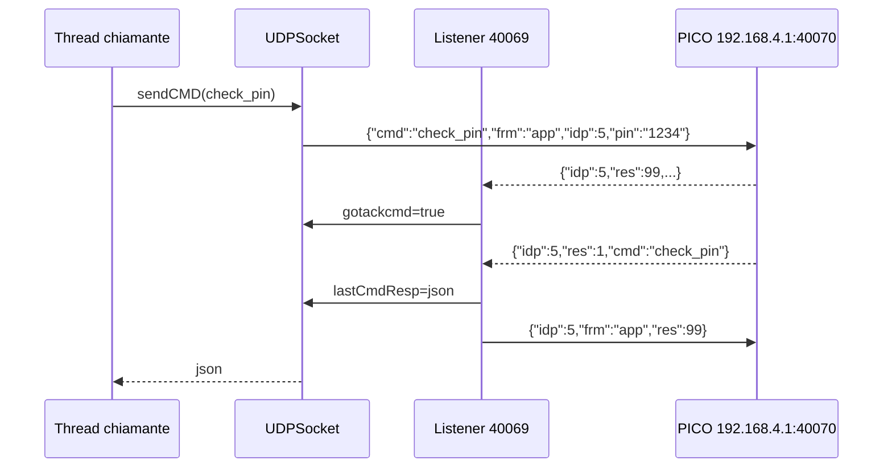

# Trasporto locale e protocollo (PICO)

Analisi della decompilazione JADX dell'app Tecnosystemi (`Export-Pico/sources/it/tecnosystemi/TS/`). Tutti i path sono relativi a quella directory. Marcatura: senza tag = letto nel codice; "(inferred)" = dedotto. Il decompilato di alcuni metodi e' degradato da JADX (segnalato dove rilevante).

Scope: solo PICO. Fuori scope (esistono nell'app, non analizzati qui): CU legacy via TCP (`MySocket`, `10.0.0.1:1235`), bootloader CU legacy (`MySocketBootLoader`), discovery UDP 5678 (`ThreadUDPServer`, mai avviato), helper di rete POLARIS (`Functions.netBinding`), cloud HTTP (`ThreadWebService`).

Altri documenti: `02-pico-runtime.md` (stato/comandi PICO a runtime), `03-provisioning.md` (config AP, scan_wifi, set pin), `04-firmware-ota.md` (ota_start + TCP 40060). Per lo stato lato libreria Python vedi `docs/retry-logic.md`, `docs/connection-lifecycle.md`, `docs/architecture.md`.

## Indice

1. [Mappa dei trasporti](#1-mappa-dei-trasporti)
2. [Risoluzione dell'IP del dispositivo](#2-risoluzione-dellip-del-dispositivo)
3. [UDP PICO: wire format](#3-udp-pico-wire-format)
4. [UDP PICO: macchina a stati idp/ack](#4-udp-pico-macchina-a-stati-idpack)
5. [Retry, timeout, overload di sendCMD](#5-retry-timeout-overload-di-sendcmd)
6. [Master vs slave](#6-master-vs-slave)
7. [Polling stato (sendGetStato)](#7-polling-stato-sendgetstato)
8. [Binding di rete Android (AP del PICO)](#8-binding-di-rete-android-ap-del-pico)
9. [TCP 40060 (pointer a 04)](#9-tcp-40060-pointer-a-04)
10. [Credenziali, PIN, cifratura](#10-credenziali-pin-cifratura)
11. [Costanti di trasporto](#11-costanti-di-trasporto)
12. [Quirk e bug visibili](#12-quirk-e-bug-visibili)
13. [Domande aperte](#13-domande-aperte)

---

## 1. Mappa dei trasporti

| Trasporto | Classe | Dest. | Porte | Uso |
|---|---|---|---|---|
| UDP JSON | `Commands/UDPSocket.java` | `192.168.4.1` (AP) o IP slave | invio 40070, ascolto 40069 (master) | tutto il runtime locale PICO |
| TCP raw | `Commands/PicoSocketBootloader.java` | `192.168.4.1` o IP slave | 40060 (`:17`) | upload firmware dopo `ota_start`, vedi 04 |

Scelta locale vs cloud: per PICO il flag `pico.getOffline()` (`Model/Pico.java:295`) decide. `Offline==true` = l'app e' collegata all'AP del dispositivo e usa UDP locale; `false` = usa il cloud via `ThreadWebService` (`GetPICOState?picoSerial=..&PIN=..`, `SendPicoCmd`; fuori scope). Esempio: `Activity/PICO/PicoActivity.java:846-872` (timer stato 5 s: ramo offline = UDP, ramo else = cloud) e `Activity/PICO/PicoCascataActivity.java:478-509` (`set_slave` via `UDPSocket.sendCMD` se offline, altrimenti `SendPicoCmd`, con `setSlave.setIdp(PicoActivity.getIDP())`). Il flag viene azzerato a `false` quando il dispositivo e' registrato nel cloud (`Activity/TS/TSDeviceListActivity.java:273-322`). Non esiste un percorso "UDP sulla LAN domestica" lato app: vedi sez. 2.

## 2. Risoluzione dell'IP del dispositivo

- `UDPSocket.ipDest` e' una static (`Commands/UDPSocket.java:33`), scritta solo in `startListening(z, z2, str)` (`:61-65`):
  - non slave: sempre `"192.168.4.1"` (IP fisso dell'AP del PICO).
  - slave: la stringa `str` passata dal chiamante.
- Nessuna discovery per PICO: ne' broadcast, ne' mDNS, ne' lettura dell'IP STA. L'app non apre mai UDP verso l'IP LAN del PICO. In modalita' LAN/STA usa il cloud.
- IP slave: arriva dalla risposta `get_slave` (`Activity/PICO/PicoCascataActivity.java:93-145`, `slave.setIp(jSONObject2.getString("ip"))`, `:145`) e viene passato a `PicoBootloaderActivity` via Intent extra `IPSLAVE`/`ISSLAVE` (`PicoCascataActivity.java:366-367,384-385`; letto in `PicoBootloaderActivity.java:87-88`). L'app resta sulla rete AP del master; gli slave sono raggiunti sull'IP che il master riporta (inferred: sottorete dell'AP del master).
- Per raggiungere `192.168.4.1` l'app deve essere agganciata alla SSID del dispositivo: `Pico_<serial>` con password `TS_<serial>` (`Activity/PICO/PicoActivity.java:2103-2104`, costanti `Utils/Constants.java:277,279,286,288`). Config: `Pico_config`/`12345678`. Dettaglio sez. 8.
- `UDPSocket.isConnected()` (`:359-365`): `InetAddress.getByName(ipDest).isReachable(2000)`. Su Android non-root il probe e' ICMP o TCP echo (inferred); usato come check di liveness da `PicoActivity` (`:847,1642,2109`).

## 3. UDP PICO: wire format

Trasporto: datagramma UDP, payload = JSON UTF-8 serializzato con Gson (`gson.toJson(cmdPICO)`, `UDPSocket.java:255`), nessun framing, nessun terminatore. Nessuna cifratura/firma (PIN in chiaro).

Envelope richiesta (`Commands/CmdPICO.java:17-20`, campi privati serializzati da Gson):

```json
{"cmd":"check_pin","frm":"app","idp":7,"pin":"1234"}
```

| Campo | Tipo | Semantica |
|---|---|---|
| `cmd` | string | nome comando (`check_pin`, `stato_sync`, `scan_wifi`, `get_slave`, `pico_info`, `ota_start`, `ota_end`, `pico_ap`, ... ; classi in `CmdPICO`, altre aree) |
| `frm` | string | sempre `"app"` |
| `idp` | long | assegnato da `sendCMD`/`sendGetStato` dal contatore statico, vedi sez. 4 |
| `pin` | string | PIN del dispositivo (da `Pico.getPin()`); puo' essere `null` e Gson omette i `null` (inferred: Gson default non serializza null) |

`Commands/CmdPICO.java:16-20` (`frm` ha default `"app"`; le sottoclassi aggiungono campi flat allo stesso oggetto, dettaglio dei payload in 02-04):

```java
public class CmdPICO {
    private String cmd;
    private String frm = "app";
    private long idp;
    private String pin;
```

ACK app -> dispositivo (costruito a mano con `JSONObject`; esiste anche `CmdPICO.ACK` (`:22-26`), non usato qui):

```json
{"idp":7,"frm":"app","res":99}
```

`Commands/UDPSocket.java:166-172` (l'ACK e' un `JSONObject` inviato via `sendCMD` con `z2=true`, cioe' "invio raw", senza attesa di risposta):

```java
private static void sendAk(long j, String str) {
    try {
        JSONObject jSONObject = new JSONObject();
        jSONObject.put(idpkJson, j);
        jSONObject.put("frm", "app");
        jSONObject.put(resJson, 99);
        sendCMD(null, 5000L, 5000L, true, 1, true, jSONObject);
```

Risposta dispositivo (letta con `org.json`): `{"idp":N,"res":R,"cmd":"...", ...campi specifici}`. Parsing in `parsemsg` (`:117-155`):

- `res == 99`: ACK del dispositivo alla nostra richiesta (non va riacknowledged).
- `res != 99`: risposta vera. Convenzione osservata dai chiamanti: `res == 1` = OK (es. `PicoActivity.java:1636`, `PicoBootloaderActivity.java:308`, `Constants.JSON_RES="res"` `:185`). Altri codici: non enumerati in questo layer.
- Buffer di ricezione 1500 byte (`ConnectionResult.DRIVE_EXTERNAL_STORAGE_REQUIRED`, costante GMS = 1500, inferred dal valore noto). La stringa viene creata con `new String(buf, 0, 1500)` (`:98`), non con la lunghezza del pacchetto: il JSON e' seguito da NUL. `new JSONObject(String)` di Android tollera il trailing (inferred). Risposte > 1500 B vengono troncate.

`Commands/UDPSocket.java:94-98` (ricezione: buffer fisso, stringa sempre di 1500 caratteri):

```java
while (UDPSocket.keeplistening && UDPSocket.socketListen != null) {
    try {
        byte[] bArr = new byte[ConnectionResult.DRIVE_EXTERNAL_STORAGE_REQUIRED];
        UDPSocket.socketListen.receive(new DatagramPacket(bArr, ConnectionResult.DRIVE_EXTERNAL_STORAGE_REQUIRED));
        UDPSocket.parsemsg(new String(bArr, 0, ConnectionResult.DRIVE_EXTERNAL_STORAGE_REQUIRED));
```

Porta di risposta (confermato): il PICO risponde sempre alla UDP 40069, qualunque sia la porta sorgente del mittente. Il socket di invio dell'app usa una porta effimera (`new DatagramSocket()`, `:262`), quindi il listener deve essere legato a 40069 per vedere le risposte (vedi sez. 6 per lo slave).

## 4. UDP PICO: macchina a stati idp/ack

Stato globale (tutto `static`, non volatile, senza lock): `idp` (contatore, init 1), `statoIdp` (lista sincronizzata degli idp di `stato_sync` pendenti), `lastCmdIdp`, `lastCmdResp`, `gotackcmd`, `gotackstato` (scritto, mai letto altrove: codice morto), `lastcmd`.

Regole:

1. `sendCMD` (non-ACK): a ogni tentativo `cmd.idp = idp++` (`:242-246`). Quindi un retry usa un idp nuovo, non lo stesso. `lastCmdIdp = idp`, `lastCmdResp = null`, `gotackcmd = false`.

   `Commands/UDPSocket.java:242-260`:

   ```java
   if (!z2) {
       long j3 = idp;
       idp = 1 + j3;
       cmdPICO.setIdp(j3);
   }
   // ...
   if (z2) {
       bytes = jSONObject.toString().getBytes();
   } else {
       bytes = gson.toJson(cmdPICO).getBytes();
       lastcmd = cmdPICO.getCmd();
       lastCmdIdp = cmdPICO.getIdp();
       lastCmdResp = null;
       gotackcmd = z3;
   }
   ```
2. `sendGetStato`: `idp++`, push in `statoIdp`, fire-and-forget (sez. 7).
3. Listener, per ogni datagramma, un nuovo `Thread` (`parsemsg`):
   - `idp` in `statoIdp`: se `res==99` -> `gotackstato=true`; altrimenti rimuove l'idp e chiama `PicoActivity.receiveStato(json)` se `statoActivity` e' una `PicoActivity`.
   - `idp == lastCmdIdp`: `res==99` -> `gotackcmd=true`; altrimenti `lastCmdResp=json`.
   - Qualsiasi altro idp: scartato (ma vedi sotto, viene comunque ack-ato).
   - Se il messaggio ha `res` e `res != 99`: `sendAk` (invia `{idp,frm:"app",res:99}`). Gli ACK del dispositivo non vengono mai ri-ackati.

   `Commands/UDPSocket.java:124-148` (`parsemsg`, ridotto):

   ```java
   if (jSONObject.has(UDPSocket.idpkJson)) {
       long j = jSONObject.getLong(UDPSocket.idpkJson);
       if (UDPSocket.statoIdp.contains(Long.valueOf(j))) {
           if (jSONObject.has(UDPSocket.resJson)) {
               if (jSONObject.getLong(UDPSocket.resJson) == 99) {
                   UDPSocket.gotackstato = true;
               } else {
                   UDPSocket.statoIdp.remove(Long.valueOf(j));
                   // ... receiveStato(jSONObject.toString()) se PicoActivity
               }
           }
       } else if (j == UDPSocket.lastCmdIdp) {
           if (jSONObject.getLong(UDPSocket.resJson) == 99) {
               UDPSocket.gotackcmd = true;
           } else {
               UDPSocket.lastCmdResp = jSONObject.toString();
           }
       }
       if (!jSONObject.has(UDPSocket.resJson) || jSONObject.getLong(UDPSocket.resJson) == 99) {
           return;
       }
       UDPSocket.sendAk(jSONObject);
   ```
4. `sendAk(JSONObject)` (`:158-164`) chiama `jSONObject.getString("cmd")` anche se il valore non viene usato (il secondo parametro di `sendAk(long, String)` e' ignorato, `:166-172`): se la risposta del dispositivo non contiene `cmd`, lancia `JSONException` -> `RuntimeException`, catturata dal `catch (Exception)` di `parsemsg` (`:150`); l'ACK non parte (inferred: dispositivi che omettono `cmd` non ricevono ACK).
5. `sendCMD` blocca in polling a passi di 100 ms:
   - `lastCmdResp != null` -> ritorna la stringa JSON.
   - ACK ricevuto: se `ackOnly` ritorna `"OK"`; altrimenti attende risposta fino a `j` ms dall'invio e poi esce (forzando `i2=3`, nessun ulteriore retry) con `null`.
   - nessun ACK entro `j2` ms -> prossimo tentativo (con restart del listener).

   `Commands/UDPSocket.java:284-311` (z=ackOnly, j=timeout risposta, j2=timeout ACK):

   ```java
   Date date = new Date();
   boolean z4 = true;
   while (z4) {
       String str = lastCmdResp;
       if (str != null) {
           lastcmd = null;
           lastCmdIdp = -1L;
           return str;
       }
       try {
           Thread.sleep(100L);
       } catch (Exception unused) {
       }
       if (gotackcmd) {
           if (z) {
               return "OK";
           }
           if (new Date().getTime() - date.getTime() > j) {
               i2 = 3;
               z4 = false;
           } else {
               i2 = 3;
           }
       } else if (new Date().getTime() - date.getTime() > j2) {
           z4 = false;
       }
   }
   i2++;
   ```

```mermaid
stateDiagram-v2
    [*] --> Idle
    Idle --> Sending: sendCMD: idp++, lastCmdIdp=idp, lastCmdResp=null, gotackcmd=false
    Sending --> WaitAck: datagram sent (socket connected to ipDest:port)
    WaitAck --> GotAck: device {idp==lastCmdIdp,res:99}
    WaitAck --> Done: device response first (res!=99) lastCmdResp set
    WaitAck --> Retry: now-start > ackTimeout (j2) and attempts left
    WaitAck --> Failed: now-start > j2 and attempts exhausted
    GotAck --> Done: ackOnly -> return "OK"
    GotAck --> WaitResp: not ackOnly
    WaitResp --> Done: lastCmdResp != null
    WaitResp --> Failed: now-start > cmdTimeout (j), NO retry (i2=3)
    Retry --> Sending: stopListening(500ms)+sleep 100+startListening(true), NEW idp
    Done --> [*]: return json / "OK"; app sends ACK{idp,frm:app,res:99} for res!=99
    Failed --> [*]: return null (lastCmdIdp=-1)
```

Ordine di arrivo: la risposta puo' precedere l'ACK; viene comunque restituita (il check `lastCmdResp` e' prioritario). Risposte tardive di un tentativo precedente (idp diverso da `lastCmdIdp`) sono ignorate, ma ack-ate.



## 5. Retry, timeout, overload di sendCMD

Firma reale: `sendCMDAsink(cmd, j, j2, z, i, z2, json)` (`:228`); `j`=timeout risposta dopo ACK, `j2`=timeout ACK, `z`=ackOnly, `i`=tentativi, `z2`=modalita' "invio raw JSON" (usata solo per gli ACK app).

| Overload | j | j2 | z | i | Note |
|---|---|---|---|---|---|
| `sendCMD(cmd)` | 5000 | 5000 | false | 3 | default (`:204`) |
| `sendCMD(cmd, j)` | j | 5000 | false | 3 | (`:208`) |
| `sendCMD(cmd, j, j2)` | j | j2 | false | 3 | es. `scan_wifi` 10000/1500 (`Activity/PICO/Config/ChooseWifiPICOActivity.java:143`); `ota_start` 15000/15000 (`PicoBootloaderActivity.java:304`) |
| `sendCMD(cmd, j, j2, z)` | j | j2 | **false sempre** | 3 | il parametro `z` e' ignorato: `return sendCMD(cmd, j, j2, false, 3)` (`:216-218`) |
| `sendCMD(cmd, j, j2, z, i)` | j | j2 | z | i | unico modo di ottenere ackOnly; es. `pico_info` 15000/15000/false/1 (`PicoBootloaderActivity.java:120,129`) |

`Commands/UDPSocket.java:216-222` (il 4-arg scarta `z`):

```java
public static synchronized String sendCMD(CmdPICO cmdPICO, long j, long j2, boolean z) {
    return sendCMD(cmdPICO, j, j2, false, 3);
}

public static synchronized String sendCMD(CmdPICO cmdPICO, long j, long j2, boolean z, int i) {
    return sendCMD(cmdPICO, j, j2, z, i, false, null);
}
```

Conseguenza: la chiamata `sendCMD(picoAP, 10000L, 10000L, true)` (`PicoBootloaderActivity.java:343`) NON e' in ack-only; attende la risposta o fallisce con `null` dopo 10 s (nel flusso OTA il reset avviene comunque lato dispositivo, il risultato non e' usato). Vedi 04.

Tempi:
- Un tentativo: fino a `j2` senza ACK; con ACK fino a `j` dall'invio.
- Peggior caso senza ACK, default: 3 x 5 s + 2 x (500 ms stop + 100 ms sleep) ~ 16,2 s. Con 15000/15000: ~46,2 s.
- Ogni retry chiama `stopListening()` (500 ms di sleep dentro, `:194`) + `startListening(true, isSlave, ipDest)`, che ricrea anche `statoIdp` vuota (`:60`): eventuali `stato_sync` pendenti vengono dimenticati.
- Poll del listener: `SO_TIMEOUT` 1000 ms (`:93`).
- Invio: `datagramSocketSend` riusato; `connect()` fino a 5 prove da 100 ms (`:270-278`); eccezione -> `datagramSocketSend` azzerato e ritorno `null` (`:314-324`) senza ulteriori tentativi.
- Serializzazione: `sendCMD` a 1-5 argomenti e' `synchronized` (lock sulla classe); `sendCMD` a 7 argomenti e `sendGetStato` no. Gli ACK passano dal 7-arg, quindi possono scrivere sul socket concorrentemente a un comando in corso (UDP, innocuo di per se').
- Pattern di retry a livello chiamante: `PicoActivity.checkPin` (`:1606-1651`): `startListening()`, sleep 100, `sendCMD(check_pin)`; se `null` -> `stopListening()`, sleep 2000, `startListening()`, sleep 100, secondo `sendCMD` (cioe' fino a 6 invii e idp nuovi); se ancora `null` e `!isConnected()` -> toast `connectToPolaris` + `reconnect()` (sez. 8); altrimenti `showGetPin()` (PIN errato/assente).
- Esito `check_pin` OK: `res == 1` -> `startStatoTimer()`.

`Activity/PICO/PicoActivity.java:1619-1648` (retry a livello chiamante, ridotto):

```java
String strSendCMD = UDPSocket.sendCMD(cmdPICO);
if (strSendCMD == null) {
    UDPSocket.stopListening();
    // Thread.sleep(2000L) ...
    UDPSocket.startListening();
    // Thread.sleep(100L) ...
    strSendCMD = UDPSocket.sendCMD(cmdPICO);
}
if (strSendCMD != null) {
    try {
        JSONObject jSONObject = new JSONObject(strSendCMD);
        if (jSONObject.has(Constants.JSON_RES) && jSONObject.getInt(Constants.JSON_RES) == 1) {
            PicoActivity.this.startStatoTimer();
            return;
        }
    } catch (Exception unused4) {
    }
} else if (!UDPSocket.isConnected()) {
    // ... toast connectToPolaris
    PicoActivity.this.reconnect();
    return;
}
PicoActivity.this.hideProgress();
PicoActivity.this.showGetPin();
```

## 6. Master vs slave

`startListening(boolean force, boolean slave, String ip)` (`:56`):

| | Master (default) | Slave (`isSlave=true`) |
|---|---|---|
| `ipDest` | `192.168.4.1` | `ip` argomento |
| porta di invio | 40070 (`portaDest`) | 40069 (`portaRead`) (`:264-268`) |
| porta di ascolto (bind) | 40069 (`portaRead`) | 40070 (`portaDest`) (`:88-92`) |
| Chiamanti | quasi tutti | solo `PicoBootloaderActivity` con `isSlave` (`:116,125,300,330`), per `pico_info`, `ota_start`, `ota_end` verso lo slave |

`Commands/UDPSocket.java:88-92` (bind del listener) e `:264-268` (porta di destinazione dell'invio):

```java
if (UDPSocket.isSlave) {
    UDPSocket.socketListen = new DatagramSocket(UDPSocket.portaDest, iPAddress);
} else {
    UDPSocket.socketListen = new DatagramSocket(UDPSocket.portaRead, iPAddress);
}
// ...
if (isSlave) {
    datagramPacket = new DatagramPacket(bytes, bytes.length, byName, portaRead);
} else {
    datagramPacket = new DatagramPacket(bytes, bytes.length, byName, portaDest);
}
```

Cioe' in slave mode l'app inverte i ruoli delle porte. Nota: dato che il PICO risponde sempre a 40069 (sez. 3), in slave mode il listener su 40070 vede le risposte solo se il firmware slave risponde a 40070 (inferred: non verificato; il codice dell'app non lo chiarisce). Il valore di `isSlave` e' una static scritta da `startListening`: la chiamata `startListening()` / `startListening(true)` successiva lo riporta a `false` (`startListening(true)` -> `startListening(true,false,null)`), per cui qualsiasi altra activity che avvia il listener "normale" mentre un flusso slave e' in corso cambia modalita' sotto i piedi (vedi sez. 12). Nei retry interni `sendCMD` ripassa `isSlave, ipDest` correnti (`:240`), quindi il flag e' stabile durante un singolo comando.

Il listener e' associato a `Functions.getIPAddress(true)` (`Utils/Functions.java:166-187`): primo indirizzo IPv4 non-loopback del primo `NetworkInterface` che ne ha uno. Se `null`, `new DatagramSocket(port, null)` si lega al wildcard (inferred).

## 7. Polling stato (sendGetStato)

Trigger: `PicoActivity.startStatoTimer()` (`:803-876`): `Timer.schedule(task, 0, 5000)`.

Ramo `pico.getOffline()==true` (locale), dentro il task:
1. `!UDPSocket.isConnected()` (ping 2 s): se sono passati > 10 s dall'ultimo retry (`lastRetry`) -> `showProgress()`, `stopListening()`, `reconnect()` (sez. 8) e `return`.
2. altrimenti `startListening()` (ricrea sempre listener e `statoIdp`, vedi sez. 12 punto 1), sleep 500 ms, `sendGetStato(pin)`.

`sendGetStato(pin)` (`UDPSocket.java:327-353`): `{"cmd":"stato_sync","frm":"app","idp":N,"pin":"..."}` su un `new DatagramSocket()` mai chiuso (fd leak ogni 5 s, inferred dal codice: nessun `close()`), idp registrato in `statoIdp`, nessuna attesa. La risposta (res != 99) arriva sul listener e passa a `PicoActivity.receiveStato(String)` (`:779`) -> `pico.receivedSync(json)` + `updateView()` (eseguiti sul thread di `parsemsg`; `runOnUiThread` solo per `updateStatoLabel`). L'ACK dell'app e' generato automaticamente dal listener.

`Activity/PICO/PicoActivity.java:846-866` (ramo locale del timer):

```java
if (PicoActivity.pico.getOffline().booleanValue()) {
    if (!UDPSocket.isConnected()) {
        if (PicoActivity.this.lastRetry == null) {
            PicoActivity.this.lastRetry = new Date();
        }
        if (new Date().getTime() - PicoActivity.this.lastRetry.getTime() > 10000) {
            PicoActivity.this.lastRetry = new Date();
            PicoActivity.this.showProgress();
            UDPSocket.stopListening();
            PicoActivity.this.reconnect();
            return;
        }
        return;
    }
    UDPSocket.startListening();
    // Thread.sleep(500L) ...
    UDPSocket.sendGetStato(PicoActivity.pico.getPin());
    return;
}
```

`Commands/UDPSocket.java:330-347` (`sendGetStato`, ridotto: socket nuovo a ogni chiamata, nessuna attesa):

```java
CmdPICO cmdPICO = new CmdPICO();
cmdPICO.setPin(str);
long j = idp;
idp = 1 + j;
cmdPICO.setIdp(j);
cmdPICO.setCmd("stato_sync");
String json = new Gson().toJson(cmdPICO);
// ...
statoIdp.add(Long.valueOf(cmdPICO.getIdp()));
InetAddress byName = InetAddress.getByName(ipDest);
DatagramSocket datagramSocket = new DatagramSocket();
// ...
datagramSocket.send(datagramPacket);
return null;
```

Watchdog: se `lastReceivedStato` e' piu' vecchio di 15 s -> toast errore (`zone_errors[5]`) e imposta `pico.err=[[10004]]` (`PicoActivity.java:826-838`), ripetuto al massimo ogni 15 s.

Un solo `stato_sync` per tick: se si accoda un comando (es. `sendCmdDataOraTImezone` `:1527`, `sendCmdUpdPico` `:1557`) mentre e' pendente uno stato, i due idp sono distinti; `picoCMD` (flag, impostato a `true` prima di `sendCMD`) fa scartare il prossimo stato ricevuto per evitare di sovrascrivere la UI (`receiveStato`, `:788-791`: `if (picoCMD) {picoCMD=false; return;}`; `lastReceivedStato` viene comunque aggiornato prima, `:787`).

## 8. Binding di rete Android (AP del PICO)

Problema: l'AP del PICO non ha Internet, Android tenderebbe a instradare su dati mobili. Soluzione dell'app: agganciare la SSID e fare `ConnectivityManager.bindProcessToNetwork(network)` (tutti i socket del processo, UDP compreso). `UDPSocket` non fa `bindSocket` (nessun `tobindnet`, verificato): si affida interamente al binding di processo. `PicoSocketBootloader` (TCP 40060, vedi 04) fa in piu' `network.bindSocket(socket)` con `tobindnet` (`PicoSocketBootloader.java:19,42-45`).

Flusso `BaseActivity.connectToWifi(...)` -> thread -> `connectToWifi_` (`Activity/BaseActivity.java:1556-1576`). Trigger: `PicoActivity.reconnect()` (`:2097-2136`); imposta le static `toConnSid`/`toConnPwd`.

1. `manualconn` gia' true: chiama subito il runnable e basta (`:1583-1594`).
2. GPS (`LocationManager.isProviderEnabled("gps")`) richiesto, salvo flag `z2` (`:1595`); permesso `ACCESS_FINE_LOCATION` richiesto una volta.
3. SSID corrente == `toConnSid`: "GIA' CONNESSO": `bindProcessToNetwork(getCurrentWifiNetwork())` + `tobindnet` (`:1600-1618`), eccetto `BootloaderActivity` su SDK >= 34. `getCurrentWifiNetwork` (`:1565-1574`) = primo `Network` con `TRANSPORT_WIFI` (`hasTransport(1)`), non necessariamente quello della SSID richiesta (inferred: ambiguo con piu' Wi-Fi).
4. SDK >= 29: `WifiNetworkSpecifier` (`:1680-1720`):
   - Wi-Fi spento -> apre pannello `android.settings.panel.action.WIFI` e termina.
   - SDK >= 31 cerca il BSSID da `getScanResults()`; altrimenti `startScan()` e attende `SCAN_RESULTS` fino a ~16 s (`i>15`, `sleep 1000`, `:1697-1706`).
   - `setSsid`, `setBssid` (se noto), `setWpa2Passphrase(toConnPwd)` (`:1709-1713`).
   - `NetworkRequest`: `TRANSPORT_WIFI` (1), `removeCapability(12)` (= `NET_CAPABILITY_INTERNET`), specifier (`:1715-1719`); `requestNetwork(req, cb, 120000)` (timeout 120 s, inferred: chiamata dopo `:1760`).
   - `onAvailable(network)`: `mHandler.postDelayed(AvaiableNetwork, 10 ms)` (`:1760`); `AvaiableNetwork` (`:1891-1922`) fa `bindProcessToNetwork(network)`, setta `tobindnet`, `connected=true` ed esegue il runnable chiamante. Per `BootloaderActivity` su SDK >= 34 binding diverso (`:1739-1744`).
   - `onLost`: dipende dall'activity in primo piano. Per `PicoActivity`: fino a 4 tentativi (`onlost > 3`, `:1801`), attende 2 s, richiama `connectToWifi` con runnable `UDPSocket.resetIDP(); stopListening(); startListening(true)` (`:1818-1827`).
   - `onUnavailable`: runnable di errore o toast `msg_error`.
5. SDK < 29: API legacy `WifiManager`: `addNetwork`/`enableNetwork`/`reconnect` con config `priority=999999` (`buildWifiConfig`, `:1955-1961`), registra `WifiChangeBroadcastReceiver` su `android.net.wifi.STATE_CHANGE`, timer di 30 s per `errorcollWifi()` se non connesso (`:1885`).

`Utils/WifiChangeBroadcastReceiver.java`: wrapper che delega a `BaseActivity.onWifiChangeBroadcastReceived` (`:1963-1976`): confronta `wifiInfo.getSSID()` con `"\"" + toConnSid + "\""`; se uguale -> `bindProcessToNetwork()` (`:1970`) e `connected=true` + runnable. Attenzione: il metodo di `BaseActivity` chiamato `bindProcessToNetwork()` NON chiama `ConnectivityManager.bindProcessToNetwork`: aggiorna solo `MySocket.tobindnet` (`:1990-1993`, quirk; `MySocket` e' legacy, quindi su SDK < 29 nessun binding per PICO; e' sufficiente il Wi-Fi come unica rete (inferred)). Il receiver viene deregistrato in `onStop` (`:1925-1931`).

Unbinding: `BaseActivity.unbidNetwork()` (`:1995-2007`) azzera `tobindnet` di `MySocket` e `MySocketBootLoader` ma non di `PicoSocketBootloader` (resta stale) e fa `bindProcessToNetwork(null)`. `disconnectFromWIfi()` (`:1933-1953`): SDK < 29 rimuove la rete; altrimenti `unregisterNetworkCallback` + `bindProcessToNetwork(null)`.

Ciclo di reconnect PICO (`PicoActivity.reconnect`, `:2097-2136`), per riferimento: `times++`; SSID `Pico_<serial>` (`Constants.WIFI_NAME_OFFLINE_PICO`), pwd `TS_<serial>`; runnable successo: se `firstCheck` e (`!isConnected()` e `times>1`) -> `disconnectFromWIfi()`, `times=0`; altrimenti `resetIDP()`, `startListening(true)`, `startStatoTimer()`. Prima volta: `resetIDP(); startListening(true); checkPin()`.

Fuori scope: `Functions.netBinding` (filtro SSID `POLARIS`, nessun chiamante) e il pre-check `MySocket.checkPinCmd` per le activity CU legacy.

## 9. TCP 40060 (pointer a 04)

`PicoSocketBootloader` (TCP raw): `connectToSocket(ip)`: `ip==null` -> `192.168.4.1`; `Socket()`, `tobindnet.bindSocket`, `connect(ip:40060, 10000 ms)` (`PicoSocketBootloader.java:25-51`); `sendfile(bytes)` = `write + flush`, nessuna lettura di risposta, nessun ACK applicativo (`:53-65`). Chiamante e chunking (1300 B, 20 ms) in `PicoBootloaderActivity.java:313-324`; flusso completo in `04-firmware-ota.md`.

Fuori scope: `MySocket` (TCP `10.0.0.1:1235`, CU legacy), `MySocketBootLoader` (bootloader CU legacy), `ThreadUDPServer` (UDP 5678, mai avviato, `parseUdpMessage` e' uno stub), `Model/Response.java` (POJO HTTP cloud).

## 10. Credenziali, PIN, cifratura

- PIN locale: in chiaro nel JSON UDP (`pin`). Nessuna cifratura di trasporto, nessun challenge. Il PIN del PICO e' salvato in `PREF_PICO_DEVS` (`"PICODevs"`, `Utils/Constants.java:217`, JSON array con `Name`, `Serial`, `Pin`, `Offline`, `IP`... `Model/Pico.java:510-606`).
- `SavePreferences` (`Utils/SavePreferences.java`): wrapper su `com.securepreferences.SecurePreferences`, file `appProAirPref.xml`, password hard-coded `"proAirprefpwd12345"`, salt = `ANDROID_ID` (10000 iterazioni, `:22`; variante senza salt `:24`). Cifra chiavi/valori a riposo, ma la chiave e' derivabile dall'APK + `ANDROID_ID`.
- `AESCrypt`/`AESAlgorithm`: usati solo per la password dell'account cloud; non usati nel trasporto locale.
- Password Wi-Fi AP: derivate dal serial (`TS_<serial>`) o fisse (`Pico_config`/`12345678`): `Utils/Constants.java:277-288`.

## 11. Costanti di trasporto

| Costante | Valore | Dove |
|---|---|---|
| `portaDest` / `portaRead` | 40070 / 40069 | `UDPSocket.java:40-41` |
| `ipDest` default | `192.168.4.1` | `:33` |
| `DEFTIMEOUTACK` / `DEFTIMEOUTCMD` | 5000 ms | `:24-25` |
| ack code | `res == 99` | `:128,138,145` |
| listener `SO_TIMEOUT` | 1000 ms | `:93` |
| buffer ricezione | 1500 B | `:96-97` |
| poll sendCMD | 100 ms | `:294` |
| retry default | 3 | `:217` |
| `stopListening` sleep | 500 ms | `:194` |
| stato timer | 5000 ms | `PicoActivity.java:875` |
| watchdog stato | 15000 ms | `PicoActivity.java:826` |
| `isReachable` | 2000 ms | `UDPSocket.java:361` |
| TCP OTA | `192.168.4.1:40060`, connect 10000 | `PicoSocketBootloader.java:13,16-17` |
| chiavi JSON | `cmd`, `idp`, `res`, `frm`, `pin` (UDP) | `UDPSocket.java:26,32,42` |
| SSID/pwd | `Pico_`/`TS_`, `Pico_config`/`12345678` | `Constants.java:277-288` |

## 12. Quirk e bug visibili

Trasporto UDP:
1. `islistening` non viene mai impostato a `true` (solo assegnazioni a `false`, `:100,106,181`): il guard `if (!islistening || z)` in `startListening` e' sempre vero (`:58`). Ogni chiamata ricrea thread, socket e `statoIdp`. Interagisce male col timer stato: `startStatoTimer` chiama `startListening()` ogni 5 s (`PicoActivity.java:860`), cancellando gli idp stato pendenti e chiudendo/riaprendo il socket 40069 mentre una risposta puo' essere in volo.
2. Race su static non protette: `idp`, `lastCmdIdp`, `lastCmdResp`, `gotackcmd`, `isSlave`, `ipDest`, `datagramSocketSend`, `socketListen` sono letti/scritti da UI thread, timer, thread di `parsemsg` (uno per datagramma) senza `volatile`/lock; `sendGetStato` (timer) e `sendCMD` (UI) incrementano `idp` senza sincronizzazione comune (`sendGetStato` non e' `synchronized`): possibile idp duplicato (inferred). `statoIdp` e' sostituita (non svuotata) da `startListening`/`resetIDP`.
3. Thread lettore accumulabili (inferred): il vecchio thread non termina con `interrupt()` (non interrompe `receive`); su `SocketException` (chiusura del vecchio socket) resta nel loop `while (keeplistening && socketListen != null)` e continua a leggere il NUOVO `socketListen`. Chiamate ravvicinate a `startListening` -> piu' lettori sullo stesso socket -> `parsemsg` doppi -> ACK duplicati e doppia consegna di `receiveStato`.
4. `BindException` sul 40069 (secondo processo/lettore che non ha ancora rilasciato) e' ingoiata (`catch Exception unused5`, `:107`): listener morto in silenzio, `sendCMD` poi va in timeout.
5. `datagramSocketSend` e' `connect()`-ato al primo destinatario e mai riconnesso: cambiando `ipDest` (master -> slave) un `send` verso indirizzo diverso da un `DatagramSocket` connesso lancia `IllegalArgumentException` (inferred: comportamento JDK), catturata -> socket azzerato e `sendCMD` ritorna `null`; funziona al tentativo successivo. L'ACK e i comandi partono dalla porta effimera di questo socket, non da 40069: irrilevante, il PICO risponde sempre a 40069 (confermato), indipendentemente dalla porta sorgente.
6. `sendGetStato` crea un `DatagramSocket` a ogni chiamata e non lo chiude (leak fd, 12/min).
7. `sendCMD(..., z)` a 4 argomenti ignora `z` (ackOnly mai attivo da quei call site).
8. ACK dipende dalla presenza di `cmd` nella risposta (sez. 4 punto 4).
9. Retry = nuovo idp: un comando non idempotente (es. `upd_pico`, `set_slave`) puo' essere eseguito piu' volte se la risposta si perde; `res` del tentativo precedente viene scartata. Inoltre il polling dopo ACK conta il timeout `j` dall'invio, non dall'ACK, e non ritenta (`i2=3`).
10. `gotackstato`, `lastcmd` (letto solo internamente) e il campo `CmdPICO.ACK` non hanno effetto: residui.
11. Listener su `getIPAddress(true)` = primo IPv4 non-loopback in ordine di enumerazione, che puo' essere l'interfaccia mobile; con `bindProcessToNetwork` attivo il socket di invio va sul Wi-Fi ma l'indirizzo di bind del listener potrebbe non appartenere alla rete AP (inferred; su dispositivi comuni `wlan0` e' spesso la prima).
12. `isSlave` globale: qualunque `startListening()` generico (stato timer in `PicoActivity`) riporta a master mentre una schermata slave e' aperta.
13. `isReachable` come liveness puo' dare falsi negativi sugli AP (ICMP bloccato).

Rete:
14. `BaseActivity.bindProcessToNetwork()` (nome fuorviante) non lega il processo; `unbidNetwork` dimentica `PicoSocketBootloader.tobindnet`.
15. `connectToWifi_` seleziona la "rete Wi-Fi corrente" come primo `TRANSPORT_WIFI` di `getAllNetworks()`.

## 13. Domande aperte

- Elenco completo dei valori di `res` oltre 1/99: non nel livello trasporto, verificare in 02.
- Nessun idp-sync lato app: `resetIDP()` riporta a 1 ad ogni (ri)connessione; il firmware lo tollera o richiede monotonia? Confronta con `docs/retry-logic.md` (lato Python il drift di IDP blocca i comandi).
- Comportamento reale di `Functions.getIPAddress(true)` quando sono attive piu' interfacce (cellulare + Wi-Fi) in presenza di `bindProcessToNetwork`.
- Slave: la rete su cui l'IP slave e' raggiungibile (stessa subnet 192.168.4.0/24 dell'AP master?) non e' esplicitata nel codice.
