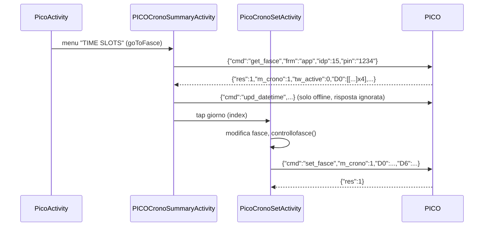
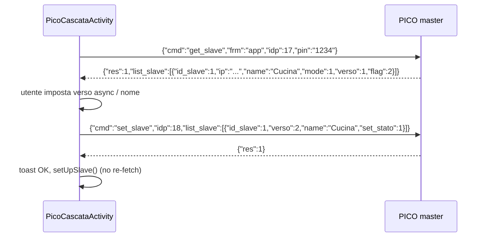

# PICO: controllo runtime

Scope: Activity PICO (`PicoActivity`, `PicoCascataActivity`, `PicoCronoSetActivity`, `PICOCronoSummaryActivity`), modelli `Pico`, `PICOCronoObj`, adapter `PICOCronoSummaryAdapter`.
Trasporto UDP, envelope `CmdPICO`, ACK (`res=99`), retry/timeout di `sendCMD`: vedi [01-transport.md](01-transport.md) (qui solo richiamati). Provisioning/config: [03-provisioning.md](03-provisioning.md). OTA/bootloader: [04-firmware-ota.md](04-firmware-ota.md). Scope solo PICO.

Convenzioni: path relativi a `Export-Pico/sources/it/tecnosystemi/TS/`. Sigle: `PA` = `Activity/PICO/PicoActivity.java`, `PC` = `Activity/PICO/PicoCascataActivity.java`, `PS` = `Activity/PICO/PicoCronoSetActivity.java`, `PM` = `Activity/PICO/PICOCronoSummaryActivity.java`, `CP` = `Commands/CmdPICO.java`, `UD` = `Commands/UDPSocket.java`, `MP` = `Model/Pico.java`, `MO` = `Model/PICOCronoObj.java`, `TW` = `Threads/ThreadWebService.java`, `BA` = `Activity/BaseActivity.java`. Stringhe: `Export-Pico/resources/res/values/strings.xml` (EN) e `arrays.xml`. "(inferred)" = dedotto, non letto esplicitamente.

## Indice

1. [Modello mentale: locale vs cloud](#1-modello-mentale-locale-vs-cloud)
2. [Apertura device, connessione, polling `stato_sync`](#2-apertura-device-connessione-polling-stato_sync)
3. [Stato device: parsing `receiveStato` / `Pico.receivedSync`](#3-stato-device-parsing)
4. [Comandi runtime `upd_pico` (on/off, mode, speed, umidita, night, led, manutenzione, m_crono)](#4-comandi-runtime-upd_pico)
5. [Enum `mod` e mappa UI](#5-enum-mod-e-mappa-ui)
6. [Data/ora: `upd_datetime`](#6-dataora-upd_datetime)
7. [Cronotermostato: `get_fasce` / `set_fasce`](#7-fasce-orarie-get_fasce--set_fasce)
8. [Cascata master/slave: `get_slave` / `set_slave`](#8-cascata-masterslave-get_slave--set_slave)
9. [Varianti `upd_P6X`](#9-varianti-upd_p6x)
10. [Stato persistito (SharedPreferences)](#10-stato-persistito)
11. [Anomalie osservate e domande aperte](#11-anomalie-osservate-e-domande-aperte)

---

## 1. Modello mentale: locale vs cloud

Ogni flusso PICO ha due rami decisi da `Pico.isOffline` (`MP:47`, getter `getOffline()`), non da una scelta runtime:

| `pico.getOffline()` | Trasporto | Note |
|---|---|---|
| `true` ("offline") | UDP locale via `UDPSocket`. `startListening(true)` forza `isSlave=false`, `ipDest="192.168.4.1"` (`UD:56-66`). Il telefono deve essere agganciato al Wi-Fi AP del device `SSID="Pico_<serial>"`, `pwd="TS_<serial>"` (`PA:2103-2104`, `Constants.WIFI_NAME_OFFLINE_PICO="Pico_"`). | Nessun uso di IP LAN: in tutto il runtime PICO l'IP destinatario e' sempre 192.168.4.1. L'unico uso di `isSlave=true` + `ipDest` custom e' `PicoBootloaderActivity` (`PicoBootloaderActivity.java:116,125,300,330`, vedi 04). |
| `false` (default se il device non e' in pref) | Cloud HTTP `https://proair.azurewebsites.net` (`strings.xml:811`). | Solo confine: `GET /api/v1/GetPICOState`, `POST /api/v1/SendPicoCmd`, `POST /api/v1/UpdPicoTimeAndTimezone` (`strings.xml:828,837,843`). Il comando UDP-JSON e' serializzato con Gson in stringa, `frm` riscritto a `"mqtt"`, `idp` da `PicoActivity.getIDP()` e annidato in `PICOServer{Serial,Pin,Name,Cmd}` o `PICOServerTimezone{Serial,Pin,Timezone,Cmd}` (`PA:1568-1577`, `PA:1542-1551`, `Commands/PICOServer.java`). Il cloud poi inoltra via MQTT (inferred). Non mappato oltre. |

Origine del flag: `TSDeviceListActivity.startPICOActivity` (`Activity/TS/TSDeviceListActivity.java:285-301`) carica il `Pico` da pref `PICODevs` (`Pico.getPICOFromPref`, `MP:509`); se assente `new Pico()` con `setOffline(false)` => cloud. Il flag `offline` viene scritto da `Pico.savePicoInPref(..., offline, ...)` (`MP:573-609`) in fase di provisioning (vedi 03). Il `Pico` viaggia in `Intent` extra `Constants.INTENT_PICO="pico"` (`PA:158`).

Modalita demo (`Constants.ISDEMO`): nessun I/O, `updatePico` applica `tmpPico` a `pico` e basta (`PA:1436-1438`). Ignorata nel resto del documento.

Ack-mode: tutti i comandi PICO del runtime usano `sendCMD(cmd)` a argomenti default (ack timeout 5000 ms, cmd timeout 5000 ms, 3 tentativi, `ackOnly=false`), quindi il valore di ritorno e' il JSON di risposta non-ACK con stesso `idp` oppure `null` (vedi 01). L'`idp` impostato a mano dalle Activity (`cmdPICO.setIdp(PicoActivity.getIDP())`, `PM:66`, `PS:201`, `PC:123`) viene **sovrascritto** da `UDPSocket.sendCMDAsink` col contatore globale (`UD:243-247`); conta solo nel ramo cloud. Il contatore `UDPSocket.idp` parte da 1, e viene incrementato **ad ogni tentativo** del loop di retry (un retry usa un `idp` nuovo; ACK/risposta tardivi del tentativo precedente vengono ignorati).

`Commands/UDPSocket.java:236-246`
```java
while (i2 < i) {
    if (i2 != 0) {
        stopListening();
        Thread.sleep(100L);
        startListening(true, isSlave, ipDest);
    }
    if (!z2) {
        long j3 = idp;
        idp = 1 + j3;
        cmdPICO.setIdp(j3);
    }
```

`PicoActivity.getIDP()` (`PA:1516-1523`) e' un contatore separato 2..501 (wrap a 1), azzerato a 0 in `onCreate` (`PA:157`).

## 2. Apertura device, connessione, polling `stato_sync`

### 2.1 Trigger e lifecycle

- Trigger UI: tap sul device in `TSDeviceListActivity.connectDevice` con `LVDV_Type == DEVICE_TYPE_PICO` => `startPICOActivity` (`TSDeviceListActivity.java:268-301`).
- `PicoActivity.onCreate` (`PA:152-184`): `idp=0`, legge `pico` da Intent, `tmpPico = pico.getCopy()` (copia di lavoro "ottimistica", `MP:365-401`), `setUpGui`, `updateView`, `UDPSocket.setStatoActivity(this)` (registra la Activity come destinatario di `receiveStato`, `UD:355`), prepara l'handler AQI. **Non** avvia il polling.
- `onResume` (`PA:2072-2085`): `pausastato=false`; se online => `startStatoTimer()`; se offline => se `firstCheck||errcon` ritorna, altrimenti `reconnect()`.
- `onPause` (`PA:2173-2177`): `pausastato=true` (il `Timer` continua a girare ma ogni tick esce subito e azzera `lastReceivedStato`), ferma handler AQI.
- `onDestroy` (`PA:2057-2069`): `UDPSocket.stopListening()`, `timerStato.purge()+cancel()`. Il flag statico `BaseActivity.picoActDestoryed` (`BA:115`, impostato in `BA:2051`) evita che il callback `onLost` della rete rilanci la riconnessione (`BA:1798,1814`).

### 2.2 Connessione locale (ramo offline)

```mermaid
sequenceDiagram
    participant U as PicoActivity
    participant W as BaseActivity.connectToWifi
    participant S as UDPSocket
    participant D as PICO 192.168.4.1:40070
    U->>U: onResume -> reconnect() (PA:2097)
    U->>W: connectToWifi(SSID Pico_serial, pwd TS_serial)
    W-->>U: runnable: firstCheck=false -> firstCheck=true
    U->>S: resetIDP() (idp=1, statoIdp=[]) + startListening(true)
    Note over S: bind UDP 40069 su IP Wi-Fi locale, SoTimeout 1000
    U->>U: checkPin() (thread)
    U->>S: startListening(); sleep 100
    U->>D: {"cmd":"check_pin","frm":"app","idp":1,"pin":"1234"}
    D-->>U: {"idp":1,"res":99,...}  (ACK)
    D-->>U: {"idp":1,"res":1,"cmd":"check_pin"}
    U->>D: {"idp":1,"frm":"app","res":99}  (ACK della risposta)
    U->>U: res==1 -> startStatoTimer()
```

Dettagli `checkPin` (`PA:1606-1651`):
- payload: `{"cmd":"check_pin","frm":"app","idp":N,"pin":"<pin>"}` (costante `Protocols.CMD_CHECK_PIN`, `Commands/Protocols.java:5`).
- se `sendCMD` ritorna `null`: `stopListening`, sleep 2000 ms, `startListening`, sleep 100 ms, secondo `sendCMD` (=> fino a 2x3 tentativi UDP).
- risposta con `res==1` => `startStatoTimer()`; qualunque altro esito con risposta non-null => `hideProgress` + `showGetPin()` (dialog PIN, interpretato come PIN errato; `ERRPICO16` "PIN error" esiste in `strings.xml:12` ma non e' referenziato qui).
- risposta `null` e `!UDPSocket.isConnected()` (`InetAddress.isReachable(2000)` su `ipDest`, `UD:359-365`) => toast `connectToPolaris` + `reconnect()`. Risposta `null` ma host raggiungibile => cade in `hideProgress` + `showGetPin()` come un PIN errato.

`Activity/PICO/PicoActivity.java:1619-1648`
```java
String strSendCMD = UDPSocket.sendCMD(cmdPICO);
if (strSendCMD == null) {
    UDPSocket.stopListening();
    // ... sleep 2000, startListening, sleep 100
    strSendCMD = UDPSocket.sendCMD(cmdPICO);
}
if (strSendCMD != null) {
    try {
        JSONObject jSONObject = new JSONObject(strSendCMD);
        if (jSONObject.has(Constants.JSON_RES) && jSONObject.getInt(Constants.JSON_RES) == 1) {
            PicoActivity.this.startStatoTimer();
            return;
        }
    } catch (Exception unused4) {
    }
} else if (!UDPSocket.isConnected()) {
    Functions.makeErrorToast(PicoActivity.this.activity, PicoActivity.this.getResources().getString(R.string.connectToPolaris));
    PicoActivity.this.reconnect();
    return;
}
PicoActivity.this.hideProgress();
PicoActivity.this.showGetPin();
```
- `showGetPin` conferma: `pico.setPin(txt)`, `Pico.savePicoInPref(pico)` (persiste il PIN, `PA:1663-1664`), poi `checkPin()` (offline) oppure `first=true; startStatoTimer()` (online).

`reconnect()` seconda esecuzione (`PA:2108-2118`): se `!isConnected() && times>1` => `disconnectFromWIfi()`, `times=0`; altrimenti `resetIDP(); startListening(true); startStatoTimer()`. Callback "AP assente" (`PA:2139-2170`): dialog con SSID/pwd e apertura `android.settings.WIFI_SETTINGS`, `errcon=true` fino alla conferma.

### 2.3 Loop di polling (`startStatoTimer`, `PA:803-876`)

`java.util.Timer.schedule(task, delay=0, period=5000 ms)`. Prima di creare il timer cancella quello precedente (statico `timerStato`), `pausastato=false`, `lastReceivedStato=null`.

Ogni tick:
1. `ISDEMO` => return. `pausastato` => `lastReceivedStato=null; return`.
2. Watchdog: se `now - lastReceivedStato > 15000 ms` => toast `zone_errors[5]` ("System status not synchronized, please try again later", `arrays.xml`), rate-limited a 1 ogni 15 s (`lastErrShow`), e imposta localmente `pico.err = [[10004]]` (codice sintetico, vedi 3.2) + `setErrorsMan()`. Se `lastReceivedStato==null` viene inizializzato a "adesso" al primo tick (il conto dei 15 s parte dal primo tick).

`Activity/PICO/PicoActivity.java:823-838`
```java
if (PicoActivity.lastReceivedStato == null) {
    PicoActivity.lastReceivedStato = new Date();
}
if (new Date().getTime() - PicoActivity.lastReceivedStato.getTime() > 15000) {
    // ... toast rate-limited (lastErrShow, 15 s)
    PicoActivity.pico.getErr();
    int[][] iArr = (int[][]) Array.newInstance((Class<?>) Integer.TYPE, 1, 1);
    iArr[0][0] = 10004;
    PicoActivity.pico.setErr(iArr);
```
3. Ramo offline:
   - `!UDPSocket.isConnected()` => se `now - lastRetry > 10000 ms` => `showProgress`, `stopListening`, `reconnect()`; return.
   - altrimenti `UDPSocket.startListening()` (no-op se gia' in ascolto), sleep 500 ms, `UDPSocket.sendGetStato(pin)` (fire-and-forget; `UD:327-353`).
4. Ramo online: `ThreadWebService(type=26)` `GET .../GetPICOState?picoSerial=<serial>&PIN=<pin>` (`PA:872`). Risposta in `parserServerStato` (`PA:899-917`): HTTP 200 + `ResCode==0` => `receiveStato(ResDescr)`; `ResCode==2` (PIN) => `stopgetState()` + `showGetPin()` (`PA:1580-1591`).

Payload polling locale (`UD:327-353`):

```json
{"cmd":"stato_sync","frm":"app","idp":7,"pin":"1234"}
```

- l'`idp` e' preso dal contatore globale e inserito in `UDPSocket.statoIdp` (lista sincronizzata) **prima** dell'invio;
- invio con un `DatagramSocket` nuovo ad ogni chiamata (porta sorgente effimera, mai chiuso), verso `ipDest:portaDest` (40070);
- nessun attendere/retry: la risposta e' asincrona sul thread listener.

Porta di risposta (fatto confermato): il PICO risponde **sempre** a UDP 40069 (`portaRead`), qualunque sia la porta sorgente del mittente. Il listener dell'app e' infatti bindato su 40069 (`UD:91`) e i socket di invio (`sendGetStato`, `datagramSocketSend` di `sendCMD`) non ricevono mai nulla: la risposta arriva solo su `socketListen`. Un client Python deve quindi ascoltare su 40069 e inviare a 192.168.4.1:40070.

`Commands/UDPSocket.java:332-347`
```java
long j = idp;
idp = 1 + j;
cmdPICO.setIdp(j);
cmdPICO.setCmd("stato_sync");
String json = new Gson().toJson(cmdPICO);
Log.d("SOCKET - UDP", "---->" + json);
statoIdp.add(Long.valueOf(cmdPICO.getIdp()));
InetAddress byName = InetAddress.getByName(ipDest);
DatagramSocket datagramSocket = new DatagramSocket();
byte[] bytes = json.toString().getBytes();
if (isSlave) {
    datagramPacket = new DatagramPacket(bytes, bytes.length, byName, portaRead);
} else {
    datagramPacket = new DatagramPacket(bytes, bytes.length, byName, portaDest);
}
datagramSocket.send(datagramPacket);
```

Ricezione (`UD:parsemsg`, `UD:117-155`): se l'`idp` e' in `statoIdp`: `res==99` => `gotackstato=true`; altro => rimuove l'idp, chiama `PicoActivity.receiveStato(json)` (solo se `statoActivity instanceof PicoActivity`). Se l'`idp` e' invece `lastCmdIdp` (risposta a un comando) si imposta `gotackcmd` (res 99) o `lastCmdResp`. Poi, **per qualunque messaggio con `idp` e `res != 99`** (anche con `idp` sconosciuto, quindi anche push non richiesti), viene inviato l'ACK `{"idp":N,"frm":"app","res":99}` (`sendAk`, `UD:158-176`). Il dispatch di messaggi con idp sconosciuto e' ignorato, ma l'ACK parte comunque. `sendAk(JSONObject)` legge la chiave `cmd` (`getString`): se manca => `JSONException` => `RuntimeException`, che pero' e' catturata dal `catch (Exception)` di `parsemsg` (`UD:150-152`, solo log) e l'ACK non parte.

`Commands/UDPSocket.java:124-148`
```java
if (jSONObject.has(UDPSocket.idpkJson)) {
    long j = jSONObject.getLong(UDPSocket.idpkJson);
    if (UDPSocket.statoIdp.contains(Long.valueOf(j))) {
        if (jSONObject.has(UDPSocket.resJson)) {
            if (jSONObject.getLong(UDPSocket.resJson) == 99) {
                UDPSocket.gotackstato = true;
            } else {
                UDPSocket.statoIdp.remove(Long.valueOf(j));
                if (UDPSocket.statoActivity instanceof PicoActivity) {
                    ((PicoActivity) UDPSocket.statoActivity).receiveStato(jSONObject.toString());
                }
            }
        }
    } else if (j == UDPSocket.lastCmdIdp) {
        if (jSONObject.getLong(UDPSocket.resJson) == 99) {
            UDPSocket.gotackcmd = true;
        } else {
            UDPSocket.lastCmdResp = jSONObject.toString();
        }
    }
    if (!jSONObject.has(UDPSocket.resJson) || jSONObject.getLong(UDPSocket.resJson) == 99) {
        return;
    }
    UDPSocket.sendAk(jSONObject);
}
```

```mermaid
sequenceDiagram
    participant T as Timer (5 s)
    participant S as UDPSocket
    participant D as PICO
    participant A as PicoActivity
    T->>S: sendGetStato(pin) idp=7, statoIdp+=7
    S->>D: {"cmd":"stato_sync","frm":"app","idp":7,"pin":"1234"}
    D-->>S: {"idp":7,"res":99,...} (ACK) -> gotackstato
    D-->>S: {"idp":7,"res":1,"cmd":"stato_sync",<stato>}
    S->>D: {"idp":7,"frm":"app","res":99}
    S->>A: receiveStato(json)
    A->>A: lastReceivedStato=now; skip se picoCMD; pico.receivedSync(json); tmpPico=copy; updateView()
```

### 2.4 `receiveStato` (`PA:779-801`)

1. `lastReceivedStato = now` (reset watchdog), `updateStatoLabel(str)` (solo pannello debug, `PA:187-230`).
2. Se `picoCMD==true` (settato prima di ogni comando locale, `PA:1558`, `PA:1528`): lo azzera e **scarta** questo stato (anti-flicker dopo un comando ottimistico; se il comando fallisce il flag resta true e lo stato successivo viene comunque scartato (inferred)).
3. `hideProgress()`, `pico.receivedSync(str)`, se `fw_ver` cambia aggiorna menu, `tmpPico = pico.getCopy()`, `updateView()`.

`Activity/PICO/PicoActivity.java:787-800`
```java
lastReceivedStato = new Date();
if (this.picoCMD) {
    this.picoCMD = false;
    return;
}
hideProgress();
this.lastStato = str;
pico.receivedSync(str);
if (pico.getFw_ver() != null && !pico.getFw_ver().equals(this.verfw)) {
    this.verfw = pico.getFw_ver();
    updatemenu();
}
tmpPico = pico.getCopy();
updateView();
```

## 3. Stato device: parsing

### 3.1 Campi letti da `Pico.receivedSync` (`MP:403-507`)

Tutti opzionali (`has`), JSON piatto. Errori di parsing => `false` (i campi gia' letti prima dell'eccezione restano applicati).

`Model/Pico.java:409-438`
```java
if (jSONObject.has("on_off")) {
    setOff(Boolean.valueOf(jSONObject.getInt("on_off") == 2));
}
if (jSONObject.has("mod")) {
    setPCOM_Id(Long.valueOf(jSONObject.getLong("mod")));
}
if (jSONObject.has("speed")) {
    this.ventvel = jSONObject.getInt("speed");
}
if (jSONObject.has("spd_row")) {
    this.speed_raw = jSONObject.getInt("spd_row");
}
// ... spd_rich, umd
if (jSONObject.has("s_umd")) {
    setHumvel(jSONObject.getInt("s_umd"));
}
if (jSONObject.has("led_on_off")) {
    setLed(jSONObject.getInt("led_on_off"));
}
if (jSONObject.has("led")) {
    setLed(jSONObject.getInt("led"));
}
if (jSONObject.has("led_on_off_breve")) {
    setLed(jSONObject.getInt("led_on_off_breve"));
}
```

| Chiave JSON | Campo `Pico` | Semantica (dal codice) | Uso UI |
|---|---|---|---|
| `fw_ver` | `Fw_ver` (String) | versione firmware | voce menu "FW ver" (`PA:2045-2046`) |
| `on_off` | `IsOff` | `==2` => OFF; `1` => ON | `updateView`, colore bottone on/off |
| `mod` | `PCOM_Id` (Long) | modalita' operativa 1..12, tabella 5 | evidenzia bottone modo (`PA:321-386`) |
| `speed` | `ventvel` | velocita' discreta legacy (1..3 (inferred)); `Pico.setVentvel` azzera `speed_raw` ma `receivedSync` scrive i campi direttamente (`MP:416`) | non usata dalla UI attuale |
| `spd_row` | `speed_raw` | velocita' grezza 0..100 (SeekBar max 100, `PA:1209`) | debug label "Velocita'" |
| `spd_rich` | `spd_rich` | velocita' richiesta 0..100 | posizione SeekBar (`setBarValue`, `PA:634`) |
| `umd` oppure `s_umd` | `humvel` | setpoint umidita' 1=40%, 2=50%, 3=60% (icone `hum_40/50/60`, `cr_Umd1..3`) | tre bottoni in modi umidita' (`PA:654-690`) |
| `led_on_off` / `led` / `led_on_off_breve` | `led` | `1`=LED acceso, altro (2)=spento. Ultima chiave presente vince (ordine nel codice) | voce menu "TURN ON/OFF LED" (`PA:1939-1957`) |
| `vr` | `vr` | variante/versione scheda. `1` => nasconde AQI/CO2/comfort/umidita2 (`PA:288-297`); `3` => abilita menu fasce e icona cronotermostato (`PA:260-277`) (semantica inferred) | layout |
| `has_slave` | `has_slave` | `>0` => compare voce menu "MASTER / SLAVE MODE" (`PA:2001`) | menu |
| `man` | `man` (int[]) | indice 0=master, 1..4=slave; `1` = manutenzione filtri richiesta (`PICO<i>` = "MASTER PICO", "SLAVE n PICO") | icona `lblman` + dialog (`PA:1269-1297`) |
| `night_mod` | `night` | `==1` => night ON (qualunque altro = OFF; il comando usa 1/2) | blocca SeekBar, bottone luna (`PA:529-553`) |
| `err` | `err` (int[][]) | array per unita' (idx = come `man`) di codici errore | icona `lblhome` + dialog, vedi 3.2 |
| `timezone` | `timezone` | se assente => `""`; stringa `"null"` => `getTimezone()` null (`MP:66-71`) | decide se chiedere timezone prima delle fasce (`PA:1971`) |
| `m_crono` | `m_crono` | cronotermostato: `1`=abilitato, `2`=disabilitato | menu Abilita/Disabilita, icona (`PA:265-277`) |
| `tw_active` | `tw_active` | `>0` con `m_crono==1` => icona orologio, altrimenti calendario (time-window attiva (inferred)) | `PA:269-274` |
| `par_amb` | `par_amb` (List<Int>) | qualita' aria interna | 3.3 |
| `par_ext` | `par_ext` (List<Int>) | qualita' aria esterna | 3.3 |

Chiavi presenti nello stato e lette solo nel pannello debug (`PA:187-230`, non entrano in `Pico`): `fw_note`, `AMB_tmpr` (temp. interna), `EXT_tmpr` (temp. esterna), `v_tmpr` (temp. letta), `spd_row`. Sul ramo cloud `updateStatoLabel` fa `new JSONObject(obj.getString("lastpk"))`: la risposta cloud contiene quindi anche `lastpk` (stringa JSON dell'ultimo pacchetto device); struttura completa di `ResDescr` non verificabile (domanda aperta).

Il pannello debug (`lyDebug`) non e' raggiungibile: il `Runnable` che lo rende visibile in `getMenu` e' creato ma mai aggiunto (`PA:2021-2027`, codice morto).

### 3.2 Codici errore `err` e manutenzione `man`

`err[i][j]` (i = unita' 0..4, `PICO<i>`): `code = categoria*1000 + maschera` con maschera a 8 bit; per ogni bit k (0..7) settato la stringa e' `ERRPICO<categoria><%03d(k+1)>` (`PA:1241-1254`). Esempi da `strings.xml:3-18`: `1001` => `ERRPICO1001` "Temperature sensor not found"; `2001` CO2 sensor not found; `3001` limit switch not found; `3002` => bit1 => `ERRPICO3002` shutter error; `3004` => bit2 => `ERRPICO3003` shutter motor error; `3003` = bit0+bit1 => `ERRPICO3001` + `ERRPICO3002`; `4001` RTC not found; `4002` => bit1 => `ERRPICO4002` low battery. Categoria `0` maschera `1..16`: "Slave (n) not communicating" (`ERRPICO0001..5`). Codice sintetico del watchdog `10004` = categoria 10, maschera 4 => bit2 => `ERRPICO10003` "Status not updated" (`PA:836-838`). `receivedSync` sostituisce `err` solo se la chiave `err` e' nello stato: se lo stato non la contiene, l'errore sintetico resta (inferred).
Icona errori visibile se qualunque elemento != 0. `man`: icona visibile se qualunque elemento == 1, nascosta per 60 s dopo reset (`lastHideMan`, `PA:590-596`).

### 3.3 Qualita' aria `par_amb` / `par_ext`

Array di interi, indice letto: `[1]` umidita' (`/100` => "% RH"), `[2]` indice qualita' (freccia: `>400` => freccia 3, `>200` => 2, altrimenti 1), `[3]` CO2 (`/100` => PPM; valido solo se grezzo 30000..300000, altrimenti icona refresh); `-999` = non disponibile (`PA:441-526`). `[0]` non usato (inferred). Visualizzazione dipende dal modo (`showQualAria`, `PA:392-410`): 1=interno, 2=esterno, 3=alternanza ogni 5000 ms (`runnableAQI`, `PA:171-183`, in alternanza `lyHum` e' nascosto).

## 4. Comandi runtime `upd_pico`

Tutti passano da `PicoActivity.updatePico(int)` (`PA:1435-1514`) in un thread, che costruisce il payload da `tmpPico` e chiama `sendCmdUpdPico` (`PA:1555-1578`). Comune: `cmd="upd_pico"`, `frm="app"`, `idp` auto, `pin=pico.getPin()`. Chiavi Gson: campi della sottoclasse + base (ordine inferred, irrilevante).

Ramo offline di `sendCmdUpdPico`: `picoCMD=true`; `resp=UDPSocket.sendCMD(cmd)`; `hideProgress()`; se `resp.res==1` (`checkRespSetMode`, `PA:1593-1603`) => `pico = tmpPico.getCopy(); updateView()` (aggiornamento ottimistico, nessuna rilettura dello stato). Se `res!=1` o `null`: nessun toast, nessun rollback esplicito (la UI torna coerente col prossimo `stato_sync` non scartato).
`Activity/PICO/PicoActivity.java:1557-1566`
```java
if (pico.getOffline().booleanValue()) {
    this.picoCMD = true;
    String strSendCMD = UDPSocket.sendCMD(cmdPICO);
    hideProgress();
    if (checkRespSetMode(strSendCMD)) {
        pico = tmpPico.getCopy();
        updateView();
        return;
    }
    return;
}
```

Ramo online: `ThreadWebService(type=27)` -> `parseRespSetStato` (`PA:878-897`): `ResCode==0` => `pico = tmpPico.getCopy(); picoCMD=true; updateView()`; altrimenti toast `msg_commandKo`.

| Azione UI (`updatePico(n)`) | Classe `CP` | Payload (campi oltre envelope) | Semantica |
|---|---|---|---|
| Bottone on/off (`btnOnOff`, `PA:919`) `n=2` | `UpdPicoON` (`CP:144`) | `{"cmd":"upd_pico","frm":"app","idp":12,"pin":"1234","on_off":2}` | `1`=ON, `2`=OFF (valore = `tmpPico.off ? 2 : 1`, con `tmp.off = !pico.off`) |
| Tap su un modo (recupero, estrazione, immissione, ric. naturale, sotto-modi) `n=3` | `UpdPicoONMode` (`CP:259`) | `{... ,"on_off":1,"mod":4}` | imposta `tmp.PCOM_Id=<mod>` e `tmp.off=false` (quindi **accende** sempre) |
| Bottone luna `n=4` (`PA:1396-1405`) | `UpdPicoNight` (`CP:243`) | `{... ,"night_mod":1}` | `1`=night ON, `2`=night OFF; localmente azzera `spd_rich` quando attivo |
| SeekBar velocita' `n=5` (`onStopTrackingTouch`, `PA:1222-1228`; debug `btnSetVelDebug`, `PA:232`) | `UpdPicoSpeed` (`CP:216`) | `{... ,"speed":0,"spd_row":55}` | `spd_row` 0..100 (percentuale, sempre via SeekBar max 100); `speed` fisso 0 (modo "velocita' grezza"). Invio solo a fine trascinamento (`changingvalue` blocca `setBarValue` durante il drag). Disabilitato se `night` |
| Selettore umidita' `n=6` (`PA:701-720`) | `UpdPicoHum` (`CP:200`) | `{... ,"s_umd":2}` | `1`=40%, `2`=50%, `3`=60% (setpoint, solo nei modi 4,5,10,11) |
| Menu LED `n=7` (`PA:1939-1957`) | `UpdPicoLed` (`CP:184`) | `{... ,"led_on_off_breve":1}` | `1`=acceso, `2`=spento (nota: JSON usa `led_on_off_breve`, stato usa `led_on_off`/`led`/`led_on_off_breve`) |
| Reset manutenzione `n=8` (`PA:1180-1194`, dialog conferma) | `UpdPManReset` (`CP:160`) | `{... ,"man_reset":[1,0,0,0,0]}` | array lungo quanto `man`, `1` dove `man[i]==1`. Sovrascrive `lastHideMan` e azzera `tmpPico.man` |
| Menu Abilita/Disabilita timer `n=9` (`PA:1981-1999`) | `UpdPicoMCrono` (`CP:284`) | `{... ,"m_crono":1}` | `1`=cronotermostato abilitato, `2`=disabilitato. Voce visibile solo con `vr==3` (3.1) |
| Debug: tap sul titolo toolbar (`PA:1407-1415`) | `CmdPICO` base | `{"cmd":"publish_sync_db","frm":"app","idp":N,"pin":"1234"}` | comando non documentato altrove, probabilmente forza pubblicazione stato verso cloud (inferred). Usa `sendCmdUpdPico` (stesso ramo ottimistico: `res==1` => `pico=tmpPico`) |

`Commands/CmdPICO.java:216-224` (la velocita' PICO e' sempre `spd_row`, `speed` e' fisso a 0)
```java
public static class UpdPicoSpeed extends CmdPICO {
    private int spd_row;
    private int speed;

    public UpdPicoSpeed() {
        this.speed = 0;
        ((CmdPICO) this).cmd = "upd_pico";
        this.speed = 0;
    }
```

Note:
- `UpdPico` (payload completo `on_off,mod,speed,s_umd,led_on_off_breve,spd_row`, `CP:300`, `default:` di `updatePico`, `PA:1499-1509`) e' codice non raggiungibile: tutti i call site usano `n` in 2..9 (grep).
- Rinomina device (`PA:1708-1740`): offline solo pref locale (`Device.updateDevice` + `savePicoInPref`); online `sendCmdUpdPico(null)` => `PICOServer` con `Cmd=null` verso `SendPicoCmd` (inferred: rinomina lato cloud).
- Menu "Cambia PIN" mostra solo un toast (`PA:1901-1907`), nessuna operazione.
- "UPDATE FW" (`PA:1936`) visibile se pref `infofw` (default SharedPreferences, `Constants.PREF_INFOFWS`) e' un array non vuoto; porta a `PicoBootloaderActivity` (04).

```mermaid
sequenceDiagram
    participant U as Utente
    participant A as PicoActivity
    participant S as UDPSocket
    participant D as PICO
    U->>A: tap "Estrazione"
    A->>A: tmpPico.PCOM_Id=2, tmpPico.off=false
    A->>A: updatePico(3) (thread) showProgress
    A->>A: picoCMD=true
    A->>S: sendCMD(UpdPicoONMode)
    S->>D: {"cmd":"upd_pico","frm":"app","idp":9,"pin":"1234","on_off":1,"mod":2}
    D-->>S: ACK {"idp":9,"res":99}
    D-->>S: {"idp":9,"res":1,...}
    S->>D: ACK {"idp":9,"frm":"app","res":99}
    S-->>A: json (res==1)
    A->>A: pico=tmpPico.getCopy(); updateView(); prossimo stato_sync scartato
```

## 5. Enum `mod` e mappa UI

Costanti `MODE_*` (`PA:56-66`) e `setPCOM_Id(...)` nei listener. Etichette EN da `strings.xml` (`pm_btn*`, `cr_*`). Coincidono con `DeviceModeEnum` in `open_pico_local_api/enums/device_mode_enum.py` (1..12).

| `mod` | Costante | Etichetta (strings) | Bottone UI / indice `listlayouts` / variante | Pannello controllo (`updateView`) | Qualita' aria mostrata |
|---|---|---|---|---|---|
| 1 | `MODE_RECUPERATORE` | HEAT RECOVERY (`cr_Recuperatore`) | `ly_recupero` idx0 | SeekBar velocita' | alternata (3) |
| 2 | `MODE_ESTRAZIONE` | EXTRACTION | `ly_estrazione` idx1 | SeekBar | interno (1) |
| 3 | `MODE_IMMISSIONE` | SUPPLY | `ly_immissione` idx2 | SeekBar | esterno (2) |
| 4 | `MODE_UM1` | HUMIDITY RECOVERY (`cr_Auto1`) | `ly_umidita1` idx3 var.1 (sotto-menu `showOtherChoise(2)`) | 3 bottoni umidita' | alternata |
| 5 | `MODE_UM2` | HUMIDITY EXTRACTION (`cr_Auto2`) | idx3 var.2 | umidita' | interno |
| 6 | `MODE_COMFORT_ESTATE` | SUMMER COMFORT (`cr_Auto3`) | `ly_comfort` idx5 var.1 (`showOtherChoise(0)`) | SeekBar | alternata |
| 7 | `MODE_COMFORT_INVERNO` | WINTER COMFORT (`cr_Auto4`) | idx5 var.2 | SeekBar | alternata |
| 8 | `MODE_CO2_RECUPERATORE` | CO2 RECOVERY (`cr_Auto5`) | `ly_co2` idx6 var.1 (`showOtherChoise(1)`) | nessun controllo velocita' | alternata |
| 9 | `MODE_CO2_ESTRAZIONE` | CO2 EXTRACTION (`cr_Auto6`) | idx6 var.2 | nessuno | interno |
| 10 | `MODE_AUTO7` | HUMIDITY + CO2 RECOVERY (`cr_Auto7`) | `ly_umidita2` idx4 var.1 (`showOtherChoise(3)`) | umidita' | alternata |
| 11 | `MODE_AUTO8` | HUMIDITY + CO2 EXTRACTION (`cr_Auto8`) | idx4 var.2 | umidita' | interno |
| 12 | `MODE_RIC_NAT` | FREE/NATURAL VENTILATION (`cr_RicambioNaturale`, `pm_btnRicambioNaturale`) | `ly_ric_nat` idx7 | nessuno | alternata |

Mappa tabellata da `PA:321-386`; click in `PA:1334-1389`, sotto-scelte in `PA:937-1169` (`mod` 6/7 `PA:954,962`; 8/9 `PA:996,1004`; 4/5 `PA:1041,1049`; 10/11 `PA:1086,1094`). `mod` fuori range => nessun bottone attivo (`PA:382-385`). Su `vr==1` i modi 6..11 non sono selezionabili (layout nascosto, `PA:288-297`); `ly_ric_nat` ne prende il posto.

Velocita': nei modi 1,2,3,6,7 la SeekBar invia `spd_row` percentuale (4.). Non esiste in questa UI un comando per `speed` discreto; la scala discreta 1..3 + "night" (4) e' usata solo nelle fasce (7).

## 6. Data/ora: `upd_datetime`

Trigger: menu "SET DATE/TIME" (`PA:1959-1967`, visibile con `vr==3`) o, per "TIME SLOTS" quando online e `timezone` vuoto (`PA:1971-1979`, `isFasce=true`). Dialog `createDataOraTimezonePopUp` (`BA:480-560`): giorno (default oggi), ora/minuto (default ora del telefono), switch 12/24h (pref `PICO_12H`, `BA:225,553`; solo display), spinner timezone (solo online; offline usa indice 0).

`PicoActivity.impostaDataOraTimeZone(week, hh, mm, tzIdx)` (`PA:1878-1887`):

```json
{"cmd":"upd_datetime","frm":"app","idp":14,"pin":"1234","date":"2026-10-26","time":"14:05:00","week":0}
```

- `date` = data odierna del telefono `yyyy-MM-dd`; `time` = ora scelta nel dialog `HH:mm:00` (24h); `week`: **0=Lunedi ... 6=Domenica** (`Calendar.SUNDAY(1)->6`, `MONDAY(2)->0`, `BA:526-544`). Stesso ordine di `D0..D6` (7).
- offline: `UDPSocket.sendCMD`; `res==1` => `pico=tmpPico.getCopy(); updateView(); se gotofasce -> goToFasce()` (`PA:1525-1541`).
- online: `ThreadWebService(type=27)` verso `UpdPicoTimeAndTimezone` con `PICOServerTimezone{Serial,Pin,Timezone=Constants.TIMEZONES[idx].getIdTimeZone(),Cmd=<json cmd, frm "mqtt">}`; ok => `parseRespSetStato` (`ResCode==0`; se `gotofasce` => `goToFasce`).

Sincronizzazione automatica orologio: ad ogni apertura di `PICOCronoSummaryActivity` in modalita' offline, dopo `get_fasce` con successo, l'app invia un `upd_datetime` con ora del telefono (`PM:112-141`), risposta ignorata. `time` usa il pattern `hh:mm:ss` (12h, senza AM/PM): anomalia, vedi 11.

`Activity/PICO/PICOCronoSummaryActivity.java:113-116`
```java
CmdPICO.UPD_DateTime uPD_DateTime = new CmdPICO.UPD_DateTime();
Date date = new Date();
uPD_DateTime.setDate(new SimpleDateFormat("yyyy-MM-dd").format(date));
uPD_DateTime.setTime(new SimpleDateFormat("hh:mm:ss").format(date));
```

## 7. Fasce orarie: `get_fasce` / `set_fasce`

### 7.1 Navigazione

`PicoActivity` menu "TIME SLOTS" (solo `vr==3`, `PA:1968-1980`) => `goToFasce` => `PICOCronoSummaryActivity` (riepilogo 7 giorni) => tap giorno (`PICOCronoSummaryAdapter`, `Adapters/PICOCronoSummaryAdapter.java:140-153`, `PicoCronoSetActivity.index = item.indexInList`) => `PicoCronoSetActivity` (editor del giorno, 4 fasce). Dati condivisi via statici `PICOCronoSummaryActivity.cronos` / `fasce` (`PM:29-30`). `PicoCronoSetActivity.indexZonetoCopy` (copia/incolla giorno) azzerato in `PM.onCreate` (`PM:52`).

### 7.2 `get_fasce` (lettura)

Trigger: `PM.onResume` (`PM:174-178`) => `getTimeZones()` (nome fuorviante, legge le fasce).

```json
{"cmd":"get_fasce","frm":"app","idp":15,"pin":"1234"}
```

Costante `Protocols.CMD_GETFASCE="get_fasce"` (`Protocols.java:7`). Locale: `parseRespGetFasce(UDPSocket.sendCMD(cmd))`. Online: `ThreadWebService(type=33)` `SendPicoCmd`, `ResCode==0` => `parseRespGetFasce(ResDescr)`.
Parsing (`PM:106-150`): richiede `res==1`; Gson in `CmdPICO.PICO_Fasce.Response` (`CP:774`) = `{res, tw_active, m_crono, D0..D6}` (+ campi base). Costruisce `cronos = response.getCronos(activity)` (`CP:666`): 7 `PICOCronoObj`, nome da `cs_DayL/Ma/Me/G/V/S/D`.

Risposta attesa (struttura; valori d'esempio):

```json
{"idp":15,"res":1,"cmd":"get_fasce","m_crono":1,"tw_active":0,
 "D0":[[480,720,1,2,0],[-1,-1,0,0,0],[-1,-1,0,0,0],[-1,-1,0,0,0]],
 "D1":[...], "D2":[...], "D3":[...], "D4":[...], "D5":[...], "D6":[...]}
```

### 7.3 Formato `Dn` (semantica)

`D0..D6` = Lunedi..Domenica (`getCronos` assegna D0 a `cs_DayL`; spinner giorni `PS:519-526` in ordine Lun..Dom; `week` in `upd_datetime` stesso ordine). Ogni `Dn` e' una lista di **4 fasce** (F1..F4), ogni fascia una lista di 5 interi (`MO:368-388` `valueForFasce`):

| Idx | Significato |
|---|---|
| 0 | inizio, **minuti da mezzanotte** (`HH*60+MM`); `-1` = fascia vuota (`MO:63-65`: `get(0)>=0` per essere valida) |
| 1 | fine, minuti da mezzanotte; `-1` se vuota |
| 2 | `mod` 1..12 (stessa tabella di 5.); `0` = vuota. Mod 0 nella UI = voce "---" |
| 3 | valore velocita' 1..4 (1,2,3 = `cr_Speed1..3`; **4 = NIGHT MODE**, `cr_Speed4`, icona `night`): letto/scritto solo se `mod` in {1,2,3,6,7}, altrimenti 0 |
| 4 | umidita' 1..3 (40/50/60%, `cr_Umd1..3`): solo se `mod` in {4,5,10,11}, altrimenti 0 |

`Model/PICOCronoObj.java:368-388`
```java
public List<Integer> valueForFasce(int i) {
    ArrayList arrayList = new ArrayList();
    arrayList.add(-1);
    arrayList.add(-1);
    arrayList.add(0);
    arrayList.add(0);
    arrayList.add(0);
    if (getStartTime(i) != null) {
        arrayList.set(0, Integer.valueOf(getTimeAsInt(getStartTime(i))));
        arrayList.set(1, Integer.valueOf(getTimeAsInt(getEndTime(i))));
        Integer mode = getMode(i);
        int iIntValue = mode.intValue();
        arrayList.set(2, mode);
        if (iIntValue == 1 || iIntValue == 2 || iIntValue == 3 || iIntValue == 6 || iIntValue == 7) {
            arrayList.set(3, getValueToWrite(i));
        } else if (iIntValue == 4 || iIntValue == 5 || iIntValue == 10 || iIntValue == 11) {
            arrayList.set(4, getValueToWrite(i));
        }
    }
    return arrayList;
}
```

Fascia vuota in scrittura: `[-1,-1,0,0,0]`. I modi 8, 9, 12 hanno entrambi i valori a 0 (nessun parametro). Nell'editor spinner modo = indice 0..12 coincide col `mod` (`PS:540-553`), spinner valore: valore = `indice+1` (`PS:614-653`).

### 7.4 `set_fasce` (scrittura)

Trigger: pulsante "Salva" (`PS:236-238`, `saveValue`, `PS:176-234`). Validazione locale `controllofasce` (`PS:105-130`) su tutti i 7 giorni, per ciascuno: le fasce devono essere riempite in sequenza da F1 senza buchi, ogni fascia usata deve avere `mod!=0` e `fine`, `PICOCronoObj.isok()` (`MO:203-226`): `fine > inizio` (tramite `Functions.differencetime`), e `inizio(i+1) >= fine(i)`. Errori: array `cu_errorFasce` / `cu_errorFasceTemp`. Gli orari sono scelti con `createChangeNumberPopUp` (granularita' 15 min (inferred): `getStarttimeAsInt15` usa `/15` per i default).

```json
{"cmd":"set_fasce","frm":"app","idp":16,"pin":"1234","m_crono":1,
 "D0":[[480,720,1,2,0],[-1,-1,0,0,0],[-1,-1,0,0,0],[-1,-1,0,0,0]],
 "D1":[...],"D2":[...],"D3":[...],"D4":[...],"D5":[...],"D6":[...]}
```

(NB: il comando e' `"set_fasce"` (`CP:599`, `PS:199`), diverso dalla costante legacy `Protocols.CMD_UPDFASCE="upd_fasce"`.)
- `m_crono` e' **sempre 1** (`PS:202`): salvare le fasce abilita il cronotermostato.

`Activity/PICO/PicoCronoSetActivity.java:198-209`
```java
final CmdPICO.PICO_Fasce pICO_Fasce = new CmdPICO.PICO_Fasce();
pICO_Fasce.setCmd("set_fasce");
pICO_Fasce.setPin(PicoActivity.pico.getPin());
pICO_Fasce.setIdp(PicoActivity.getIDP());
pICO_Fasce.setM_crono(1);
pICO_Fasce.setD0(PICOCronoSummaryActivity.cronos.get(0).getPicoFasce());
pICO_Fasce.setD1(PICOCronoSummaryActivity.cronos.get(1).getPicoFasce());
// ... D2..D5
pICO_Fasce.setD6(PICOCronoSummaryActivity.cronos.get(6).getPicoFasce());
```
- Locale: `parseRespSetFasce(UDPSocket.sendCMD(cmd))`; `res==1` => toast `msg_commandOk`, altrimenti `msg_commandKo`; `hideProgress`. Nessuna rilettura (lo stato `m_crono` arriva dal polling; la PicoActivity e' in pausa mentre si edita).
- Online: `ThreadWebService(type=34)` `SendPicoCmd`, `PICOServerTimezone{Serial,Pin,Cmd}` (`frm="mqtt"`), `ResCode==0` + `ResDescr.res==1`.
- Copia/incolla giorno: menu in `PS:677-696`: `cronos[index].setValues(cronos[indexZonetoCopy].getValues())` (condivide la stessa lista, (inferred) aliasing) + `setTimeLists()`.
- Il campo `PICO_Fasce.Response.tw_active` e' parsato ma non usato in queste Activity (usato solo da stato, 3.1).



## 8. Cascata master/slave: `get_slave` / `set_slave`

Trigger: menu "MASTER / SLAVE MODE" (`PA:2001-2009`), visibile se `has_slave>0` (stato, 3.1) => `PicoCascataActivity`. Il polling di `PicoActivity` e' in pausa (`onPause`). La configurazione iniziale degli slave (comando `config`, `ConfigMasterOffline/Online`, `CP:401-501`) e' in 03; qui solo la gestione runtime.

### 8.1 `get_slave`

`PC.onCreate` => `getSlaves()` (`PC:81-126`):

```json
{"cmd":"get_slave","frm":"app","idp":17,"pin":"1234"}
```

Locale: `UDPSocket.startListening(); sendCMD(cmd)`; `res==1` => `parsePicoSlaveCMD`. Online: `ThreadWebService(type=30)` `SendPicoCmd` (`PICOServer`), `ResDescr` JSON.
Risposta (`PC:129-165`):

```json
{"idp":17,"res":1,"cmd":"get_slave",
 "list_slave":[{"id_slave":1,"ip":"192.168.1.50","name":"Cucina","mode":1,"verso":1,"flag":2}]}
```

`Activity/PICO/PicoCascataActivity.java:142-156`
```java
JSONObject jSONObject2 = jSONArray.getJSONObject(i);
Pico.Slave slave = new Pico.Slave();
slave.setId_slave(jSONObject2.getInt("id_slave"));
slave.setIp(jSONObject2.getString("ip"));
slave.setName(jSONObject2.getString(Constants.INTENT_NAME));
slave.setMode(jSONObject2.getInt("mode"));
slave.setVerso(jSONObject2.getInt("verso"));
slave.setFlag(jSONObject2.getInt("flag"));
slave.setFlag(jSONObject2.getInt("flag"));
if ((slave.getFlag() & 2) == 2) {
    slave.setSet_stato(1);
} else {
    slave.setSet_stato(2);
}
this.slaves.set(slave.getId_slave() - 1, slave);
```

- `id_slave` 1..4: indice slot = `id_slave-1` (array fisso di 4, init a `null`).
- `ip`, `name`, `mode`, `verso`, `flag`: tutti obbligatori (`getInt/getString`, eccezione => slave saltato e loggato).
- `flag & 2 == 2` => `set_stato=1` (slave abilitato/collegato), altrimenti `set_stato=2` (configurato ma disabilitato). Altri bit di `flag` non letti. `set_stato=3` e' solo locale (slave eliminato).
- `verso`: `1`=`VERSOSYNC` ("SYNCHRONOUS WITH MASTER", `c3_pico_sincrono`), `2`=`VERSOASYNC` ("ASYNCHRONOUS WITH MASTER", `c3_pico_asincrono`) (`MP:611-613`, `PC:282-289`). Significato fisico (stesso senso/senso opposto del flusso rispetto al master) non verificabile (inferred).
- `mode`: letto in `Pico.Slave.mode`, mai inviato in `set_slave`, mai mostrato (`changeSlave` non e' chiamato da nessuno).
- `ip`: usato solo da `goToBootloader` per aggiornare il firmware dello slave (`PC:358-394`, extra `IPSLAVE`/`ISSLAVE`, vedi 04); mostrare il pulsante FW richiede pref `infofw` non vuota (`PC:63-76`).

Rendering (`PC:196-301`) per slot: `null` o `set_stato==3` => "Not configured"; `set_stato==2` => "Disabled" (`mc_lblNomeConfigButDisconnectedText`); `set_stato==1` => nome (EditText), radio sync/async, pulsante FW (se `showFW`), pulsante "luna" per disabilitare.

### 8.2 `set_slave`

`CmdPICO.SetSlave(list, all)` (`CP:503-523`) => `list_slave` di `Pico.Slave.ForSet {id_slave, verso, name, set_stato}` (`MP:699-736`). Include uno slave se `set_stato==1` oppure `all==true`.

Due modalita' (`PC:468-509`):

| Trigger | Costruzione | Esempio |
|---|---|---|
| Pulsante "SAVE" (`btnSalva`, `PC:511-516`) => `setSlave(null)` | `new SetSlave(slaves, false)`: solo slave abilitati (`set_stato==1`) con nome e `verso` correnti | `{"cmd":"set_slave","frm":"app","idp":18,"pin":"1234","list_slave":[{"id_slave":1,"verso":2,"name":"Cucina","set_stato":1}]}` |
| Azione singola su uno slave (dialog conferma) => `setSlave(slave)` | `new SetSlave([slave], true)`: solo quello slave, con il nuovo `set_stato` | elimina: `set_stato:3` (`PC:303-319`); disabilita: `2` (`PC:321-337`); abilita: `1` (`PC:339-355`) |

Semantica `set_stato` (come inviato): `1`=abilitato, `2`=disabilitato (resta configurato), `3`=eliminato dal master (il testo dialog avverte che per reinserirlo e' necessaria nuova configurazione, `mc_CancelDialogText`).

Risposta: locale `sendCMD(setSlave)` (`PC:481-499`) `res==1` => toast `msg_commandOk` + `setUpSlave()` (ridisegna dalla lista locale, **nessun nuovo `get_slave`**). Online: `ThreadWebService(type=31)`, `PICOServer{Serial,Pin,Name,Cmd}` con `idp=PicoActivity.getIDP()`; `parseGetSetSlaveServer` (`PC:167-189`): HTTP 200 + `ResDescr.res==1`.
Errori: locale senza risposta => nessun feedback (no toast, `hideProgress` solo se non null). Il nome modificato nell'EditText e il `verso` sono applicati ai soli slave abilitati al "SAVE".



## 9. Varianti `upd_P6X`

`Upd6X`, `Upd6X_OnOff`, `Upd6X_OnOff_Mode` (`CP:60-142`, tutte `cmd="upd_P6X"`; `Upd6X` ha `on_off, mod, m_crono, man_reset` int). Nel perimetro PICO **non hanno call site** e non vanno implementati: il PICO usa `upd_pico`.

## 10. Stato persistito

| Chiave / store | Contenuto | Scritto da |
|---|---|---|
| `Constants.PREF_PICO_DEVS = "PICODevs"` (store `SavePreferences` con nome `R.string.PrefsName`) | JSON array di `Pico` ordinati per nome (`Name`, `Serial`, `Pin`, `isOffline`, opz. `LastAddTimezone`), non lo stato runtime | `Pico.savePicoInPref` (`MP:573-609`) da `showGetPin` (PIN), rinomina offline (`PA:1730`); cancellazione `Pico.deletePICOfromPref` (`MP:531`, `PA:1851,1855`) |
| `"PICO_12H"` (boolean, `SavePreferences`) | formato 12/24h del dialog data/ora | `BA:553-554`, letto `BA:225` |
| `Constants.PREF_INFOFWS = "infofw"` (`PreferenceManager.getDefaultSharedPreferences`) | array JSON info firmware disponibili; abilita menu "UPDATE FW" e pulsante FW slave | scritto da `ThreadDowloadFirmWare` (04); letto `PA:1930`, `PC:64` |

Non persistiti: stato `Pico` ricevuto (fw, mod, speed, ...), fasce, slave, `idp`. Solo in memoria: statici `PicoActivity.pico/tmpPico/timerStato/lastReceivedStato`, `PICOCronoSummaryActivity.cronos/fasce`, `UDPSocket.*`.

## 11. Anomalie osservate e domande aperte

Anomalie (lette nel codice):
1. `upd_datetime` da `PM:116` usa `SimpleDateFormat("hh:mm:ss")` (12h): dopo le 12:59 invia ora sbagliata (es. 14:05 => `02:05:00`). Il dialog manuale (`PA:1881`) usa invece 24h corretto.
2. `picoCMD=true` e' settato prima dell'invio e resettato solo da `receiveStato`: se il comando fallisce, il successivo stato valido viene scartato e la UI non viene riportata a `pico` (nessun rollback).
3. `lastReceivedStato` non e' resettato al successo di un comando; l'errore sintetico `[[10004]]` resta finche' una nuova risposta non porta la chiave `err`.
4. Codice morto: `UpdPico` (default `updatePico`), pannello debug `lyDebug`, `Pico.setVentvel` lato UI, `PicoCascataActivity.changeSlave`.
5. `PicoCronoSetActivity.saveValue` forza `m_crono=1` anche se l'utente aveva disabilitato il timer.
6. L'`idp` impostato da `PicoActivity.getIDP()` nei comandi locali e' ignorato (sovrascritto da `UDPSocket`).
7. `UDPSocket.sendGetStato` crea un `DatagramSocket` ogni 5 s e non lo chiude (`UD:340-347`).
8. `sendAk` invia l'ACK anche a messaggi con `idp` sconosciuto (push non richiesti), se hanno `res != 99` e `cmd`.

Domande aperte (non risolvibili dalla sola decompilazione):
- Struttura completa di `ResDescr` (cloud `GetPICOState`): contiene `lastpk` + campi piatti? Cosa fa il device col comando `publish_sync_db`?
- Significato esatto di `vr` (valori diversi da 1 e 3), `has_slave` (valori >1), bit di `flag` oltre `&2`, `mode` dello slave, `verso` (sync/async).
- Se la risposta a `upd_pico`/`set_fasce`/`set_slave` e' sempre `{res:1,...}` con stessi `idp`, o se alcuni comandi rispondono direttamente con lo `stato_sync` completo (la libreria Python descrive lo `stato_sync` post-comando in `docs/command-flow.md`; l'app non lo gestisce perche' lo stato con `idp` = comando finisce in `lastCmdResp`, non in `receiveStato`).
- Range reale di `spd_rich`/`spd_row` (0..100 supposto dalla SeekBar) e significato di `speed` (1..3) nello stato.
- Granularita' reale accettata dal device per orari fasce (minuti da mezzanotte arbitrari vs multipli di 15).
- Indice `[0]` e `[2]` di `par_amb`/`par_ext`: `[2]` e' tradotto in frecce (trend/AQI), unita' ignota.
- Se il device in modalita' LAN (STA, non AP) risponde agli stessi comandi: l'app non usa mai un IP LAN per PICO (sempre 192.168.4.1); il confine con il cloud/MQTT passa da `frm="mqtt"`.
