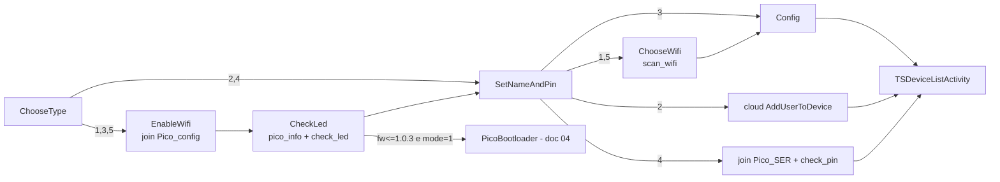
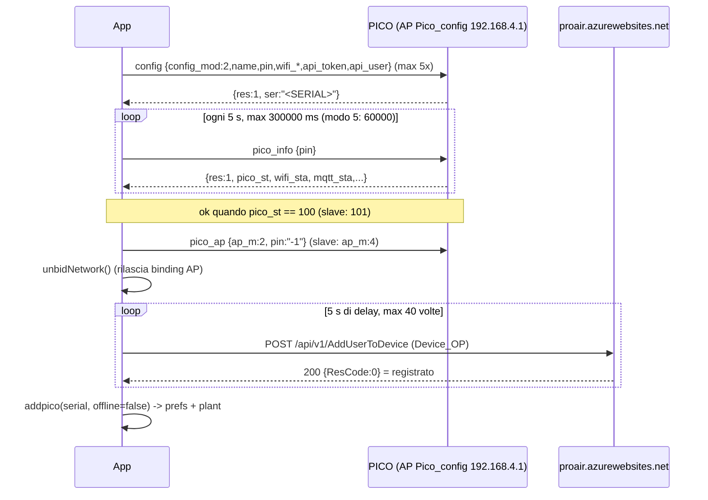

# Provisioning e configurazione

Sorgente analizzato: JADX di `it.tecnosystemi.TS`. Tutti i percorsi sono relativi a `Export-Pico/sources/it/tecnosystemi/TS/`. "(inferred)" = dedotto, non letto esplicitamente nel codice.
Trasporto UDP/ACK/idp/timeout: vedi [01-transport.md](01-transport.md) (non ripetuto). Runtime post-provisioning: [02-pico-runtime.md](02-pico-runtime.md). Bootloader/OTA: [04-firmware-ota.md](04-firmware-ota.md). Scope: solo PICO; le altre famiglie (VMC, SeiX/P6X, Control Unit legacy) sono fuori scope.

## Indice

1. [Mappa activity e modi di setup](#1-mappa-activity-e-modi-di-setup)
2. [Join dell'AP del dispositivo e network binding](#2-join-dellap-del-dispositivo-e-network-binding)
3. [Flusso PICO](#3-flusso-pico)
   - 3.1 EnableWifi / CheckLed / `pico_info` / `check_led`
   - 3.2 SetNameAndPin e PIN
   - 3.3 ChooseWifi / `scan_wifi`
   - 3.4 Config modo 1 (online), 3 (offline), 5 (slave)
   - 3.5 Modi 2 e 4 (aggiunta di PICO gia' configurato)
4. [Payload di riferimento](#4-payload-di-riferimento)
5. [`pico_ap` e semantica `ap_m`](#5-pico_ap-e-semantica-ap_m)
6. [Token / user cloud, PICOServer, locale vs cloud](#6-token--user-cloud-picoserver-locale-vs-cloud)
7. [Stato persistito (SharedPreferences)](#7-stato-persistito-sharedpreferences)
8. [Gestione errori, anomalie, domande aperte](#8-gestione-errori-anomalie-domande-aperte)

---

## 1. Mappa activity e modi di setup

Entry: `Activity/TS/SelectTypeDevActivity.java:50-85` apre `ChooseTypePICOActivity` (provisioning) oppure `IstrBootloaderActivity*` (firmware, vedi 04; la scelta dipende da un flag, (inferred)); le altre famiglie hanno activity analoghe, fuori scope.

`ChooseTypePICOActivity.btnProc` (`Activity/PICO/Config/ChooseTypePICOActivity.java:41-64`) scrive l'extra `Constants.INTENT_SETUPMODE` ("setupmode", `Utils/Constants.java:92`) con 5 modi (testi: `resources/res/values/strings.xml:148-159`):

| mode | Significato UI | Primo schermo | Contatta device? | Cloud? | `config_mod` inviato | `Pico.offline` salvato |
|---|---|---|---|---|---|---|
| 1 | Connetti PICO online (via Wi-Fi router) | EnableWifi (AP `Pico_config`) | si | si (registrazione + polling) | 2 | false |
| 2 | Aggiungi PICO gia' online (altro utente) | SetNameAndPin | no | si (`AddUserToDevice`) | - | false |
| 3 | Connetti PICO offline (solo AP) | EnableWifi | si | no | 1 | true |
| 4 | Aggiungi PICO gia' offline (altro utente) | SetNameAndPin | si (join AP `Pico_<SER>`, `check_pin`) | no | - | true |
| 5 | Aggiungi PICO slave a un master | EnableWifi | si | no | 3 | non salvato (vedi 3.4) |

Modi 2/4 saltano EnableWifi/CheckLed (`ChooseTypePICOActivity.java:57-61`).

Grafo di navigazione PICO:



---

## 2. Join dell'AP del dispositivo e network binding

Tutto passa da `Activity/BaseActivity.java`: `connectToWifi(onOk, onFail, redhome, skipGps)` (`:1552-1560`, esegue in thread) -> `connectToWifi_` (`:1576-1783`). Le credenziali target sono i campi statici `BaseActivity.toConnSid` / `toConnPwd` (`:118-119`), impostati dal chiamante subito prima.

SSID/password PICO (`Utils/Constants.java:272-289`):

| Fase | PICO |
|---|---|
| AP di configurazione (dispositivo non configurato, modi 1/3/5) | `Pico_config` / `12345678` |
| AP operativo (dispositivo configurato, modo 4) | `Pico_<SERIAL>` / `TS_<SERIAL>` |

`<SERIAL>` = serial digitato, `toUpperCase()` (`SetNameAndPinPICOActivity.java:233,248-251`). Il device espone sempre `192.168.4.1` (`Commands/UDPSocket.java:33,64`).

Algoritmo `connectToWifi_`:
1. Se `manualconn` (SDK<29, utente ha agganciato manualmente) esegue subito `onOk` (`:1585-1596`).
2. Se GPS spento e `skipGps=false` -> `enableLocation()` e abort (`:1597-1601`). Richiede anche `ACCESS_FINE_LOCATION` (`:1654-1660`). `skipGps=true` e' passato dalle fasi che seguono un join gia' avvenuto (ChooseWifi, Config), `false` da EnableWifi/SetNameAndPin (primo join).
3. Se l'SSID corrente (`getCurretWifiName()`) == `toConnSid`: non riconnette; ricava il `Network` Wi-Fi con `getCurrentWifiNetwork()` e fa `bindProcessToNetwork(net)`, salva in `MySocket.tobindnet`, `MySocketBootLoader.tobindnet`, `PicoSocketBootloader.tobindnet` (`:1600-1635`); poi `onOk`.
4. SDK >= 29 (`:1678-1783`): se Wi-Fi spento apre `android.settings.panel.action.WIFI`. Scan (SDK>=31 usa `getScanResults()` per ricavare il BSSID; altrimenti `startScan()` con attesa max ~15 s). Costruisce `WifiNetworkSpecifier` (`setSsid`, `setBssid` se noto, `setWpa2Passphrase`) e `NetworkRequest` con `removeCapability(12)` (NET_CAPABILITY_INTERNET: rete senza Internet accettata) + `TRANSPORT_WIFI`. `ConnectivityManager.requestNetwork(req, cb, 120000)`.
   - `onAvailable(net)` -> dopo 10 ms `AvaiableNetwork(net)` (`:1891-1925`): `bindProcessToNetwork(net)`, `MySocket/MySocketBootLoader/PicoSocketBootloader.tobindnet = net`, `connected=true`, poi `onOk`. Tutto il traffico del processo (incluso UDP) e' quindi forzato sulla rete del device finche' il binding resta.

`Activity/BaseActivity.java:1895-1899`:
```java
((ConnectivityManager) getSystemService("connectivity")).bindProcessToNetwork(network);
MySocket.tobindnet = network;
MySocketBootLoader.tobindnet = network;
PicoSocketBootloader.tobindnet = network;
this.connected = true;
```
   - `onUnavailable()` -> `onFail` se presente, altrimenti toast `msg_error` (`:1763-1771`).
   - `onLost()`: comportamento per tipo di activity (SetNameAndPin/ChooseWifi: riconnessione; `PicoActivity`: `UDPSocket.resetIDP()` + `stopListening()` + `startListening(true)` e riconnessione, max 3 tentativi, `:1799-1830`).
5. SDK < 29 (`:1832-1860`): `WifiConfiguration` (priority 999999) + `addNetwork/enableNetwork/reconnect`, timer 30 s; se non connesso lancia `onFail` o `errorcollWifi()` (toast `ha_apAssente` + apre `android.settings.WIFI_SETTINGS`, `:2024-2040`).

Rientro nel Wi-Fi di casa (non c'e' un "reconnect home" esplicito):
- `disconnectFromWIfi()` (`:1933-1951`): SDK>=29 `unregisterNetworkCallback` + `bindProcessToNetwork(null)`; SDK<29 `removeNetwork(STATIC_networkId)` + `disconnect()` + `reconnect()`.
- `unbidNetwork()` (`:1995-2005`): azzera `tobindnet` e `bindProcessToNetwork(null)` + `unregisterNetworkCallback`.
- Rilasciata la richiesta `NetworkRequest`, e' Android a tornare alla rete preferita (inferred). `onDestroy` (SDK<29) rimuove `networkId` aggiunto (`:2060-2070`).
- Il parametro `redhome` e' memorizzato ma i due rami di `errorcollWifi` sono identici; tutti i chiamanti config passano `false`.

Dialog di fallimento join (`EnableWifiVCActivityPICO.AnonymousClass3`, `:91-124`; analoghi in SetNameAndPin): messaggio `ba_apAssente` + `connectToPolaris` + `SSID: <toConnSid>` + password; bottone Ok apre `WIFI_SETTINGS`; in `onResume` l'activity puo' mostrare toast `ba_apAssente` (`:134-142`).

---

## 3. Flusso PICO

### 3.1 EnableWifi / CheckLed

Trigger: pulsante "Procedi" in `EnableWifiVCActivityPICO.btnProc` (`Activity/PICO/Config/EnableWifiVCActivityPICO.java:69-89`): `toConnSid="Pico_config"`, `toConnPwd="12345678"` (`:86-87`), `connectToWifi(ok->gotoCheckLed, fail->dialog, false, false)`. Prerequisito utente (testo `c2_pico_lblInstruction`, `strings.xml:213`): PICO Pro/Pro+ in config con tasti NOTE+MIN SPEED 3 s -> LED blu lampeggiante; PICO Basic: config attiva nei primi 2 minuti dall'accensione.

`CheckLedPICOActivity.onCreate` (`CheckLedPICOActivity.java:42-56`) chiama subito `getInfo()` (`:58-129`):

```json
// app -> 192.168.4.1:40070   (pin assente: campo null non serializzato (inferred))
{"cmd":"pico_info","frm":"app","idp":1}
```
`sendCMD(cmd, 10000, 10000)`; se `null` fino a 3 ulteriori tentativi con `Thread.sleep(1000)` + `startListening()` (`:70-78`). Il datagramma parte verso `192.168.4.1:40070`; la risposta arriva sempre sulla porta UDP 40069 (confermato, vedi sezione 4).

`Activity/PICO/Config/CheckLedPICOActivity.java:67-78` (retry di `pico_info`):
```java
CmdPICO cmdPICO = new CmdPICO();
cmdPICO.setCmd("pico_info");
UDPSocket.startListening();
CheckLedPICOActivity.this.respInfo = UDPSocket.sendCMD(cmdPICO, 10000L, 10000L);
UDPSocket.stopListening();
int i = 0;
while (CheckLedPICOActivity.this.respInfo == null && i < 3) {
    i++;
    Thread.sleep(1000L);
    UDPSocket.startListening();
    CheckLedPICOActivity.this.respInfo = UDPSocket.sendCMD(cmdPICO, 10000L, 10000L);
}
```
Risposta usata (tutti `getInt/get` senza default, eccezione silenziata, `:84-117`):
- `ser` (seriale), `fw_ver` (stringa semver),
- `config_mod`: 1 = master offline, 2 = master online, 3 = slave (mostra anche `id_slave`), altro = non configurato (`:94-107`). Stesso enum usato nell'invio `config`.
- Se `fw_ver` non vuota, `mode==1` e `Functions.compareVersions(fw_ver,"1.0.3") <= 0` -> `bootloader=true`, label `fw_too_old` (`:112-116`); "Procedi" andra' a `PicoBootloaderActivity` (doc 04) invece che a SetNameAndPin (`btnProc`, `:140-150`).

`Activity/PICO/Config/CheckLedPICOActivity.java:84-116` (parsing di `pico_info`):
```java
JSONObject jSONObject = new JSONObject(CheckLedPICOActivity.this.respInfo);
// ...
sb.append(jSONObject.get("ser"));
// ...
int i2 = jSONObject.getInt("config_mod");
if (i2 == 1) {
    // StatoMasterOffline
} else if (i2 == 2) {
    // StatoMasterOnline
} else if (i2 != 3) {
    // StatoNoConfig
} else {
    // StatoSlave
    sb.append(jSONObject.get("id_slave"));
}
// ...
sb.append(jSONObject.get("fw_ver"));
if (jSONObject.getString("fw_ver").length() > 0 && CheckLedPICOActivity.this.mode == 1 && Functions.compareVersions(jSONObject.getString("fw_ver"), "1.0.3") <= 0) {
    CheckLedPICOActivity.this.bootloader = true;
    // ...
}
```

`btnCheckLed` (`:152-193`):
```json
{"cmd":"check_led","frm":"app","idp":N,"led_color":2}
```
`Commands/CmdPICO.java:361-371` (`led_color` fisso a 2 dal costruttore; nessun altro setter nel codice; semantica del colore (inferred): fa lampeggiare il LED per identificare il device).

 `sendCMD(cmd, 5000, 1500)`; `res==1` -> `askLed()` dialog Si/No (`:240-248`). Si' -> `btnProc()` (SetNameAndPin con `setupmode`); No -> (inferred dall'ordine degli argomenti di `createYesNoPopUp`) `spegniCOnf()` + riconnessione:
1. `pico_ap` con `ap_m=5` (vedi 5), `sendCMD(.,5000,5000)` (`:250-264`),
2. attesa fino a 5 s che `UDPSocket.isConnected()` diventi false (`:212-220`),
3. `disconnectFromWIfi()`, `recoonect()` -> join di nuovo `Pico_config` e `getInfo()`; su `onUnavailable` -> `tornaIndietro()` torna a EnableWifi (o `IstrBootloaderActivityPICO` se `bootloader`) con toast `c2_1_pico_RetryMessage` (`:266-317`).
Su timeout `check_led` con `!UDPSocket.isConnected()` -> toast + `finish()` (`:177-185`); altrimenti toast `msg_commandKo`.

`CheckLedPICOActivity` e' raggiunta anche da `PicoActivity.gotoCheckLed()` con extra `INTENT_BOOTLOADER=true` (`Activity/PICO/PicoActivity.java:1770-1800`, join `Pico_config` come sopra) e da `IstrBootloaderActivityPICO` (doc 04): qui `bootloader=true` e "Procedi" porta al bootloader.

### 3.2 SetNameAndPin e PIN

`SetNameAndPinPICOActivity` (`Activity/PICO/Config/SetNameAndPinPICOActivity.java`). Campi per modo (`setUpGui`, `:304-350`):
- modo 1/3: `txtNome` = nome device, `txtPin` = nuovo PIN scelto dall'utente.
- modo 2: `txtNome` = **seriale**, `txtPin` = PIN esistente; `txtNome2` nascosto.
- modo 4: `txtNome` = seriale, `txtNome2` = nome locale, `txtPin` = PIN.
- modo 5: `txtNome` = nome slave, `txtPin` = **PIN del master**, spinner `sp_Slave` (valori "1","2","3","4": `Constants.COMMAND10MIN="1"`, `ONLYNAME="2"`, `:26,198`) + radio sync/async.

Validazione `checinput()` (`:171-195`): nome non vuoto; modo 4 anche nome2; PIN con `length()==4` **e** `Integer.parseInt` ok (quindi accetta anche es. "-123"/"+123"; non impone solo cifre). Nessun PIN di default lato app: il PIN lo sceglie l'utente (hint `c3_pico_lblInstruction`: "4-digit security code (e.g. 1234)", `strings.xml:222`).

Significato di `"-1"`: compare come PIN solo in `CmdPICO.PicoAP` (`Commands/CmdPICO.java:378-383`, `pico_ap`). Interpretazione (inferred): "PIN non applicabile/wildcard" per comandi eseguiti su device ancora non configurato. L'esito di `pico_ap` non e' mai verificato nei flussi PICO (`setPicoWiFiMode` ritorna bool ignorato, `ConfigPICOActivity.java:205,292,304`), quindi non e' provato che il device accetti `-1` dopo la configurazione. `pico_info` in CheckLed e `check_led` non impostano `pin`.

`btnProc` (`:197-262`):
- modo 3 -> `ConfigPICOActivity` (extra setupmode, pin, name) (`:199-206`).
- modo 1/5 -> `ChooseWifiPICOActivity` con setupmode/pin/name; modo 5 setta anche statici `ConfigPICOActivity.ID_SLAVE = spinnerPos+1` (min 1) e `VERSO = sync? Pico.Slave.VERSOSYNC(1) : VERSOASYNC(2)` (`:210-219`; `Model/Pico.java:612-613`).
- modo 2 -> cloud (3.5). modo 4 -> join AP + `check_pin` (3.5). In `ISDEMO` toast demo e ritorno a `TSHomeActivity`.

### 3.3 ChooseWifi / `scan_wifi`

`ChooseWifiPICOActivity.aggiornaWifi` (`Activity/PICO/Config/ChooseWifiPICOActivity.java:77-146`). Prima `connectToWifi(runnable,false,true)` (usa `toConnSid` ancora = `Pico_config`, quindi solo re-bind se gia' connesso), poi in thread:
```json
{"cmd":"scan_wifi","frm":"app","idp":N,"pin":"1234"}
```
`Protocols.CMD_GET_WIFI="scan_wifi"` (`Commands/Protocols.java:8`); **pin = PIN scelto dall'utente nello step precedente** (non `-1`), `sendCMD(cmd,10000,1500)` (`:141-143`).

`Activity/PICO/Config/ChooseWifiPICOActivity.java:139-143`:
```java
CmdPICO cmdPICO = new CmdPICO();
cmdPICO.setPin(ChooseWifiPICOActivity.this.pin);
cmdPICO.setCmd(Protocols.CMD_GET_WIFI);
UDPSocket.startListening();
final String strSendCMD = UDPSocket.sendCMD(cmdPICO, 10000L, 1500L);
```

Risposta attesa (`addwifi`, `:155-190`; `Model/WiFi.java`):
```json
{"idp":N,"res":1,"aps":[{"id":"MyWiFi","sec":1,"rssi":-55,"mac":"aa:bb:cc:dd:ee:ff"}, ...]}
```
`Constants.JSON_WIFI="aps"` (`Constants.java:188`). `id`=SSID, `sec` int (la UI chiede password se `sec==1`, `Adapters/WifiAdapter.java:72-80`; 0 = aperta), `rssi` default 0, `mac` default `""`. `res` **non** viene verificato; basta `aps` array. Filtro PICO: `Functions.isPicoWiFi(ssid)` = prefisso `Pico_` ed != `Pico_config` (`Utils/Functions.java:142-144`); modo 5 mostra solo SSID `Pico_*` (con `crip=0`: i master sono usati con password derivata), altri modi nascondono i `Pico_*`; deduplica per SSID. Il bottone "Aggiorna" rilancia la scansione.

`Activity/PICO/Config/ChooseWifiPICOActivity.java:158-181` (parsing e filtro):
```java
JSONObject jSONObject = new JSONObject(str);
JSONArray jSONArray = jSONObject.getJSONArray(Constants.JSON_WIFI);
this.wifis = new ArrayList();
for (int i = 0; i < jSONArray.length(); i++) {
    WiFi wiFi = new WiFi(jSONArray.getJSONObject(i));
    boolean zIsPicoWiFi = Functions.isPicoWiFi(wiFi.getSid());
    boolean z = true;
    if (zIsPicoWiFi != (this.mode == 5)) {
        z = false;
    }
    if (z) {
        if (zIsPicoWiFi) {
            wiFi.setCrip(0);
        }
        // ... dedup per SSID (getSid().equals)
    }
    // ...
}
```

`protectedwifi` (`:195-246`): se `sec==1` popup testo password (IME action 6=Done -> `wiFi.setPwd(text)`); poi `ConfigPICOActivity` con extra `INTENT_WIFI` (Serializable `WiFi`), name, setupmode, pin. La password non viene persistita.

### 3.4 Config

`ConfigPICOActivity.onCreate` (`Activity/PICO/Config/ConfigPICOActivity.java:79-228`). Legge setupmode/name/pin; `serial` non viene mai assegnato in questa activity (solo `serialToCheck`). Costanti: `akwait=15000`, `CONFIG_TIMES=40` (`:61-62`).

**Modo 1 (online)** e **modo 5 (slave)** (`:104-176`): `connectToWifi(.., false, true)` poi thread:



Costruzione del comando (modo 1 e modo 5) e retry, `Activity/PICO/Config/ConfigPICOActivity.java:115-159`:
```java
CmdPICO.ConfigMasterOnline configMasterOnline = new CmdPICO.ConfigMasterOnline();
configMasterOnline.setName(ConfigPICOActivity.this.name);
configMasterOnline.setPin(ConfigPICOActivity.this.pin);
if (ConfigPICOActivity.this.mode == 1) {
    configMasterOnline.setConfig_mod(2);
    configMasterOnline.setWifi_sec(wiFi.isCrip());
    configMasterOnline.setWifi_ssid(wiFi.getSid());
    configMasterOnline.setWifi_pwd(wiFi.getPwd());
    configMasterOnline.setWifi_mac(wiFi.getMac());
    // ... token: calcNewToken oppure Constants.FIX_TOKEN
    configMasterOnline.setApi_token(ConfigPICOActivity.this.token);
    configMasterOnline.setApi_user(Constants.user);
    i2 = 100;
    j = 300000;
} else {
    configMasterOnline.setConfig_mod(3);
    // ...
    configMasterOnline.setIdSlave(ConfigPICOActivity.ID_SLAVE);
    configMasterOnline.setVerso(ConfigPICOActivity.VERSO);
    String strSubstring = wiFi.getSid().substring(5);
    // ...
    configMasterOnline.setWifi_sec(1);
    configMasterOnline.setWifi_pwd("TS_" + strSubstring);
    i2 = 101;
    j = 60000;
}
String strSendCMD = null;
for (int i3 = 0; i3 < 5; i3++) {
    UDPSocket.startListening(true);
    strSendCMD = UDPSocket.sendCMD(configMasterOnline, 15000L, ConfigPICOActivity.this.akwait);
    UDPSocket.stopListening();
    if (strSendCMD != null) {
        break;
    }
    // Thread.sleep(500L)
}
```

Payload `config` modo 1 (`ConfigMasterOnline`, `Commands/CmdPICO.java:401-500`; campi riempiti a `:116-130`):
```json
{"cmd":"config","frm":"app","idp":N,"pin":"1234","config_mod":2,"id_slave":0,"name":"Salotto","verso":1,
 "wifi_sec":1,"wifi_ssid":"MyWiFi","wifi_pwd":"secret","wifi_mac":"aa:bb:cc:dd:ee:ff",
 "api_token":"<token>","api_user":"<utente cloud>"}
```
- `id_slave` default 0 e `verso` default 1 dal costruttore (`CmdPICO.java:408-412`), non toccati in modo 1.
- `wifi_sec/ssid/mac` provengono dall'oggetto `WiFi` scelto in ChooseWifi; `wifi_pwd` dalla popup (null -> campo omesso da Gson, (inferred) per reti aperte).
- `api_token`/`api_user`: vedi sezione 6.
- Tentativi: fino a 5 cicli `startListening(true)` + `sendCMD(cmd, 15000, 15000)` con `sleep(500)` tra i cicli (`:147-160`); ogni `sendCMD` ha a sua volta i 3 tentativi interni (vedi 01). `null` o `res!=1` o `ser` mancante -> `error()`. `ser` salvato in `serialToCheck`.
- `CheckInfoPICO(100, 300000)` (`:230-345`): loop finche' `!okconf && elapsed<j && !blockCheckPico`; a ogni giro chiama `connectToWifi(run, false, true)` (ricollega/binda se serve) e `pico_info` con `pin`, `sendCMD(.,10000,10000)`, poi `sleep(5000)`. Parsing: `res==1`; `pico_st` (`Constants.PICO_JSON.PICO_ST`, `Constants.java:344`) `== 100` -> ok; altrimenti memorizza `wifi_sta`, `mqtt_sta`. (inferred) `pico_st` = stato macchina di configurazione; 100 = "online configurato", 101 = "slave configurato"; altri valori non decodificabili dal client.

`Activity/PICO/Config/ConfigPICOActivity.java:242-283` (polling `pico_info`):
```java
while (true) {
    z = this.okconf;
    if (z || this.datediff >= j || this.blockCheckPico) {
        break;
    }
    // connectToWifi(new Runnable() { run() {
    UDPSocket.startListening(true);
    String strSendCMD = UDPSocket.sendCMD(cmdPICO, 10000L, 10000L);
    UDPSocket.stopListening();
    if (strSendCMD != null) {
        JSONObject jSONObject = new JSONObject(strSendCMD);
        if (jSONObject.getInt(Constants.JSON_RES) == 1) {
            if (jSONObject.has(Constants.PICO_JSON.PICO_ST)) {
                ConfigPICOActivity.this.lastpico_st = jSONObject.getInt(Constants.PICO_JSON.PICO_ST);
                if (ConfigPICOActivity.this.lastpico_st == i) {
                    ConfigPICOActivity.this.okconf = true;
                }
            }
            // ... wifi_sta / mqtt_sta salvati in lastwifi_sta / lastmqtt_sta
        }
    }
    // }}, false, true);
    this.datediff = new Date().getTime() - date.getTime();
    Thread.sleep(5000L);
}
```
- Fallimento (`:326-345`): `wifi_sta` in 1..6 -> toast `c5_lblConfigKo_wifiProblem` (password/router/Internet); altrimenti se uno tra wifi_sta/pico_st/mqtt_sta >0 -> dialog "errore codice `wifi-mqtt-pico_st`"; altrimenti `not_errcom`. Pulsante Fine riabilitato.
- Successo modo 1: `pico_ap{ap_m:2}` (`setPicoWiFiMode(2)`, `:292`), `UDPSocket.stopListening()`, `unbidNetwork()`, `times=40`, `checkPicoOnline()` (`:383-410`).

Polling cloud (`checkPicoOnline`): ogni 5 s (`Handler.postDelayed(5000)`) crea `Device_OP` `{PIN, Serial:serialToCheck, PlantId:TSDeviceListActivity.idSelected, token:FirebaseToken, platform:"fcm2", isPico:true, PhoneDate:"yyyy-MM-dd'T'HH:mm:ss.SSS'Z'"}` (`Model/Device_OP.java`) e lo invia con `ThreadWebService(code 29)` a `uriWebService_PICO + uri_AddUserToDevice` = `https://proair.azurewebsites.net/api/v1/AddUserToDevice` (`strings.xml:811,814`). `checkPicoConfig()` (`Threads/ThreadWebService.java:421-440`) -> `ConfigPICOActivity.parseCheckConfig` (`:412-422`): HTTP 200 e `ResCode==0` -> `addpico(serialToCheck,false)`; altrimenti ripete; dopo 40 tentativi -> `error()`. (Solo confine cloud: header token/user in `WebClientDevWrapper`, non mappato.)

`Activity/PICO/Config/ConfigPICOActivity.java:412-422`:
```java
public void parseCheckConfig(Response response) {
    if (response != null) {
        try {
            if (response.getHttpResponceCode() == 200 && new JSONObject(response.getHttpResponcePayload()).getInt("ResCode") == 0) {
                addpico(this.serialToCheck, false);
                return;
            }
        } catch (Exception unused) {
        }
    }
    checkPicoOnline();
}
```

**Modo 5 (slave)** (`:133-145`): `config_mod=3`, `name`, `pin` (PIN del master), `id_slave=ID_SLAVE` (1..4), `verso=VERSO` (1 sync, 2 async), `wifi_ssid=<SSID master "Pico_XXXX">`, `wifi_mac`, `wifi_sec=1`, `wifi_pwd="TS_"+ssid.substring(5)` (= password AP operativo del master, vedi sezione 2). Nessun `api_*`. `CheckInfoPICO(101, 60000)`; successo: `pico_ap{ap_m:4}` (`:304`), toast `c5_lblConfigOkSlave`. Non salva nulla (la chiamata `Pico.deletePICOfromPref(this.serial,..)` usa `serial==null`, effetto nullo (inferred)). Lo slave e' poi gestito dal master (`set_slave`, doc 02). Nota: il master e lo slave comunicano via l'AP del master; l'app resta sul device in config, non sul master.

**Modo 3 (offline)** (`:177-215`): join, poi
```json
{"cmd":"config","frm":"app","idp":N,"pin":"1234","config_mod":1,"id_slave":0,"name":"Salotto","verso":1}
```
(`ConfigMasterOffline`, nessun campo `wifi_*`/`api_*`). `UDPSocket.startListening()` + `sendCMD(cmd,15000,15000)`. Se `res==1` e `ser` non vuoto: `pico_ap{ap_m:1}`, `disconnectFromWIfi()`, `addpico(ser, offline=true)`; altrimenti `error()`. Il device rimane in AP `Pico_<SER>` / `TS_<SER>` (modo operativo locale, vedi 02 e `auto-discovery.md` del repo). Bug minore: se `sendCMD` ritorna `null`, `error()` viene chiamato e poi `new JSONObject(null)` lancia NPE -> `error()` di nuovo.

`addpico(serial, offline)` (`:459-474`): `Pico.deletePICOfromPref(serial)`, `Pico.savePicoInPref(name, serial, pin, "", activity, offline, true)`, `addDevToPlant(serial)` (`Device{LVDV_Type=DEVICE_TYPE_PICO(1), Serial, Name}` in `Plant.addDeviceToPlantPref(device, TSDeviceListActivity.idSelected)` + `Constants.listaImpianti`), UI "dispositivo aggiunto" e "Fine" -> `TSDeviceListActivity`.

### 3.5 Modi 2 e 4

**Modo 2 (cloud only)**: `SetNameAndPinPICOActivity.btnProc` (`:233-246`): `Device_OP{isPico:true, PIN, Serial:SERIAL maiuscolo, token:FirebaseToken, platform:"fcm2", PlantId}` -> `ThreadWebService(code 24)` -> `connUsrPico()` (`Threads/ThreadWebService.java:1612-1650`): HTTP 200 e `ResCode==0` -> `savserverPico()` (`:301-312`) = `Pico.savePicoInPref(name=txtNome2, serial, pin, "", activity, offline=false, true)` + `addDevToPlant`; `ResCode!=0` -> toast `au_errorAddUser` ("PIN and/or invalid serial"). Il device non viene contattato. Nota: il nome salvato e' `txtNome2`, che in modo 2 e' nascosto e vuoto -> nome `""` (inferred: poi sovrascritto da sync cloud; non verificato).

**Modo 4 (offline esistente)**: join `Pico_<SER>` / `TS_<SER>` (`:248-262`), poi `checkpin()` (`:80-130`):
```json
{"cmd":"check_pin","frm":"app","idp":N,"pin":"1234"}
```
`Protocols.CMD_CHECK_PIN="check_pin"`, `sendCMD(cmd)` default (5000,5000), risposta `res==1` -> `Pico.savePicoInPref(txtNome2, serial, pin, "", activity, offline=true, true)` + `addDevToPlant` -> `TSDeviceListActivity`; `res!=1` -> toast `au_errorAddUser`; `null`/eccezione -> `msg_commandKo`. La verifica del PIN e' quindi lato device (`res==1`), mai locale.

---

## 4. Payload di riferimento

| cmd | Campi specifici | Origine | File:riga |
|---|---|---|---|
| `pico_info` | (`pin` opzionale) | CheckLed (senza pin), Config polling (con pin) | `CheckLedPICOActivity.java:68`, `ConfigPICOActivity.java:234` |
| `check_led` | `led_color:2` | CheckLed | `CmdPICO.java:361-371` |
| `scan_wifi` | `pin` = PIN utente | ChooseWifi | `ChooseWifiPICOActivity.java:140-143` |
| `config` (online) | `config_mod:2, name, id_slave:0, verso:1, wifi_sec, wifi_ssid, wifi_pwd, wifi_mac, api_token, api_user` | Config modo 1 | `CmdPICO.java:446-500` |
| `config` (slave) | `config_mod:3, id_slave:1..4, verso:1\|2, wifi_*` (master) | Config modo 5 | `ConfigPICOActivity.java:133-145` |
| `config` (offline) | `config_mod:1, name, id_slave:0, verso:1` | Config modo 3 | `ConfigPICOActivity.java:193-198` |
| `check_pin` | solo envelope | modo 4 | `SetNameAndPinPICOActivity.java:85` |
| `pico_ap` | `ap_m`, `pin:"-1"` | vedi sezione 5 | `CmdPICO.java:378-393` |

Porte UDP (`Commands/UDPSocket.java:40-41`): l'app invia a `192.168.4.1:40070` da una porta sorgente effimera (`new DatagramSocket()`, `:262`), e ascolta con un socket legato a **40069** (`:88-92`). Confermato: il PICO risponde sempre alla UDP 40069, indipendentemente dalla porta sorgente del mittente. Con `isSlave` (modo cascata, doc 02) le due porte sono invertite.
```java
static int portaDest = 40070;
static int portaRead = 40069;
// ... (:88-92, listener)
if (UDPSocket.isSlave) {
    UDPSocket.socketListen = new DatagramSocket(UDPSocket.portaDest, iPAddress);
} else {
    UDPSocket.socketListen = new DatagramSocket(UDPSocket.portaRead, iPAddress);
}
// ... (:264-268, invio)
if (isSlave) {
    datagramPacket = new DatagramPacket(bytes, bytes.length, byName, portaRead);
} else {
    datagramPacket = new DatagramPacket(bytes, bytes.length, byName, portaDest);
}
```

Serializzazione: `bytes = gson.toJson(cmdPICO).getBytes();` (`UDPSocket.java:255`); i campi `null` non vengono serializzati da Gson standard (inferred, `new Gson()` senza `serializeNulls` in `UDPSocket.sendGetStato:~330`).

Tutte le risposte hanno `res` (1 = OK) tranne `scan_wifi` (non verificato). `res==99` = ACK, gia' gestito dal transport (01).

Timeout `(t_resp, t_ack)` = argomenti 2 e 3 di `UDPSocket.sendCMD` (`Commands/UDPSocket.java:212-310`): `t_ack` attesa ACK per tentativo; `t_resp` attesa risposta dopo l'ACK; 3 tentativi interni. Valori nel provisioning: `pico_info` (10000,10000), `check_led` (5000,1500), `scan_wifi` (10000,1500), `config` online (15000,15000), `config` offline (15000,15000), `pico_ap`/`check_pin` default (5000,5000).

---

## 5. `pico_ap` e semantica `ap_m`

`CmdPICO.PicoAP` (`CmdPICO.java:378-393`): `{"cmd":"pico_ap","frm":"app","idp":N,"pin":"-1","ap_m":<int>}`; il `pin` resta `-1` in tutti i flussi PICO.

`Commands/CmdPICO.java:378-383`:
```java
public static class PicoAP extends CmdPICO {
    int ap_m;

    public PicoAP() {
        ((CmdPICO) this).cmd = "pico_ap";
        super.setPin("-1");
    }
    // ...
}
```

`Activity/PICO/Config/ConfigPICOActivity.java:350-359` (invio e lettura di `res`, mai verificata dai chiamanti):
```java
public boolean setPicoWiFiMode(int i) {
    try {
        CmdPICO.PicoAP picoAP = new CmdPICO.PicoAP();
        picoAP.setAp_m(i);
        String strSendCMD = UDPSocket.sendCMD(picoAP);
        UDPSocket.stopListening();
        return new JSONObject(strSendCMD).getInt(Constants.JSON_RES) == 1;
    } catch (Exception unused) {
        return false;
    }
}
```

Valori di `ap_m` visti nel codice (semantica **(inferred)** dal contesto, il device non risponde con una descrizione):

| ap_m | Dove | Quando | Interpretazione |
|---|---|---|---|
| 1 | Config modo 3 (`:205`) | dopo `config` offline riuscito | resta in AP operativo `Pico_<SER>` (modo locale) |
| 2 | Config modo 1 (`:292`) | dopo `pico_st==100` | spegne/abbandona l'AP, passa a solo station + cloud |
| 4 | Config modo 5 (`:304`) | fine config slave | chiude la sessione di config |
| 5 | CheckLed "No" (`CheckLedPICOActivity.java:258`); PICO bootloader dopo `ota_end` (`PicoBootloaderActivity.java:341`) | annulla config / riavvio | esce dalla modalita' config / reboot dell'AP di config |

La risposta `res==1` e' letta in `setPicoWiFiMode` ma mai usata dai chiamanti.

---

## 6. Token / user cloud, PICOServer, locale vs cloud

**Origine di `api_token` e `api_user`** (solo modo 1):
- `api_user` = `Constants.user` (`Utils/Constants.java:327`), valorizzato dal login: `ThreadWebService.java:702` (login ok `ResCode==0`) oppure da prefs `PREF_USERNAME="username"` in `LoginActivity.onResume` se "ricordami" (`Activity/LoginActivity.java:186-196`).
- `api_token`: se `Constants.token` non vuoto -> `Functions.calcNewToken(prefs, res)` (`Utils/Functions.java:544-576`): decripta `Constants.token` con `AESCrypt(android_id[0:8] + SALT)` (`SALT="ns91wr48"`, `Constants.java:252`), formato `"<base>_<counter>"`, incrementa il contatore, re-cripta, salva `Constants.token`, `PREF_CONTTOKEN="cont_token"` (contatore), `PREF_TOKEN_VALUE="TOKENVALUE"`. Se la decrittazione fallisce ritorna `null` (token omesso, inferred). Se `Constants.token` e' vuoto -> costante hard-coded `Constants.FIX_TOKEN` (`Constants.java:57`).
`Utils/Functions.java:548-571`:
```java
aESCrypt = new AESCrypt(Constants.android_id.substring(0, 8) + Constants.SALT);
// ...
strDecrypt = aESCrypt.decrypt(Constants.token);
// ...
String[] strArrSplit = strDecrypt.split("_");
if (strArrSplit.length == 2) {
    long j = Long.parseLong(strArrSplit[1]) + 1;
    String strReplace = aESCrypt.encrypt(strArrSplit[0] + "_" + j).replace("\r", "").replace("\n", "");
    Constants.token = strReplace;
    savePreferences.save(Constants.PREF_CONTTOKEN, String.valueOf(j));
    savePreferences.save(Constants.PREF_TOKEN_VALUE, Constants.token);
    return strReplace;
}
```
- `Constants.token` arriva dal login come campo `Token` (`ThreadWebService.java:822`, `savepref`) ed e' salvato in `PREF_TOKEN`/`PREF_TOKEN_DATE`.
- Scopo (inferred): il PICO riceve credenziali con cui poi parlare al backend/MQTT come l'utente; per questo registra anche `wifi_*`. Il device non e' quindi "claimato" dal cloud ma dall'app, in due passi (config sul device + `AddUserToDevice`).

**Locale vs cloud al termine**: la scelta e' memorizzata in `Pico.offline` (`Pico.savePicoInPref(...,offline,...)`: true per modi 3/4, false per 1/2). A runtime `PicoActivity.sendCmdUpdPico` (`Activity/PICO/PicoActivity.java:1550-1575`) invia UDP se `pico.getOffline()` altrimenti POST cloud. Per i comandi cloud il `CmdPICO` viene serializzato **dentro** un JSON con `frm="mqtt"` e `idp` locale:
- `Commands/PICOServer.java`: `{Cmd:"<json CmdPICO>", Name, Pin, Serial}` -> `.../api/v1/SendPicoCmd?picoSerial=<S>&PIN=<P>` via `ThreadWebService(code 27)` (`PicoActivity.java:1568-1575`).
- `Commands/PICOServerTimezone.java`: `{Cmd, Pin, Serial, Timezone}` (`PicoActivity.java:1542-1550`).
Entrambe le classi **non** sono usate in `Activity/PICO/Config/*` (provisioning); compaiono solo nel runtime (`PicoActivity`, `PicoCascataActivity`, `PicoCronoSetActivity`, `PICOCronoSummaryActivity`) -> dettaglio in [02-pico-runtime.md](02-pico-runtime.md).

Confine: tutto il provisioning locale e' UDP su AP del device; il cloud interviene solo in modo 1 (polling `AddUserToDevice`) e modo 2.

---

## 7. Stato persistito (SharedPreferences)

File prefs `PREFS_TS` (`R.string.PrefsName`, `strings.xml:44`) via `Utils/SavePreferences`:

| Chiave | Contenuto | Scritto da |
|---|---|---|
| `PICODevs` (`PREF_PICO_DEVS`) | array JSON di `Pico` `{Name, Serial, Pin, offline, LastAddTimezone (se arg true), ...}`, deduplicato per `Serial`, ordinato per nome | `Pico.savePicoInPref` (`Model/Pico.java:573-609`) |
| lista dispositivi dell'impianto (via `Plant.addDeviceToPlantPref`) | `Device{LVDV_Type, Serial, Name}` sotto `TSDeviceListActivity.idSelected` | `addDevToPlant` (`ConfigPICOActivity.java:~430`, `SetNameAndPinPICOActivity.java:132`) |
| `cont_token`, `TOKENVALUE` | contatore e token cifrato | `Functions.calcNewToken` |
| `username`, `userid`, `token`/`TOKEN_DATE` | credenziali/sessione | login (`ThreadWebService.savepref`) |

Il PIN e' salvato in chiaro nel record `Pico` (`Pin`). La password Wi-Fi di casa non viene salvata dall'app.

---


## 8. Gestione errori, anomalie, domande aperte

Errori:
- `error()` (tutte le Config): toast `c5_lblConfigKo` ("riprova dall'inizio"), label rossa, "Fine" riabilitato. Nessun rollback sul device: un `config` gia' accettato non viene annullato.
- `UDPSocket` ritorna `null` su fallimento (vedi 01): tutti i flussi trattano `null` come errore, tranne `scan_wifi` dove `new JSONObject(null)` viene catturata e la lista resta vuota.
- `onDestroy` di Config: `UDPSocket.stopListening()` e `blockCheckPico=true` (interrompe il polling).
- DEMO (`Constants.ISDEMO=false`, `Constants.java:100`): rami demo ovunque, non rilevanti.

Anomalie lette:
1. In modo 5 `ConfigPICOActivity.serial` non e' mai assegnato (`deletePICOfromPref(null)`).
2. In modo 2 il nome salvato e' `txtNome2` (vuoto).
3. `calcNewToken` incrementa un contatore a ogni uso (anche i polling `AddUserToDevice` e `check*`): token "a rotazione" lato client (ruolo lato server non determinabile).
4. `FIX_TOKEN` hard-coded come fallback.

Domande aperte:
- Semantica reale di `ap_m` (1/2/4/5) e di `pico_st` (oltre 100/101): serve cattura di rete o firmware.
- `led_color` (2 fisso): altri valori accettati dal firmware?
- Il PIN `-1` e' accettato dal device su `pico_ap` dopo la config? (`res` mai controllato).
- Il device in modalita' `Pico_config` ignora il `pin` della richiesta `scan_wifi`/`config` o lo adotta come PIN iniziale (il `config` imposta il PIN: (inferred) si')?
- Contenuto esatto di `Pico` JSON e di `Plant`/`Device` prefs (`Model/Pico.java`, `Model/Plant.java`) non mappato qui.
- Flag che decide in `SelectTypeDevActivity` tra provisioning e bootloader (righe 45-85) non letto per intero.
- Effetto del `wifi_sec` diverso da 0/1 (WPA3?): la UI chiede password solo se `sec==1`.
