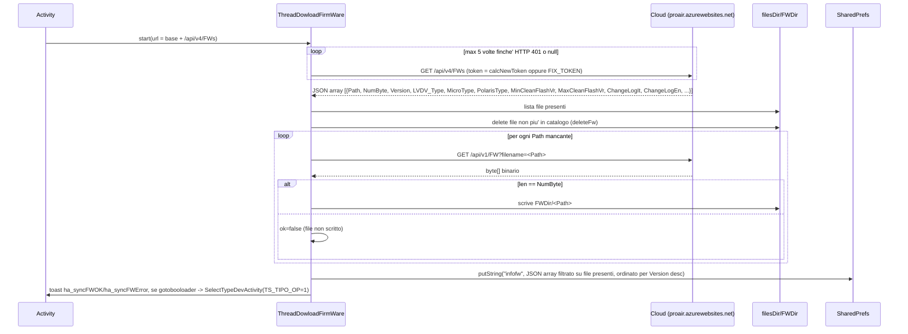
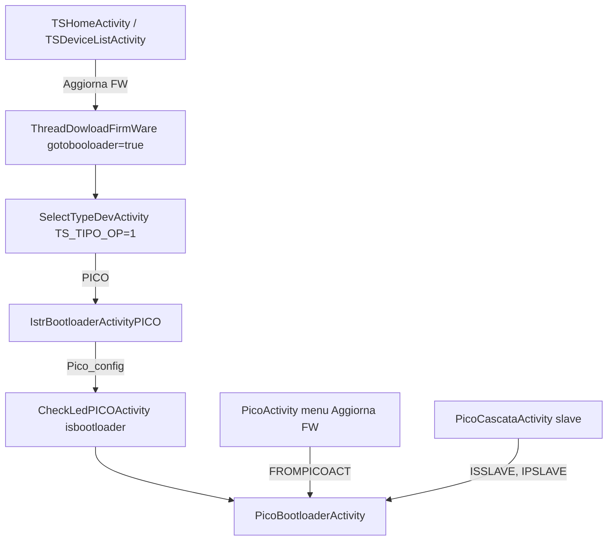

# Firmware e OTA PICO

Percorsi relativi a `Export-Pico/sources/it/tecnosystemi/TS/` (omessi nei riferimenti `file:riga`). Trasporto UDP e envelope `CmdPICO` gia' descritti in [01-transport.md](01-transport.md); runtime PICO in [02-pico-runtime.md](02-pico-runtime.md); onboarding Wi-Fi/AP in [03-provisioning.md](03-provisioning.md). Ambito: solo PICO.

## Indice

1. [Panoramica del flusso PICO](#1-panoramica-del-flusso-pico)
2. [Catalogo firmware (cloud) e cache locale](#2-catalogo-firmware-cloud-e-cache-locale)
3. [OTA PICO: UDP + TCP 40060](#3-ota-pico-udp--tcp-40060)
4. [Entry point UI e navigazione](#4-entry-point-ui-e-navigazione)
5. [Costanti e SharedPreferences](#5-costanti-e-sharedpreferences)
6. [Note per open_pico_local_api e domande aperte](#6-note-per-open_pico_local_api-e-domande-aperte)

---

## 1. Panoramica del flusso PICO

| Elemento | Valore |
|---|---|
| `LVDV_Type` nel catalogo | `1` (`Constants.DEVICE_TYPE_PICO`, Utils/Constants.java:49) |
| Attivita' | `Activity/PICO/PicoBootloaderActivity` (+ wizard `IstrBootloaderActivityPICO`) |
| Trasporto | UDP JSON (`pico_info`, `ota_start`, `ota_end`, `pico_ap`) + TCP raw 40060 (`Commands/PicoSocketBootloader`) |
| Formato immagine | `.bin` grezzo |

Il firmware NON viaggia mai dal dispositivo al cloud: l'app scarica il binario dal cloud (HTTP, solo confine, sez. 2) e lo spinge al dispositivo in locale. Catalogo/download = cloud (richiede Internet); flash = sempre locale (richiede Wi-Fi del PICO).

---

## 2. Catalogo firmware (cloud) e cache locale

Confine cloud: non mappato oltre quanto serve. Handler: `Threads/ThreadDowloadFirmWare.java`.

### 2.1 Trigger

`new ThreadDowloadFirmWare(activity, uriWebService + uri_infoFrameWork).start()`:

| Chiamante | Azione UI | `gotobooloader` | Riferimento |
|---|---|---|---|
| `Activity/TS/TSHomeActivity` menu "Verifica FW" / "Aggiorna FW" | sync (+ apre `SelectTypeDevActivity` se "Aggiorna") | false / true | TSHomeActivity.java:237,251 |
| `Activity/TS/TSDeviceListActivity` (idem) | idem | false / true | TSDeviceListActivity.java:487,501 |
| `Activity/PICO/PicoActivity` menu "Verifica FW" (solo non-offline), base `uriWebService_PICO` | sync + toast | false | PicoActivity.java:1918 |

`uriWebService_PICO` ha lo stesso valore di `uriWebService` (`https://proair.azurewebsites.net`, `resources/res/values/strings.xml:810-811`).

Prima di aprire `SelectTypeDevActivity` da "Aggiorna FW" l'app imposta `PicoBootloaderActivity.CLASSTOCALL` alla activity di ritorno (TSHomeActivity.java:248; TSDeviceListActivity.java:498). La stessa riga imposta anche i `CLASSTOCALL` delle altre famiglie, fuori ambito.

### 2.2 Sequenza



Autenticazione e retry: se `Constants.token` non e' vuoto si usa `Functions.calcNewToken`, altrimenti `Constants.FIX_TOKEN` (Constants.java:57). Fino a 5 tentativi; il ciclo ripete finche' la risposta e' `null` oppure HTTP 401. Header/algoritmo del token = confine cloud, non mappato.

Il catalogo (`/api/v4/FWs`) e' richiesto con lo stesso schema.

`Threads/ThreadDowloadFirmWare.java:74-84`
```java
for (int i3 = 5; i3 > 0 && z; i3--) {
    if (Constants.token != null && Constants.token != "") {
        strCalcNewToken = Functions.calcNewToken(pref, this.res);
    } else {
        strCalcNewToken = Constants.FIX_TOKEN;
    }
    newHttpClient = WebClientDevWrapper.getNewHttpClient(this.url, null, strCalcNewToken, Constants.user, 0, 4);
    if (newHttpClient != null && newHttpClient.getHttpResponceCode() != 401) {
        z = false;
    }
}
```

Download del singolo binario: `base + uri_FrameWork + "?filename=" + Path` (ThreadDowloadFirmWare.java:385; `uri_FrameWork` = `/api/v1/FW`, `uri_infoFrameWork` = `/api/v4/FWs`, strings.xml:826,848). Stesso ciclo di retry (:391).

Integrita': NON c'e' hash. Solo `byte[].length == NumByte` dal catalogo; se diverso il file e' scartato e `ok=false`, ma il ciclo sugli altri file prosegue.

`Threads/ThreadDowloadFirmWare.java:413-420`
```java
if (newHttpClient.getByteResponsePayload().length == list2.get(i).intValue()) {
    FileOutputStream fileOutputStream = new FileOutputStream(file.getPath() + "/" + list.get(i));
    fileOutputStream.write(newHttpClient.getByteResponsePayload());
    fileOutputStream.flush();
    fileOutputStream.close();
} else {
    this.ok = false;
}
```

Esempio di voce catalogo (nomi esatti = valori costanti `JSON_*`, Constants.java:127-131,184,187; `"NULL"` = assente per `MinCleanFlashVr`/`MaxCleanFlashVr`/`ChangeLog*`):

```json
{"Path": "pico_1.2.0.bin", "NumByte": 123456, "Version": "1.2.0", "LVDV_Type": 1,
 "MicroType": 0, "PolarisType": 0, "MinCleanFlashVr": "NULL", "MaxCleanFlashVr": "NULL",
 "ChangeLogIt": "...", "ChangeLogEn": "..."}
```
(valori illustrativi; solo i nomi dei campi derivano dal codice).

Altri dettagli:
- File locali: `<filesDir>/FWDir/<Path>` (`Constants.FW_DIRECTORY_NAME`, Constants.java:60).
- Il catalogo in pref (`Constants.PREF_INFOFWS = "infofw"`, Constants.java:214) contiene SOLO le voci il cui file e' presente in `FWDir` (ThreadDowloadFirmWare.java:154-214): voce senza file scaricato scompare.
- Ordinamento (comparatore :165-211): per `Version` "a.b.c" decrescente; a parita' di prefisso, differenza di `split.length`. In caso di eccezione di parsing ritorna 0.
- Errori: risposta `null` o payload `null` -> toast `ha_syncFWError` (solo se non `gotobooloader`), poi `gotobootloader()` comunque (:86-111). Con payload null il thread chiama `gotobootloader()` due volte (:106 e :110); la seconda e' no-op perche' il flag e' gia' azzerato (inferred).
- `gotobootloader()` (:359-372): azzera `gotobooloader`, avvia `SelectTypeDevActivity` con extra `TS_TIPO_OP=1`.

### 2.3 Versioni

- `Functions.compareVersions(String,String)` (Functions.java:114-139): confronto numerico per segmento, segmenti mancanti = 0. Usato per la soglia PICO "1.0.3" (sez. 3.5) e in `CheckLedPICOActivity`.
- Nel flusso non c'e' confronto automatico "installata vs ultima disponibile": l'utente sceglie la versione in uno Spinner.
- La voce "Aggiorna FW" nel menu `PicoActivity` appare solo se `infofw` ha almeno un elemento (PicoActivity.java:1922-1935).

---

## 3. OTA PICO: UDP + TCP 40060

File: `Activity/PICO/PicoBootloaderActivity.java`, `Commands/PicoSocketBootloader.java`, `Commands/CmdPICO.java` (`OTA_Start` :525-548, `PicoAP` :378-393), `Commands/UDPSocket.java`.

### 3.1 Trigger e precondizioni

Il PICO deve essere raggiungibile via UDP (vedi [01-transport.md](01-transport.md)). Il PICO risponde sempre alla porta UDP 40069, indipendentemente dalla porta sorgente del mittente (fatto confermato). Nel codice: il listener non-slave e' bindato su `portaRead = 40069` e l'invio non-slave va a `portaDest = 40070`; per gli slave in cascata le due porte sono invertite.

`Commands/UDPSocket.java:264-268`
```java
if (isSlave) {
    datagramPacket = new DatagramPacket(bytes, bytes.length, byName, portaRead);
} else {
    datagramPacket = new DatagramPacket(bytes, bytes.length, byName, portaDest);
}
```

`Commands/UDPSocket.java:88-92`
```java
if (UDPSocket.isSlave) {
    UDPSocket.socketListen = new DatagramSocket(UDPSocket.portaDest, iPAddress);
} else {
    UDPSocket.socketListen = new DatagramSocket(UDPSocket.portaRead, iPAddress);
}
```

(`portaDest = 40070`, `portaRead = 40069`, UDPSocket.java:40-41.)

| Origine | Come si arriva | Extra Intent |
|---|---|---|
| `PicoActivity.setApConfig()` menu "Aggiorna FW" (PicoActivity.java:1743-1777, 1926) | Se `pico.getOffline()` (gia' in rete locale/AP): diretto. Altrimenti connette Wi-Fi `Pico_<seriale>` / pwd `TS_<seriale>` (`Constants.WIFI_NAME_OFFLINE_PICO`, `WIFI_PWD_OFFLINE_PICO`) e poi apre | `FROMPICOACT=true` |
| `PicoCascataActivity.goToBootloader(i)` (slave in cascata, :358-385) | solo se master offline; altrimenti prima connette `Pico_<seriale master>` | `FROMPICOACT=true`, `ISSLAVE=true`, `IPSLAVE=<ip slave>` |
| `CheckLedPICOActivity.btnProc()` se `bootloader==true` (`Activity/PICO/Config/CheckLedPICOActivity.java:141-143`) | dopo la verifica LED; wizard da `IstrBootloaderActivityPICO` | nessuno (`fromAct=false`) |
| `PicoActivity.gotoBootIstr()` (risposta cloud `ResCode==0` per comando id 28, PicoActivity.java:1806-1830) | apre `IstrBootloaderActivityPICO` (istruzioni); percorso cloud, confine | - |

Wizard `IstrBootloaderActivityPICO.btnProcedi` (IstrBootloaderActivityPICO.java:71-100): in demo salta; altrimenti connette SSID `Pico_config` (`WIFI_NAME_PICO_CONFIG`, Constants.java:279) pwd `12345678` (:77-78) e poi `CheckLedPICOActivity` con `isbootloader=true` (:124-129). Se la connessione fallisce mostra dialog con SSID/PWD e apre le impostazioni Wi-Fi. Il device deve quindi essere in modalita' AP di configurazione (cfr. `pico_ap`/`ap_m` in [03-provisioning.md](03-provisioning.md)).

### 3.2 Fase 0: lettura info e scelta firmware

`onCreate` (PicoBootloaderActivity.java:79-101): legge extra (`FROMPICOACT`, `ISSLAVE`, `IPSLAVE`, :86-88), `getFWs()`, `setUpSPinner()`, `getInfo()`.

`getInfo()` (:103-160), in thread: avvia il listener (`startListening(true, true, ipSlave)` se slave), poi invia `pico_info` con `sendCMD(cmd, ackTimeout=15000, cmdTimeout=15000, ackOnly=false, attempts=1)`. Se la risposta e' `null`: fino a 5 ripetizioni (riavvio listener, reinvio, `sleep 2000`) finche' `contine_getInfo` (azzerato in `onDestroy`).

`Activity/PICO/PicoBootloaderActivity.java:113-131` (ramo non-slave, trimmed)
```java
CmdPICO cmdPICO = new CmdPICO();
cmdPICO.setCmd("pico_info");
// ... (startListening / startListening(true, true, ipSlave))
PicoBootloaderActivity.this.respInfo = UDPSocket.sendCMD(cmdPICO, 15000L, 15000L, false, 1);
int i = 0;
while (PicoBootloaderActivity.this.respInfo == null && i < 5 && PicoBootloaderActivity.this.contine_getInfo) {
    // ... (restart listener)
    PicoBootloaderActivity.this.respInfo = UDPSocket.sendCMD(cmdPICO, 15000L, 15000L, false, 1);
    if (PicoBootloaderActivity.this.respInfo == null) {
        Thread.sleep(2000L);
    }
    i = i2;
}
```

Risposta parsata (:144-145): `fw_ver` -> `old_fwver`, `ser` -> `old_ser`; eccezioni silenziose.

`Activity/PICO/PicoBootloaderActivity.java:144-145`
```java
PicoBootloaderActivity.this.old_fwver = jSONObject.getString("fw_ver");
PicoBootloaderActivity.this.old_ser = jSONObject.getString("ser");
```

Payload `pico_info`: `{"cmd":"pico_info","frm":"app","idp":<n>}`. `CmdPICO` ha i campi `cmd`, `frm="app"`, `idp`, `pin` (CmdPICO.java:7-10); `pin` non e' impostato qui e Gson omette i null (inferred dal comportamento standard di Gson).

`getFWs()` (:438-449) legge `infofw` e tiene solo le voci PICO (`LVDV_Type == 1`):

`Activity/PICO/PicoBootloaderActivity.java:438-449`
```java
private void getFWs() {
    try {
        this.infofwsAll = new JSONArray(this.preferences.getString(Constants.PREF_INFOFWS, "[]"));
        this.infofwToShow = new JSONArray();
        for (int i = 0; i < this.infofwsAll.length(); i++) {
            if (this.infofwsAll.getJSONObject(i).getInt(Constants.JSON_LVDV_Type) == 1) {
                this.infofwToShow.put(this.infofwsAll.getJSONObject(i));
            }
        }
    } catch (Exception unused) {
    }
}
```

`setUpSPinner()` (:162-205) popola lo Spinner con `Version`; la selezione mostra `ChangeLogIt/En` (it se locale it, altrimenti en; "NULL" = vuoto).

Modalita' debug `versioneDUBUG` (static `false`, :46): se true usa un file picker invece del catalogo. Non raggiungibile in produzione.

### 3.3 Fasi 1-4: sequenza OTA

Trigger: tap su `btnAggiorna` -> `btnAggiorna(View)` (:249-264): `Path` e `Version` dello Spinner, `file = FWDir/<Path>`, thread `AnonymousClass6`.

```mermaid
sequenceDiagram
  participant A as App
  participant D as PICO (UDP 40070 / TCP 40060, replies UDP 40069)
  A->>A: legge intero file in byte[] bArr (size = available)
  A->>A: sha256 = SHA-256(bArr) oppure SHA-256(bArr[0 .. size-32]) se bArr[23]==1
  A->>D: UDP {"cmd":"ota_start","frm":"app","idp":N,"sha256":"<64 hex minuscoli>","size":<bytes interi file>}
  D-->>A: {"idp":N,"res":1,...}   (res==1 = OK)
  Note over A: sleep 500 ms
  A->>D: TCP connect <ipSlave | 192.168.4.1>:40060 (timeout 10 s, bind su Network Wi-Fi se tobindnet)
  loop chunk da 1300 B (ultimo = resto)
    Note over A: sleep 20 ms
    A->>D: TCP raw bArr[i .. i+1300)  (nessun framing, nessun ack applicativo letto)
  end
  A->>A: close socket TCP
  Note over A: UDPSocket.stopListening(); sleep 500 ms; startListening()
  A->>D: UDP {"cmd":"ota_end","frm":"app","idp":N+k}
  D-->>A: {"idp":..,"res":1}
  A->>D: UDP {"cmd":"pico_ap","frm":"app","idp":..,"pin":"-1","ap_m":5}  (10 s, 3 tentativi)
  A->>A: BaseActivity.bootloadResetWiFi = true; UI "aggiornamento OK"
```

**1. Lettura e hash** (PicoBootloaderActivity.java:281-296). `size = FileInputStream.available()` (intero file). Se `bArr[23] == 1` l'hash esclude gli ultimi 32 byte, altrimenti l'intero file. `sha256` = hex minuscolo (`%02x`) di 64 caratteri. `size` resta la lunghezza completa del file anche con il flag. Semantica del byte 23 = flag "immagine con 32 byte finali appesi (firma/hash)" (inferred; il layout dell'header non e' nel codice).

`Activity/PICO/PicoBootloaderActivity.java:281-298` (trimmed)
```java
int iAvailable = fileInputStream.available();
byte[] bArr = new byte[iAvailable];
fileInputStream.read(bArr);
// ...
MessageDigest messageDigest = MessageDigest.getInstance("SHA-256");
int i = 0;
if (bArr[23] == 1) {
    messageDigest.update(Arrays.copyOfRange(bArr, 0, iAvailable - 32));
} else {
    messageDigest.update(bArr);
}
for (byte b : messageDigest.digest()) {
    sb.append(String.format("%02x", Byte.valueOf(b)));
}
CmdPICO.OTA_Start oTA_Start = new CmdPICO.OTA_Start();
oTA_Start.setSha(sb.toString());
oTA_Start.setSize(iAvailable);
```

**2. `ota_start`** (`CmdPICO.OTA_Start`, CmdPICO.java:525-548): campi `cmd:"ota_start"`, `sha256` (String), `size` (int). Inviato con `UDPSocket.sendCMD(ota, 15000, 15000)`: l'overload a 3 argomenti inoltra ackOnly=false e 3 tentativi (UDPSocket.java:212-218). Il listener viene avviato prima (`startListening()` o slave). Esempio JSON del payload:

```json
{"cmd":"ota_start","frm":"app","idp":101,"sha256":"<64 hex minuscoli>","size":524288}
```

Successo: `res == 1`. Qualsiasi altro caso (null, `res != 1`) -> `enableBtnAggiorna()` e fine silenziosa, senza toast (:304-308, ramo finale :400-404).

`Activity/PICO/PicoBootloaderActivity.java:304-309`
```java
String strSendCMD = UDPSocket.sendCMD(oTA_Start, 15000L, 15000L);
PicoBootloaderActivity.this.hideProgress();
if (strSendCMD != null) {
    JSONObject jSONObject = new JSONObject(strSendCMD);
    if (jSONObject.has("res") && jSONObject.getInt("res") == 1) {
        Thread.sleep(500L);
```

**3. Upload TCP.** `PicoSocketBootloader.connectToSocket(ipSlave)`: `ipSlave == null` -> default `192.168.4.1`, porta `40060`. Chiude un socket precedente, `Network.bindSocket` se `tobindnet != null`, `connect(timeout 10000)`. Se fallisce, tutto il flusso viene saltato e si chiama `enableBtnAggiorna()` (nessun errore mostrato).

`Commands/PicoSocketBootloader.java:25-27,39-49` (trimmed)
```java
public static boolean connectToSocket(String str) {
    if (str == null) {
        str = ip;
    // ...
    try {
        socket = new Socket();
        InetSocketAddress inetSocketAddress = new InetSocketAddress(InetAddress.getByName(str), porta);
        Network network = tobindnet;
        if (network != null) {
            network.bindSocket(socket);
        }
        socket.connect(inetSocketAddress, 10000);
        return socket.isConnected();
    } catch (Exception unused2) {
        return false;
    }
}
```

Loop di invio: chunk da **1300 byte**, pausa 20 ms prima di ogni scrittura, nessun framing, **nessun ack/CRC applicativo**: il ritorno di `sendfile` (false se socket non connesso o eccezione) e' ignorato, quindi un invio fallito a meta' non interrompe il loop. Alla fine `closeSocket()`; la durata e' loggata in secondi (`PICOBOOT durata`).

`Activity/PICO/PicoBootloaderActivity.java:310-324`
```java
if (PicoSocketBootloader.connectToSocket(PicoBootloaderActivity.this.ipSlave)) {
    PicoBootloaderActivity.this.setBarProgress(0, iAvailable);
    Date date = new Date();
    while (i < iAvailable) {
        Log.d("PICOBOOT", "curr: " + i + " total: " + iAvailable);
        int i2 = i + 1300;
        if (i2 > iAvailable) {
            i2 = iAvailable;
        }
        Thread.sleep(20L);
        PicoSocketBootloader.sendfile(Arrays.copyOfRange(bArr, i, i2));
        PicoBootloaderActivity.this.setBarProgress(i2, iAvailable);
        i = i2;
    }
    PicoSocketBootloader.closeSocket();
```

`Commands/PicoSocketBootloader.java:53-65`
```java
public static boolean sendfile(byte[] bArr) {
    if (!socket.isConnected()) {
        return false;
    }
    try {
        OutputStream outputStream = socket.getOutputStream();
        outputStream.write(bArr);
        outputStream.flush();
        return true;
    } catch (Exception unused) {
        return false;
    }
}
```

La classe non ha nessun metodo `read`: l'app non legge mai dal socket TCP.

**4. Fine.** `stopListening()`, `sleep(500)`, `startListening()` (o slave), poi `ota_end` con `sendCMD(cmd, 15000, 15000)`. Atteso `res == 1`. Se null/altro: `enableBtnAggiorna()`, toast `ba_aggiornamento_ko`, `hideProgress()` (:394-398); il device ha comunque ricevuto i byte. Se ok: `PicoAP{pin:"-1", ap_m:5}` inviato con `sendCMD(ap, 10000, 10000, true)`. Nota: l'overload a 4 argomenti ignora il flag `z` e passa `false` (UDPSocket.java:216-218), quindi NON e' ack-only e usa 3 tentativi. L'esito del `pico_ap` non viene controllato.

`Activity/PICO/PicoBootloaderActivity.java:335-343` (trimmed)
```java
cmdPICO.setCmd("ota_end");
String strSendCMD2 = UDPSocket.sendCMD(cmdPICO, 15000L, 15000L);
if (strSendCMD2 != null) {
    JSONObject jSONObject2 = new JSONObject(strSendCMD2);
    if (jSONObject2.has("res") && jSONObject2.getInt("res") == 1) {
        CmdPICO.PicoAP picoAP = new CmdPICO.PicoAP();
        picoAP.setAp_m(5);
        BaseActivity.bootloadResetWiFi = true;
        UDPSocket.sendCMD(picoAP, 10000L, 10000L, true);
```

`Commands/UDPSocket.java:216-218`
```java
public static synchronized String sendCMD(CmdPICO cmdPICO, long j, long j2, boolean z) {
    return sendCMD(cmdPICO, j, j2, false, 3);
}
```

Esempio `pico_ap` (il costruttore di `PicoAP` imposta `pin = "-1"`, CmdPICO.java:378-384):

```json
{"cmd":"pico_ap","frm":"app","idp":105,"pin":"-1","ap_m":5}
```

`ap_m=5` = (inferred) modalita' AP/Wi-Fi post-update; semantica enum in [03-provisioning.md](03-provisioning.md).

`BaseActivity.bootloadResetWiFi = true` (BaseActivity.java:106) e' un flag per gestire il drop di rete dopo il reboot (azzerato in BaseActivity.java:1802 dopo oltre 3 `onlost` su `PicoActivity`). Poi `stopListening()`, toast `ba_aggiornamento_ok`, sleep 2 s.

### 3.4 Parsing risposte e codici

- Tutte le risposte UDP sono JSON `{idp,res,cmd,...}`; l'app valuta solo `res`: `1` = OK; `99` = ACK transport (gestito in `UDPSocket`, vedi 01-transport.md). Ogni `res != 1` e' fallimento generico.
- `ota_start` non restituisce informazioni (porta TCP, offset, resume): IP e porta TCP sono fissi. Nessun resume lato app: in caso di errore l'utente riparte da capo.

### 3.5 Post-update: soglia fw 1.0.3

Dopo `ota_end` OK e `pico_ap`, solo se `!isSlave && old_fwver != null` e la soglia `1.0.3` e' attraversata (una tra versione vecchia e selezionata e' <= 1.0.3 e l'altra > 1.0.3; condizione di :351):

`Activity/PICO/PicoBootloaderActivity.java:351-353` (trimmed)
```java
if (!PicoBootloaderActivity.this.isSlave && PicoBootloaderActivity.this.old_fwver != null && ((Functions.compareVersions(PicoBootloaderActivity.this.old_fwver, "1.0.3") <= 0 || Functions.compareVersions(PicoBootloaderActivity.this.selectedFW, "1.0.3") <= 0) && (Functions.compareVersions(PicoBootloaderActivity.this.old_fwver, "1.0.3") > 0 || Functions.compareVersions(PicoBootloaderActivity.this.selectedFW, "1.0.3") > 0))) {
    Pico.deletePICOfromPref(PicoBootloaderActivity.this.old_ser, PicoBootloaderActivity.this.activity);
    Device.deleteDevPICOFromPef(PicoBootloaderActivity.this.old_ser, PicoBootloaderActivity.this.activity);
```

- L'app cancella il PICO dalle liste locali (il PICO va riconfigurato; inferred dal fatto che `CheckLedPICOActivity` marca `fw_too_old` per `fw_ver <= 1.0.3` in setup `mode==1`).
- Naviga a `TSDeviceListActivity` (se `fromAct`) o `CLASSTOCALL`, con `addFlags(AccessibilityEventCompat.TYPE_VIEW_TARGETED_BY_SCROLL)` (costante jadx riusata come flag Intent; effetto reale = clear-top/new-task, inferred), poi `finish()`.
- Altrimenti: il bottone diventa "Procedi" e torna a `finish()` (fromAct) o `CLASSTOCALL`.

`onDestroy` (:411-428): `contine_getInfo=false`, interrompe il thread info; se `fromAct` e PICO non offline `disconnectFromWIfi()`, se offline `UDPSocket.startListening(true)`; se non `fromAct` sempre `disconnectFromWIfi()`.

---

## 4. Entry point UI e navigazione



`SelectTypeDevActivity.btnPico` (Activity/TS/SelectTypeDevActivity.java:65-71): se `TS_TIPO_OP == 0` apre il wizard di setup, altrimenti `IstrBootloaderActivityPICO` (:69).

Fallback "fw troppo vecchio" in setup PICO: `CheckLedPICOActivity` legge `pico_info.fw_ver`; se `mode == 1` e `fw_ver <= 1.0.3` imposta `bootloader=true` e mostra `fw_too_old`; `btnProc()` allora apre `PicoBootloaderActivity` invece di `SetNameAndPinPICOActivity`.

`Activity/PICO/Config/CheckLedPICOActivity.java:112-115`
```java
if (jSONObject.getString("fw_ver").length() > 0 && CheckLedPICOActivity.this.mode == 1 && Functions.compareVersions(jSONObject.getString("fw_ver"), "1.0.3") <= 0) {
    CheckLedPICOActivity.this.bootloader = true;
    sb.append("\n");
    sb.append(CheckLedPICOActivity.this.getResources().getString(R.string.fw_too_old));
```

Risposta `pico_info` usata: `ser`, `config_mod` (1 master offline, 2 master online, 3 slave con `id_slave`, altro = non configurato), `fw_ver`.

---

## 5. Costanti e SharedPreferences

| Chiave / costante | Valore | Dove |
|---|---|---|
| `Constants.PREF_INFOFWS` | `"infofw"` (stringa JSON array, `PreferenceManager.getDefaultSharedPreferences`) | scritta da `ThreadDowloadFirmWare`, letta da `PicoBootloaderActivity` e dal menu `PicoActivity` |
| `Constants.FW_DIRECTORY_NAME` | `"FWDir"` (`<filesDir>/FWDir/<Path>`) | file firmware scaricati |
| `Constants.JSON_VERSION / JSON_LVDV_Type / JSON_MICROTYPE / JSON_POLARISTYPE / JSON_MINCLEANFLASHVR / JSON_MAXCLEANFLASHVR` | `Version`, `LVDV_Type`, `MicroType`, `PolarisType`, `MinCleanFlashVr`, `MaxCleanFlashVr` | Constants.java:127-131,184,187 |
| `Constants.WIFI_NAME_PICO_CONFIG` / `WIFI_PWD_PICO_CONFIG` | `Pico_config` / `12345678` | Constants.java:279,288 |
| `Constants.WIFI_NAME_OFFLINE_PICO` / `WIFI_PWD_OFFLINE_PICO` | `Pico_` (+ seriale) / `TS_` (+ seriale) | Constants.java:277,286 |
| `Constants.INTENT_BOOTLOADER` | `"isbootloader"` | Constants.java:82 |
| `Constants.TS_TIPO_OP` | `"TS_TIPO_OP"` (0 = setup, 1 = bootloader) | Constants.java:264 |
| `PicoSocketBootloader.ip` / `porta` | `192.168.4.1` / `40060` | PicoSocketBootloader.java:16-17 |
| Statici (non persistiti) | `PicoBootloaderActivity.CLASSTOCALL`, `BaseActivity.bootloadResetWiFi`, `PicoSocketBootloader.tobindnet` | solo memoria di processo |

Modifiche persistenti conseguenti all'update: solo cancellazione `Pico`/`Device` da pref sulla soglia 1.0.3 (3.5). Il catalogo `infofw` viene rigenerato ad ogni sync.

---

## 6. Note per open_pico_local_api e domande aperte

Per l'implementazione Python (vincoli letti dal codice):
- OTA PICO = (1) UDP `ota_start{sha256,size}` -> `res==1`; (2) TCP raw 40060, nessun framing, chunk 1300 B con 20 ms di pausa; (3) UDP `ota_end` -> `res==1`; (4) `pico_ap{ap_m:5, pin:"-1"}`. Nessuna verifica di progresso dal device durante il TCP.
- `sha256` e' sull'immagine completa (o senza gli ultimi 32 byte se byte 23 == 1); `size` e' la dimensione completa del file.
- Le risposte arrivano alla porta UDP 40069 qualunque sia la porta sorgente dell'invio.
- Per slave in cascata: UDP (porte invertite, vedi sez. 3.1) e TCP verso l'IP dello slave.

Domande aperte:
1. Significato esatto del byte 23 dell'immagine (`bArr[23]==1`) e struttura degli ultimi 32 byte (firma, sha256 appeso?): non presente nel codice.
2. Semantica enum di `ap_m` (5 per PICO) e cosa fa il device dopo `ota_end` (reboot automatico?): inferita, non letta.
3. Il device invia dati sul socket TCP 40060 (progress/errori)? L'app non legge mai dal socket.
4. Codici `res` diversi da 1/99 per `ota_start`/`ota_end` (spazio insufficiente, sha non valido): l'app non li distingue.
5. `Constants.token`/`calcNewToken` e header HTTP del cloud: confine, non mappato.
