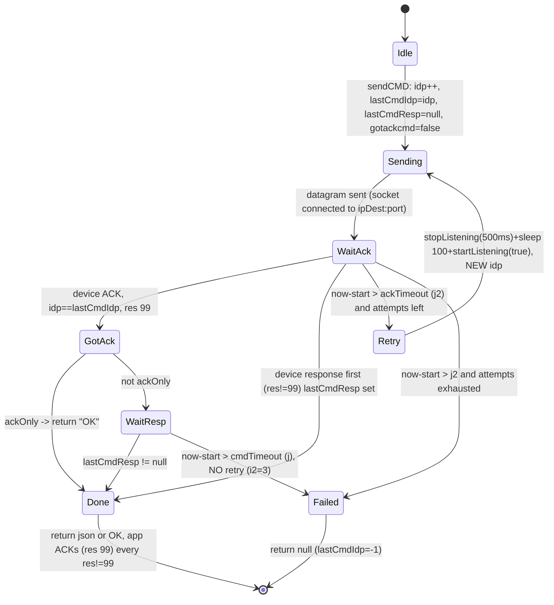
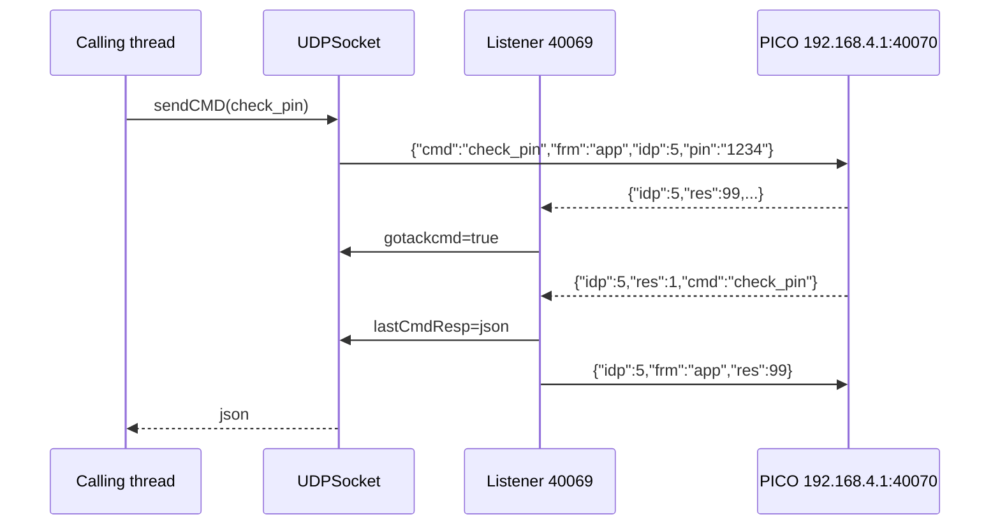

# Local transport and protocol (PICO)

Analysis of the JADX decompilation of the Tecnosystemi app (`../../../Export-Pico/sources/it/tecnosystemi/TS`). All paths are relative to that directory. Marking: no tag = read in the code; "(inferred)" = deduced. The decompiled output of some methods is degraded by JADX (flagged where relevant).

Scope: PICO only. Out of scope (present in the app, not analyzed here): legacy CU over TCP (`MySocket`, `10.0.0.1:1235`), legacy CU bootloader (`MySocketBootLoader`), UDP 5678 discovery (`ThreadUDPServer`, never started), POLARIS network helper (`Functions.netBinding`), HTTP cloud (`ThreadWebService`).

Other documents: `02-pico-runtime.md` (PICO state/commands at runtime), `03-provisioning.md` (AP config, scan_wifi, set pin), `04-firmware-ota.md` (ota_start + TCP 40060). For the Python library side see `docs/retry-logic.md`, `docs/connection-lifecycle.md`, `docs/architecture.md`.

## Index

1. [Transport map](#1-transport-map)
2. [Device IP resolution](#2-device-ip-resolution)
3. [PICO UDP: wire format](#3-pico-udp-wire-format)
4. [PICO UDP: idp/ack state machine](#4-pico-udp-idpack-state-machine)
5. [Retry, timeout, sendCMD overloads](#5-retry-timeout-sendcmd-overloads)
6. [State polling (sendGetStato)](#6-state-polling-sendgetstato)
7. [Android network binding (PICO AP)](#7-android-network-binding-pico-ap)
8. [TCP 40060 (pointer to 04)](#8-tcp-40060-pointer-to-04)
9. [Credentials, PIN, encryption](#9-credentials-pin-encryption)
10. [Transport constants](#10-transport-constants)
11. [Visible quirks and bugs](#11-visible-quirks-and-bugs)
12. [Open questions](#12-open-questions)

---

## 1. Transport map

| Transport | Class | Dest. | Ports | Use |
|---|---|---|---|---|
| UDP JSON | `Commands/UDPSocket.java` | `192.168.4.1` (AP) | send 40070, listen 40069 | all local PICO runtime |
| TCP raw | `Commands/PicoSocketBootloader.java` | `192.168.4.1` | 40060 (`:17`) | firmware upload after `ota_start`, see 04 |

Local vs cloud choice: for PICO the `pico.getOffline()` flag (`Model/Pico.java:295`) decides. `Offline==true` = the app is connected to the device AP and uses local UDP; `false` = uses the cloud via `ThreadWebService` (`GetPICOState?picoSerial=..&PIN=..`, `SendPicoCmd`; out of scope). Example: `Activity/PICO/PicoActivity.java:846-872` (5 s state timer: offline branch = UDP, else branch = cloud). The flag is reset to `false` when the device is registered in the cloud (`Activity/TS/TSDeviceListActivity.java:273-322`). There is no "UDP over the home LAN" path on the app side: see sec. 2.

## 2. Device IP resolution

- `UDPSocket.ipDest` is a static (`Commands/UDPSocket.java:33`), written only in `startListening(z, z2, str)` (`:61-65`):
  - always `"192.168.4.1"` (fixed IP of the PICO AP).
- No discovery for PICO: no broadcast, no mDNS, no reading of the STA IP. The app never opens UDP to the PICO LAN IP. In LAN/STA mode it uses the cloud.
- To reach `192.168.4.1` the app must be attached to the device SSID: `Pico_<serial>` with password `TS_<serial>` (`Activity/PICO/PicoActivity.java:2103-2104`, constants `Utils/Constants.java:277,279,286,288`). Config: `Pico_config`/`12345678`. Details in sec. 7.
- `UDPSocket.isConnected()` (`:359-365`): `InetAddress.getByName(ipDest).isReachable(2000)`. On non-root Android the probe is ICMP or TCP echo (inferred); used as a liveness check by `PicoActivity` (`:847,1642,2109`).

## 3. PICO UDP: wire format

Transport: UDP datagram, payload = UTF-8 JSON serialized with Gson (`gson.toJson(cmdPICO)`, `UDPSocket.java:255`), no framing, no terminator. No encryption/signature (PIN in clear).

Request envelope (`Commands/CmdPICO.java:17-20`, private fields serialized by Gson):

```json
{"cmd":"check_pin","frm":"app","idp":7,"pin":"1234"}
```

| Field | Type | Semantics |
|---|---|---|
| `cmd` | string | command name (`check_pin`, `stato_sync`, `scan_wifi`, `pico_info`, `ota_start`, `ota_end`, `pico_ap`, ... ; classes in `CmdPICO`, other areas) |
| `frm` | string | always `"app"` |
| `idp` | long | assigned by `sendCMD`/`sendGetStato` from the static counter, see sec. 4 |
| `pin` | string | device PIN (from `Pico.getPin()`); may be `null` and Gson omits `null`s (inferred: Gson default does not serialize null) |

`Commands/CmdPICO.java:16-20` (`frm` defaults to `"app"`; subclasses add flat fields to the same object, payload details in 02-04):

```java
public class CmdPICO {
    private String cmd;
    private String frm = "app";
    private long idp;
    private String pin;
```

ACK app -> device (built by hand with `JSONObject`; `CmdPICO.ACK` also exists (`:22-26`), not used here):

```json
{"idp":7,"frm":"app","res":99}
```

`Commands/UDPSocket.java:166-172` (the ACK is a `JSONObject` sent via `sendCMD` with `z2=true`, i.e. "raw send", without waiting for a response):

```java
private static void sendAk(long j, String str) {
    try {
        JSONObject jSONObject = new JSONObject();
        jSONObject.put(idpkJson, j);
        jSONObject.put("frm", "app");
        jSONObject.put(resJson, 99);
        sendCMD(null, 5000L, 5000L, true, 1, true, jSONObject);
```

Device response (read with `org.json`): `{"idp":N,"res":R,"cmd":"...", ...specific fields}`. Parsing in `parsemsg` (`:117-155`):

- `res == 99`: device ACK to our request (must not be re-acknowledged).
- `res != 99`: actual response. Convention observed in callers: `res == 1` = OK (e.g. `PicoActivity.java:1636`, `PicoBootloaderActivity.java:308`, `Constants.JSON_RES="res"` `:185`). Other codes: not enumerated in this layer.
- Receive buffer 1500 bytes (`ConnectionResult.DRIVE_EXTERNAL_STORAGE_REQUIRED`, GMS constant = 1500, inferred from the known value). The string is created with `new String(buf, 0, 1500)` (`:98`), not with the packet length: the JSON is followed by NULs. Android's `new JSONObject(String)` tolerates the trailing data (inferred). Responses > 1500 B are truncated.

`Commands/UDPSocket.java:94-98` (receive: fixed buffer, string always 1500 characters):

```java
while (UDPSocket.keeplistening && UDPSocket.socketListen != null) {
    try {
        byte[] bArr = new byte[ConnectionResult.DRIVE_EXTERNAL_STORAGE_REQUIRED];
        UDPSocket.socketListen.receive(new DatagramPacket(bArr, ConnectionResult.DRIVE_EXTERNAL_STORAGE_REQUIRED));
        UDPSocket.parsemsg(new String(bArr, 0, ConnectionResult.DRIVE_EXTERNAL_STORAGE_REQUIRED));
```

Reply port (confirmed): the PICO always replies to UDP 40069, whatever the sender's source port. The app's send socket uses an ephemeral port (`new DatagramSocket()`, `:262`), so the listener must be bound to 40069 to see the replies.

## 4. PICO UDP: idp/ack state machine

Global state (all `static`, not volatile, no locks): `idp` (counter, init 1), `statoIdp` (synchronized list of pending `stato_sync` idps), `lastCmdIdp`, `lastCmdResp`, `gotackcmd`, `gotackstato` (written, never read elsewhere: dead code), `lastcmd`.

Rules:

1. `sendCMD` (non-ACK): at each attempt `cmd.idp = idp++` (`:242-246`). So a retry uses a new idp, not the same one. `lastCmdIdp = idp`, `lastCmdResp = null`, `gotackcmd = false`.

   `Commands/UDPSocket.java:242-260`:

   ```java
   if (!z2) {
       long j3 = idp;
       idp = 1 + j3;
       cmdPICO.setIdp(j3);
   }
   // ...
   if (z2) {
       bytes = jSONObject.toString().getBytes();
   } else {
       bytes = gson.toJson(cmdPICO).getBytes();
       lastcmd = cmdPICO.getCmd();
       lastCmdIdp = cmdPICO.getIdp();
       lastCmdResp = null;
       gotackcmd = z3;
   }
   ```
2. `sendGetStato`: `idp++`, push into `statoIdp`, fire-and-forget (sec. 6).
3. Listener, a new `Thread` per datagram (`parsemsg`):
   - `idp` in `statoIdp`: if `res==99` -> `gotackstato=true`; otherwise removes the idp and calls `PicoActivity.receiveStato(json)` if `statoActivity` is a `PicoActivity`.
   - `idp == lastCmdIdp`: `res==99` -> `gotackcmd=true`; otherwise `lastCmdResp=json`.
   - Any other idp: discarded (but see below, it is acked anyway).
   - If the message has `res` and `res != 99`: `sendAk` (sends `{idp,frm:"app",res:99}`). Device ACKs are never re-acked.

   `Commands/UDPSocket.java:124-148` (`parsemsg`, reduced):

   ```java
   if (jSONObject.has(UDPSocket.idpkJson)) {
       long j = jSONObject.getLong(UDPSocket.idpkJson);
       if (UDPSocket.statoIdp.contains(Long.valueOf(j))) {
           if (jSONObject.has(UDPSocket.resJson)) {
               if (jSONObject.getLong(UDPSocket.resJson) == 99) {
                   UDPSocket.gotackstato = true;
               } else {
                   UDPSocket.statoIdp.remove(Long.valueOf(j));
                   // ... receiveStato(jSONObject.toString()) if PicoActivity
               }
           }
       } else if (j == UDPSocket.lastCmdIdp) {
           if (jSONObject.getLong(UDPSocket.resJson) == 99) {
               UDPSocket.gotackcmd = true;
           } else {
               UDPSocket.lastCmdResp = jSONObject.toString();
           }
       }
       if (!jSONObject.has(UDPSocket.resJson) || jSONObject.getLong(UDPSocket.resJson) == 99) {
           return;
       }
       UDPSocket.sendAk(jSONObject);
   ```
4. `sendAk(JSONObject)` (`:158-164`) calls `jSONObject.getString("cmd")` even though the value is not used (the second parameter of `sendAk(long, String)` is ignored, `:166-172`): if the device response does not contain `cmd`, it throws `JSONException` -> `RuntimeException`, caught by the `catch (Exception)` of `parsemsg` (`:150`); the ACK is not sent (inferred: devices that omit `cmd` do not receive an ACK).
5. `sendCMD` blocks polling in 100 ms steps:
   - `lastCmdResp != null` -> returns the JSON string.
   - ACK received: if `ackOnly` returns `"OK"`; otherwise waits for a response up to `j` ms from the send and then exits (forcing `i2=3`, no further retry) with `null`.
   - no ACK within `j2` ms -> next attempt (with listener restart).

   `Commands/UDPSocket.java:284-311` (z=ackOnly, j=response timeout, j2=ACK timeout):

   ```java
   Date date = new Date();
   boolean z4 = true;
   while (z4) {
       String str = lastCmdResp;
       if (str != null) {
           lastcmd = null;
           lastCmdIdp = -1L;
           return str;
       }
       try {
           Thread.sleep(100L);
       } catch (Exception unused) {
       }
       if (gotackcmd) {
           if (z) {
               return "OK";
           }
           if (new Date().getTime() - date.getTime() > j) {
               i2 = 3;
               z4 = false;
           } else {
               i2 = 3;
           }
       } else if (new Date().getTime() - date.getTime() > j2) {
           z4 = false;
       }
   }
   i2++;
   ```



Arrival order: the response may precede the ACK; it is returned anyway (the `lastCmdResp` check has priority). Late responses from a previous attempt (idp different from `lastCmdIdp`) are ignored, but acked.



## 5. Retry, timeout, sendCMD overloads

Real signature: `sendCMDAsink(cmd, j, j2, z, i, z2, json)` (`:228`); `j`=response timeout after ACK, `j2`=ACK timeout, `z`=ackOnly, `i`=attempts, `z2`="raw JSON send" mode (used only for app ACKs).

| Overload | j | j2 | z | i | Notes |
|---|---|---|---|---|---|
| `sendCMD(cmd)` | 5000 | 5000 | false | 3 | default (`:204`) |
| `sendCMD(cmd, j)` | j | 5000 | false | 3 | (`:208`) |
| `sendCMD(cmd, j, j2)` | j | j2 | false | 3 | e.g. `scan_wifi` 10000/1500 (`Activity/PICO/Config/ChooseWifiPICOActivity.java:143`); `ota_start` 15000/15000 (`PicoBootloaderActivity.java:304`) |
| `sendCMD(cmd, j, j2, z)` | j | j2 | **always false** | 3 | the `z` parameter is ignored: `return sendCMD(cmd, j, j2, false, 3)` (`:216-218`) |
| `sendCMD(cmd, j, j2, z, i)` | j | j2 | z | i | only way to get ackOnly; e.g. `pico_info` 15000/15000/false/1 (`PicoBootloaderActivity.java:120,129`) |

`Commands/UDPSocket.java:216-222` (the 4-arg discards `z`):

```java
public static synchronized String sendCMD(CmdPICO cmdPICO, long j, long j2, boolean z) {
    return sendCMD(cmdPICO, j, j2, false, 3);
}

public static synchronized String sendCMD(CmdPICO cmdPICO, long j, long j2, boolean z, int i) {
    return sendCMD(cmdPICO, j, j2, z, i, false, null);
}
```

Consequence: the call `sendCMD(picoAP, 10000L, 10000L, true)` (`PicoBootloaderActivity.java:343`) is NOT ack-only; it waits for the response or fails with `null` after 10 s (in the OTA flow the reset happens on the device side anyway, the result is not used). See 04.

Timing:
- One attempt: up to `j2` without ACK; with ACK up to `j` from the send.
- Worst case without ACK, default: 3 x 5 s + 2 x (500 ms stop + 100 ms sleep) ~ 16.2 s. With 15000/15000: ~46.2 s.
- Each retry calls `stopListening()` (500 ms sleep inside, `:194`) + `startListening(true, ...)`, which also recreates an empty `statoIdp` (`:60`): any pending `stato_sync` are forgotten.
- Listener poll: `SO_TIMEOUT` 1000 ms (`:93`).
- Send: `datagramSocketSend` reused; `connect()` up to 5 tries of 100 ms (`:270-278`); exception -> `datagramSocketSend` reset and `null` returned (`:314-324`) with no further attempts.
- Serialization: `sendCMD` with 1-5 arguments is `synchronized` (class lock); `sendCMD` with 7 arguments and `sendGetStato` are not. ACKs go through the 7-arg one, so they may write to the socket concurrently with a command in progress (UDP, harmless in itself).
- Caller-level retry pattern: `PicoActivity.checkPin` (`:1606-1651`): `startListening()`, sleep 100, `sendCMD(check_pin)`; if `null` -> `stopListening()`, sleep 2000, `startListening()`, sleep 100, second `sendCMD` (i.e. up to 6 sends and new idps); if still `null` and `!isConnected()` -> `connectToPolaris` toast + `reconnect()` (sec. 7); otherwise `showGetPin()` (wrong/missing PIN).
- `check_pin` OK outcome: `res == 1` -> `startStatoTimer()`.

`Activity/PICO/PicoActivity.java:1619-1648` (caller-level retry, reduced):

```java
String strSendCMD = UDPSocket.sendCMD(cmdPICO);
if (strSendCMD == null) {
    UDPSocket.stopListening();
    // Thread.sleep(2000L) ...
    UDPSocket.startListening();
    // Thread.sleep(100L) ...
    strSendCMD = UDPSocket.sendCMD(cmdPICO);
}
if (strSendCMD != null) {
    try {
        JSONObject jSONObject = new JSONObject(strSendCMD);
        if (jSONObject.has(Constants.JSON_RES) && jSONObject.getInt(Constants.JSON_RES) == 1) {
            PicoActivity.this.startStatoTimer();
            return;
        }
    } catch (Exception unused4) {
    }
} else if (!UDPSocket.isConnected()) {
    // ... toast connectToPolaris
    PicoActivity.this.reconnect();
    return;
}
PicoActivity.this.hideProgress();
PicoActivity.this.showGetPin();
```

## 6. State polling (sendGetStato)

Trigger: `PicoActivity.startStatoTimer()` (`:803-876`): `Timer.schedule(task, 0, 5000)`.

Branch `pico.getOffline()==true` (local), inside the task:
1. `!UDPSocket.isConnected()` (2 s ping): if > 10 s have passed since the last retry (`lastRetry`) -> `showProgress()`, `stopListening()`, `reconnect()` (sec. 7) and `return`.
2. otherwise `startListening()` (always recreates listener and `statoIdp`, see sec. 11 point 1), sleep 500 ms, `sendGetStato(pin)`.

`sendGetStato(pin)` (`UDPSocket.java:327-353`): `{"cmd":"stato_sync","frm":"app","idp":N,"pin":"..."}` on a `new DatagramSocket()` never closed (fd leak every 5 s, inferred from the code: no `close()`), idp registered in `statoIdp`, no wait. The response (res != 99) arrives on the listener and goes to `PicoActivity.receiveStato(String)` (`:779`) -> `pico.receivedSync(json)` + `updateView()` (executed on the `parsemsg` thread; `runOnUiThread` only for `updateStatoLabel`). The app ACK is generated automatically by the listener.

`Activity/PICO/PicoActivity.java:846-866` (local branch of the timer):

```java
if (PicoActivity.pico.getOffline().booleanValue()) {
    if (!UDPSocket.isConnected()) {
        if (PicoActivity.this.lastRetry == null) {
            PicoActivity.this.lastRetry = new Date();
        }
        if (new Date().getTime() - PicoActivity.this.lastRetry.getTime() > 10000) {
            PicoActivity.this.lastRetry = new Date();
            PicoActivity.this.showProgress();
            UDPSocket.stopListening();
            PicoActivity.this.reconnect();
            return;
        }
        return;
    }
    UDPSocket.startListening();
    // Thread.sleep(500L) ...
    UDPSocket.sendGetStato(PicoActivity.pico.getPin());
    return;
}
```

`Commands/UDPSocket.java:330-347` (`sendGetStato`, reduced: new socket on every call, no wait):

```java
CmdPICO cmdPICO = new CmdPICO();
cmdPICO.setPin(str);
long j = idp;
idp = 1 + j;
cmdPICO.setIdp(j);
cmdPICO.setCmd("stato_sync");
String json = new Gson().toJson(cmdPICO);
// ...
statoIdp.add(Long.valueOf(cmdPICO.getIdp()));
InetAddress byName = InetAddress.getByName(ipDest);
DatagramSocket datagramSocket = new DatagramSocket();
// ...
datagramSocket.send(datagramPacket);
return null;
```

Watchdog: if `lastReceivedStato` is older than 15 s -> error toast (`zone_errors[5]`) and sets `pico.err=[[10004]]` (`PicoActivity.java:826-838`), repeated at most every 15 s.

One `stato_sync` per tick: if a command is queued (e.g. `sendCmdDataOraTImezone` `:1527`, `sendCmdUpdPico` `:1557`) while a state is pending, the two idps are distinct; `picoCMD` (flag, set to `true` before `sendCMD`) makes the next received state be discarded to avoid overwriting the UI (`receiveStato`, `:788-791`: `if (picoCMD) {picoCMD=false; return;}`; `lastReceivedStato` is updated anyway beforehand, `:787`).

## 7. Android network binding (PICO AP)

Problem: the PICO AP has no Internet, Android would tend to route over mobile data. App solution: attach to the SSID and call `ConnectivityManager.bindProcessToNetwork(network)` (all process sockets, UDP included). `UDPSocket` does not do `bindSocket` (no `tobindnet`, verified): it relies entirely on the process binding. `PicoSocketBootloader` (TCP 40060, see 04) additionally does `network.bindSocket(socket)` with `tobindnet` (`PicoSocketBootloader.java:19,42-45`).

Flow `BaseActivity.connectToWifi(...)` -> thread -> `connectToWifi_` (`Activity/BaseActivity.java:1556-1576`). Trigger: `PicoActivity.reconnect()` (`:2097-2136`); sets the statics `toConnSid`/`toConnPwd`.

1. `manualconn` already true: calls the runnable right away and that's it (`:1583-1594`).
2. GPS (`LocationManager.isProviderEnabled("gps")`) required, unless flag `z2` (`:1595`); `ACCESS_FINE_LOCATION` permission requested once.
3. Current SSID == `toConnSid`: "ALREADY CONNECTED": `bindProcessToNetwork(getCurrentWifiNetwork())` + `tobindnet` (`:1600-1618`), except `BootloaderActivity` on SDK >= 34. `getCurrentWifiNetwork` (`:1565-1574`) = first `Network` with `TRANSPORT_WIFI` (`hasTransport(1)`), not necessarily the one of the requested SSID (inferred: ambiguous with multiple Wi-Fi).
4. SDK >= 29: `WifiNetworkSpecifier` (`:1680-1720`):
   - Wi-Fi off -> opens the `android.settings.panel.action.WIFI` panel and terminates.
   - SDK >= 31 looks up the BSSID from `getScanResults()`; otherwise `startScan()` and waits for `SCAN_RESULTS` up to ~16 s (`i>15`, `sleep 1000`, `:1697-1706`).
   - `setSsid`, `setBssid` (if known), `setWpa2Passphrase(toConnPwd)` (`:1709-1713`).
   - `NetworkRequest`: `TRANSPORT_WIFI` (1), `removeCapability(12)` (= `NET_CAPABILITY_INTERNET`), specifier (`:1715-1719`); `requestNetwork(req, cb, 120000)` (120 s timeout, inferred: call after `:1760`).
   - `onAvailable(network)`: `mHandler.postDelayed(AvaiableNetwork, 10 ms)` (`:1760`); `AvaiableNetwork` (`:1891-1922`) does `bindProcessToNetwork(network)`, sets `tobindnet`, `connected=true` and runs the calling runnable. For `BootloaderActivity` on SDK >= 34 different binding (`:1739-1744`).
   - `onLost`: depends on the foreground activity. For `PicoActivity`: up to 4 attempts (`onlost > 3`, `:1801`), waits 2 s, calls `connectToWifi` again with runnable `UDPSocket.resetIDP(); stopListening(); startListening(true)` (`:1818-1827`).
   - `onUnavailable`: error runnable or `msg_error` toast.
5. SDK < 29: legacy `WifiManager` API: `addNetwork`/`enableNetwork`/`reconnect` with config `priority=999999` (`buildWifiConfig`, `:1955-1961`), registers `WifiChangeBroadcastReceiver` on `android.net.wifi.STATE_CHANGE`, 30 s timer for `errorcollWifi()` if not connected (`:1885`).

`Utils/WifiChangeBroadcastReceiver.java`: wrapper delegating to `BaseActivity.onWifiChangeBroadcastReceived` (`:1963-1976`): compares `wifiInfo.getSSID()` with `"\"" + toConnSid + "\""`; if equal -> `bindProcessToNetwork()` (`:1970`) and `connected=true` + runnable. Note: the `BaseActivity` method called `bindProcessToNetwork()` does NOT call `ConnectivityManager.bindProcessToNetwork`: it only updates `MySocket.tobindnet` (`:1990-1993`, quirk; `MySocket` is legacy, so on SDK < 29 there is no binding for PICO; having Wi-Fi as the only network is enough (inferred)). The receiver is unregistered in `onStop` (`:1925-1931`).

Unbinding: `BaseActivity.unbidNetwork()` (`:1995-2007`) clears `tobindnet` of `MySocket` and `MySocketBootLoader` but not of `PicoSocketBootloader` (stays stale) and does `bindProcessToNetwork(null)`. `disconnectFromWIfi()` (`:1933-1953`): SDK < 29 removes the network; otherwise `unregisterNetworkCallback` + `bindProcessToNetwork(null)`.

PICO reconnect cycle (`PicoActivity.reconnect`, `:2097-2136`), for reference: `times++`; SSID `Pico_<serial>` (`Constants.WIFI_NAME_OFFLINE_PICO`), pwd `TS_<serial>`; success runnable: if `firstCheck` and (`!isConnected()` and `times>1`) -> `disconnectFromWIfi()`, `times=0`; otherwise `resetIDP()`, `startListening(true)`, `startStatoTimer()`. First time: `resetIDP(); startListening(true); checkPin()`.

Out of scope: `Functions.netBinding` (SSID filter `POLARIS`, no callers) and the `MySocket.checkPinCmd` pre-check for legacy CU activities.

## 8. TCP 40060 (pointer to 04)

`PicoSocketBootloader` (raw TCP): `connectToSocket(ip)`: `ip==null` -> `192.168.4.1`; `Socket()`, `tobindnet.bindSocket`, `connect(ip:40060, 10000 ms)` (`PicoSocketBootloader.java:25-51`); `sendfile(bytes)` = `write + flush`, no response read, no application ACK (`:53-65`). Caller and chunking (1300 B, 20 ms) in `PicoBootloaderActivity.java:313-324`; full flow in `04-firmware-ota.md`.

Out of scope: `MySocket` (TCP `10.0.0.1:1235`, legacy CU), `MySocketBootLoader` (legacy CU bootloader), `ThreadUDPServer` (UDP 5678, never started, `parseUdpMessage` is a stub), `Model/Response.java` (cloud HTTP POJO).

## 9. Credentials, PIN, encryption

- Local PIN: in clear in the UDP JSON (`pin`). No transport encryption, no challenge. The PICO PIN is saved in `PREF_PICO_DEVS` (`"PICODevs"`, `Utils/Constants.java:217`, JSON array with `Name`, `Serial`, `Pin`, `Offline`, `IP`... `Model/Pico.java:510-606`).
- `SavePreferences` (`Utils/SavePreferences.java`): wrapper over `com.securepreferences.SecurePreferences`, file `appProAirPref.xml`, hard-coded password `"proAirprefpwd12345"`, salt = `ANDROID_ID` (10000 iterations, `:22`; saltless variant `:24`). Encrypts keys/values at rest, but the key is derivable from the APK + `ANDROID_ID`.
- `AESCrypt`/`AESAlgorithm`: used only for the cloud account password; not used in local transport.
- AP Wi-Fi passwords: derived from the serial (`TS_<serial>`) or fixed (`Pico_config`/`12345678`): `Utils/Constants.java:277-288`.

## 10. Transport constants

| Constant | Value | Where |
|---|---|---|
| `portaDest` / `portaRead` | 40070 / 40069 | `UDPSocket.java:40-41` |
| `ipDest` default | `192.168.4.1` | `:33` |
| `DEFTIMEOUTACK` / `DEFTIMEOUTCMD` | 5000 ms | `:24-25` |
| ack code | `res == 99` | `:128,138,145` |
| listener `SO_TIMEOUT` | 1000 ms | `:93` |
| receive buffer | 1500 B | `:96-97` |
| sendCMD poll | 100 ms | `:294` |
| default retry | 3 | `:217` |
| `stopListening` sleep | 500 ms | `:194` |
| state timer | 5000 ms | `PicoActivity.java:875` |
| state watchdog | 15000 ms | `PicoActivity.java:826` |
| `isReachable` | 2000 ms | `UDPSocket.java:361` |
| TCP OTA | `192.168.4.1:40060`, connect 10000 | `PicoSocketBootloader.java:13,16-17` |
| JSON keys | `cmd`, `idp`, `res`, `frm`, `pin` (UDP) | `UDPSocket.java:26,32,42` |
| SSID/pwd | `Pico_`/`TS_`, `Pico_config`/`12345678` | `Constants.java:277-288` |

## 11. Visible quirks and bugs

UDP transport:
1. `islistening` is never set to `true` (only assignments to `false`, `:100,106,181`): the guard `if (!islistening || z)` in `startListening` is always true (`:58`). Every call recreates thread, socket and `statoIdp`. Interacts badly with the state timer: `startStatoTimer` calls `startListening()` every 5 s (`PicoActivity.java:860`), wiping pending state idps and closing/reopening the 40069 socket while a response may be in flight.
2. Races on unprotected statics: `idp`, `lastCmdIdp`, `lastCmdResp`, `gotackcmd`, `ipDest`, `datagramSocketSend`, `socketListen` are read/written by the UI thread, timer, `parsemsg` threads (one per datagram) without `volatile`/lock; `sendGetStato` (timer) and `sendCMD` (UI) increment `idp` without a common synchronization (`sendGetStato` is not `synchronized`): possible duplicate idp (inferred). `statoIdp` is replaced (not emptied) by `startListening`/`resetIDP`.
3. Reader threads can pile up (inferred): the old thread does not terminate with `interrupt()` (it does not interrupt `receive`); on `SocketException` (closing of the old socket) it stays in the `while (keeplistening && socketListen != null)` loop and keeps reading the NEW `socketListen`. Back-to-back `startListening` calls -> multiple readers on the same socket -> duplicate `parsemsg` -> duplicate ACKs and double delivery of `receiveStato`.
4. `BindException` on 40069 (second process/reader that has not yet released it) is swallowed (`catch Exception unused5`, `:107`): listener silently dead, `sendCMD` then times out.
5. `sendGetStato` creates a `DatagramSocket` on every call and does not close it (fd leak, 12/min).
6. `sendCMD(..., z)` with 4 arguments ignores `z` (ackOnly never active from those call sites).
7. ACK depends on the presence of `cmd` in the response (sec. 4 point 4).
8. Retry = new idp: a non-idempotent command (e.g. `upd_pico`) may be executed multiple times if the response is lost; the `res` of the previous attempt is discarded. Also, polling after ACK counts the `j` timeout from the send, not from the ACK, and does not retry (`i2=3`).
9. `gotackstato`, `lastcmd` (read only internally) and the `CmdPICO.ACK` field have no effect: leftovers.
10. Listener on `getIPAddress(true)` = first non-loopback IPv4 in enumeration order, which may be the mobile interface; with `bindProcessToNetwork` active the send socket goes over Wi-Fi but the listener bind address might not belong to the AP network (inferred; on common devices `wlan0` is often the first).
11. `isReachable` as liveness can give false negatives on APs (ICMP blocked).

Network:
12. `BaseActivity.bindProcessToNetwork()` (misleading name) does not bind the process; `unbidNetwork` forgets `PicoSocketBootloader.tobindnet`.
13. `connectToWifi_` selects the "current Wi-Fi network" as the first `TRANSPORT_WIFI` of `getAllNetworks()`.

## 12. Open questions

- Full list of `res` values beyond 1/99: not in the transport layer, check in 02.
- No app-side idp-sync: `resetIDP()` resets to 1 on every (re)connection; does the firmware tolerate it or require monotonicity? Compare with `../../retry-logic.md` (on the Python side IDP drift blocks commands).
- Actual behavior of `Functions.getIPAddress(true)` when multiple interfaces are active (cellular + Wi-Fi) in the presence of `bindProcessToNetwork`.
