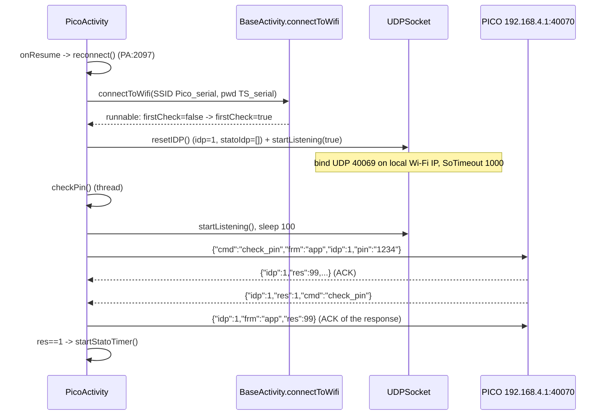
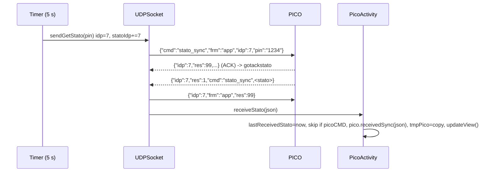
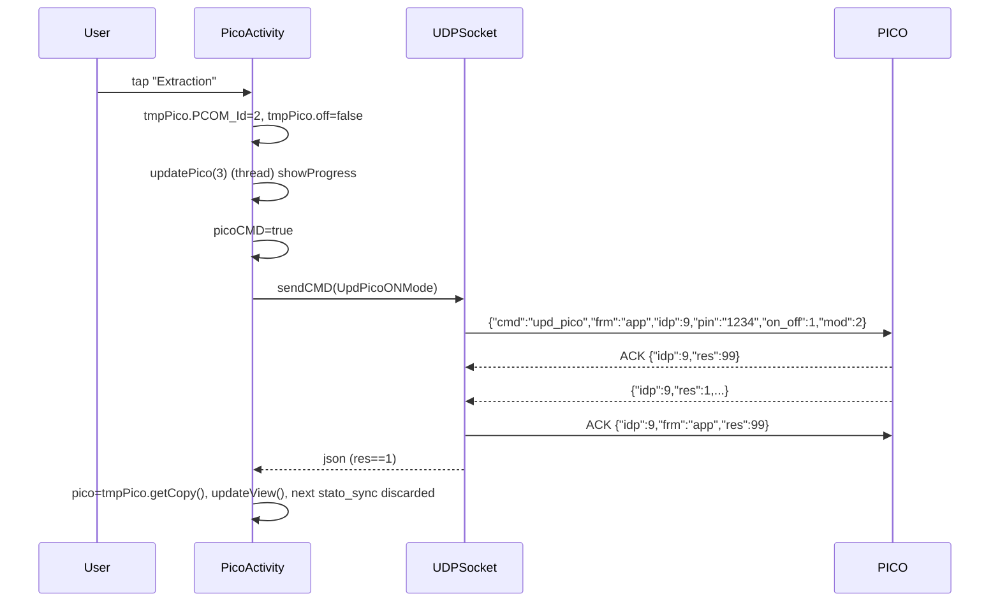
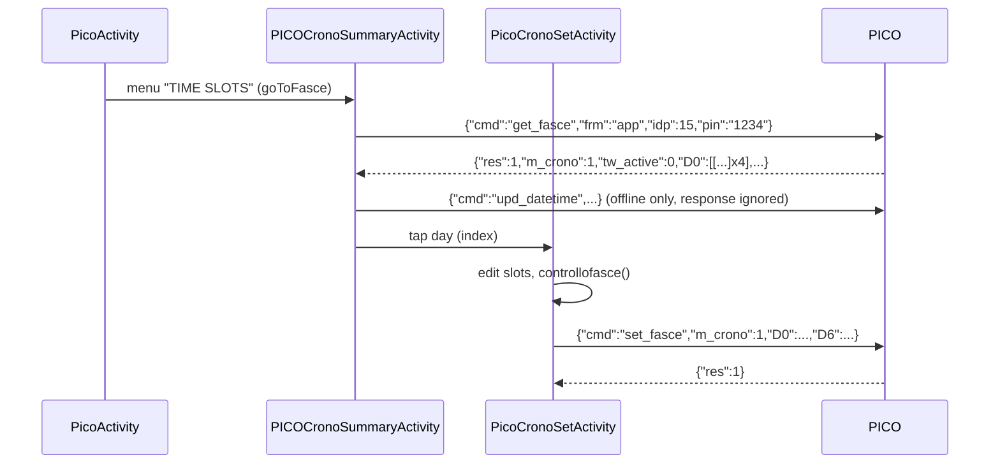

# PICO: runtime control

Scope: PICO activities (`PicoActivity`, `PicoCronoSetActivity`, `PICOCronoSummaryActivity`), models `Pico`, `PICOCronoObj`, adapter `PICOCronoSummaryAdapter`.
UDP transport, `CmdPICO` envelope, ACK (`res=99`), `sendCMD` retry/timeout: see [01-transport.md](01-transport.md) (only referenced here). Provisioning/config: [03-provisioning.md](03-provisioning.md). OTA/bootloader: [04-firmware-ota.md](04-firmware-ota.md). PICO scope only.

Conventions: paths relative to `../../../Export-Pico/sources/it/tecnosystemi/TS`. Abbreviations: `PA` = `Activity/PICO/PicoActivity.java`, `PS` = `Activity/PICO/PicoCronoSetActivity.java`, `PM` = `Activity/PICO/PICOCronoSummaryActivity.java`, `CP` = `Commands/CmdPICO.java`, `UD` = `Commands/UDPSocket.java`, `MP` = `Model/Pico.java`, `MO` = `Model/PICOCronoObj.java`, `TW` = `Threads/ThreadWebService.java`, `BA` = `Activity/BaseActivity.java`. Strings: `Export-Pico/resources/res/values/strings.xml` (EN) and `arrays.xml`. "(inferred)" = deduced, not read explicitly.

## Index

1. [Mental model: local vs cloud](#1-mental-model-local-vs-cloud)
2. [Device opening, connection, `stato_sync` polling](#2-device-opening-connection-stato_sync-polling)
3. [Device state: `receiveStato` / `Pico.receivedSync` parsing](#3-device-state-parsing)
4. [Runtime commands `upd_pico` (on/off, mode, speed, humidity, night, led, maintenance, m_crono)](#4-runtime-commands-upd_pico)
5. [`mod` enum and UI map](#5-mod-enum-and-ui-map)
6. [Date/time: `upd_datetime`](#6-datetime-upd_datetime)
7. [Chronothermostat: `get_fasce` / `set_fasce`](#7-time-slots-get_fasce--set_fasce)
8. [`upd_P6X` variants](#8-upd_p6x-variants)
9. [Persisted state (SharedPreferences)](#9-persisted-state)
10. [Observed anomalies and open questions](#10-observed-anomalies-and-open-questions)

---

## 1. Mental model: local vs cloud

Every PICO flow has two branches decided by `Pico.isOffline` (`MP:47`, getter `getOffline()`), not by a runtime choice:

| `pico.getOffline()` | Transport | Notes |
|---|---|---|
| `true` ("offline") | Local UDP via `UDPSocket`. `startListening(true)` forces `ipDest="192.168.4.1"` (`UD:56-66`). The phone must be connected to the device Wi-Fi AP `SSID="Pico_<serial>"`, `pwd="TS_<serial>"` (`PA:2103-2104`, `Constants.WIFI_NAME_OFFLINE_PICO="Pico_"`). | No LAN IP is used: throughout the PICO runtime the destination IP is always 192.168.4.1. |
| `false` (default if the device is not in prefs) | Cloud HTTP `https://proair.azurewebsites.net` (`strings.xml:811`). | Boundary only: `GET /api/v1/GetPICOState`, `POST /api/v1/SendPicoCmd`, `POST /api/v1/UpdPicoTimeAndTimezone` (`strings.xml:828,837,843`). The UDP-JSON command is serialized to a string with Gson, `frm` rewritten to `"mqtt"`, `idp` from `PicoActivity.getIDP()`, and nested in `PICOServer{Serial,Pin,Name,Cmd}` o `PICOServerTimezone{Serial,Pin,Timezone,Cmd}` (`PA:1568-1577`, `PA:1542-1551`, `Commands/PICOServer.java`). The cloud then forwards via MQTT (inferred). Not mapped further. |

Flag origin: `TSDeviceListActivity.startPICOActivity` (`Activity/TS/TSDeviceListActivity.java:285-301`) loads the `Pico` from pref `PICODevs` (`Pico.getPICOFromPref`, `MP:509`); if absent, `new Pico()` with `setOffline(false)` => cloud. The `offline` flag is written by `Pico.savePicoInPref(..., offline, ...)` (`MP:573-609`) during provisioning (see 03). The `Pico` travels in the `Intent` extra `Constants.INTENT_PICO="pico"` (`PA:158`).

Demo mode (`Constants.ISDEMO`): no I/O, `updatePico` just applies `tmpPico` to `pico` (`PA:1436-1438`). Ignored in the rest of the document.

Ack-mode: all runtime PICO commands use `sendCMD(cmd)` with default arguments (ack timeout 5000 ms, cmd timeout 5000 ms, 3 attempts, `ackOnly=false`), so the return value is the non-ACK response JSON with the same `idp`, or `null` (see 01). The `idp` set by hand by the Activities (`cmdPICO.setIdp(PicoActivity.getIDP())`, `PM:66`, `PS:201`) is **overwritten** by `UDPSocket.sendCMDAsink` with the global counter (`UD:243-247`); it only matters in the cloud branch. The `UDPSocket.idp` counter starts at 1 and is incremented **on every attempt** of the retry loop (a retry uses a new `idp`; late ACK/response from the previous attempt are ignored).

`Commands/UDPSocket.java:236-246`
```java
while (i2 < i) {
    if (i2 != 0) {
        stopListening();
        Thread.sleep(100L);
        startListening(true, isSlave, ipDest);
    }
    if (!z2) {
        long j3 = idp;
        idp = 1 + j3;
        cmdPICO.setIdp(j3);
    }
```

`PicoActivity.getIDP()` (`PA:1516-1523`) is a separate counter 2..501 (wraps to 1), reset to 0 in `onCreate` (`PA:157`).

## 2. Device opening, connection, `stato_sync` polling

### 2.1 Trigger and lifecycle

- UI trigger: tap on the device in `TSDeviceListActivity.connectDevice` with `LVDV_Type == DEVICE_TYPE_PICO` => `startPICOActivity` (`TSDeviceListActivity.java:268-301`).
- `PicoActivity.onCreate` (`PA:152-184`): `idp=0`, reads `pico` from the Intent, `tmpPico = pico.getCopy()` ("optimistic" working copy, `MP:365-401`), `setUpGui`, `updateView`, `UDPSocket.setStatoActivity(this)` (registers the Activity as the recipient of `receiveStato`, `UD:355`), prepares the AQI handler. Does **not** start polling.
- `onResume` (`PA:2072-2085`): `pausastato=false`; if online => `startStatoTimer()`; if offline => if `firstCheck||errcon` returns, otherwise `reconnect()`.
- `onPause` (`PA:2173-2177`): `pausastato=true` (the `Timer` keeps running but every tick exits immediately and clears `lastReceivedStato`), stops the AQI handler.
- `onDestroy` (`PA:2057-2069`): `UDPSocket.stopListening()`, `timerStato.purge()+cancel()`. The static flag `BaseActivity.picoActDestoryed` (`BA:115`, set in `BA:2051`) prevents the network `onLost` callback from restarting the reconnection (`BA:1798,1814`).

### 2.2 Local connection (offline branch)



`checkPin` details (`PA:1606-1651`):
- payload: `{"cmd":"check_pin","frm":"app","idp":N,"pin":"<pin>"}` (constant `Protocols.CMD_CHECK_PIN`, `Commands/Protocols.java:5`).
- if `sendCMD` returns `null`: `stopListening`, sleep 2000 ms, `startListening`, sleep 100 ms, second `sendCMD` (=> up to 2x3 UDP attempts).
- response with `res==1` => `startStatoTimer()`; any other outcome with a non-null response => `hideProgress` + `showGetPin()` (PIN dialog, interpreted as wrong PIN; `ERRPICO16` "PIN error" exists in `strings.xml:12` but is not referenced here).
- `null` response and `!UDPSocket.isConnected()` (`InetAddress.isReachable(2000)` on `ipDest`, `UD:359-365`) => toast `connectToPolaris` + `reconnect()`. `null` response but host reachable => falls into `hideProgress` + `showGetPin()` like a wrong PIN.

`Activity/PICO/PicoActivity.java:1619-1648`
```java
String strSendCMD = UDPSocket.sendCMD(cmdPICO);
if (strSendCMD == null) {
    UDPSocket.stopListening();
    // ... sleep 2000, startListening, sleep 100
    strSendCMD = UDPSocket.sendCMD(cmdPICO);
}
if (strSendCMD != null) {
    try {
        JSONObject jSONObject = new JSONObject(strSendCMD);
        if (jSONObject.has(Constants.JSON_RES) && jSONObject.getInt(Constants.JSON_RES) == 1) {
            PicoActivity.this.startStatoTimer();
            return;
        }
    } catch (Exception unused4) {
    }
} else if (!UDPSocket.isConnected()) {
    Functions.makeErrorToast(PicoActivity.this.activity, PicoActivity.this.getResources().getString(R.string.connectToPolaris));
    PicoActivity.this.reconnect();
    return;
}
PicoActivity.this.hideProgress();
PicoActivity.this.showGetPin();
```
- `showGetPin` confirm: `pico.setPin(txt)`, `Pico.savePicoInPref(pico)` (persists the PIN, `PA:1663-1664`), then `checkPin()` (offline) or `first=true; startStatoTimer()` (online).

`reconnect()` second run (`PA:2108-2118`): if `!isConnected() && times>1` => `disconnectFromWIfi()`, `times=0`; otherwise `resetIDP(); startListening(true); startStatoTimer()`. "AP missing" callback (`PA:2139-2170`): dialog with SSID/pwd and opening of `android.settings.WIFI_SETTINGS`, `errcon=true` until confirmed.

### 2.3 Polling loop (`startStatoTimer`, `PA:803-876`)

`java.util.Timer.schedule(task, delay=0, period=5000 ms)`. Before creating the timer it cancels the previous one (static `timerStato`), `pausastato=false`, `lastReceivedStato=null`.

Each tick:
1. `ISDEMO` => return. `pausastato` => `lastReceivedStato=null; return`.
2. Watchdog: if `now - lastReceivedStato > 15000 ms` => toast `zone_errors[5]` ("System status not synchronized, please try again later", `arrays.xml`), rate-limited to 1 per 15 s (`lastErrShow`), and locally sets `pico.err = [[10004]]` (synthetic code, see 3.2) + `setErrorsMan()`. If `lastReceivedStato==null` it is initialized to "now" on the first tick (the 15 s count starts from the first tick).

`Activity/PICO/PicoActivity.java:823-838`
```java
if (PicoActivity.lastReceivedStato == null) {
    PicoActivity.lastReceivedStato = new Date();
}
if (new Date().getTime() - PicoActivity.lastReceivedStato.getTime() > 15000) {
    // ... toast rate-limited (lastErrShow, 15 s)
    PicoActivity.pico.getErr();
    int[][] iArr = (int[][]) Array.newInstance((Class<?>) Integer.TYPE, 1, 1);
    iArr[0][0] = 10004;
    PicoActivity.pico.setErr(iArr);
```
3. Offline branch:
   - `!UDPSocket.isConnected()` => if `now - lastRetry > 10000 ms` => `showProgress`, `stopListening`, `reconnect()`; return.
   - otherwise `UDPSocket.startListening()` (no-op if already listening), sleep 500 ms, `UDPSocket.sendGetStato(pin)` (fire-and-forget; `UD:327-353`).
4. Online branch: `ThreadWebService(type=26)` `GET .../GetPICOState?picoSerial=<serial>&PIN=<pin>` (`PA:872`). Response in `parserServerStato` (`PA:899-917`): HTTP 200 + `ResCode==0` => `receiveStato(ResDescr)`; `ResCode==2` (PIN) => `stopgetState()` + `showGetPin()` (`PA:1580-1591`).

Local polling payload (`UD:327-353`):

```json
{"cmd":"stato_sync","frm":"app","idp":7,"pin":"1234"}
```

- the `idp` is taken from the global counter and inserted into `UDPSocket.statoIdp` (synchronized list) **before** sending;
- sent with a new `DatagramSocket` on every call (ephemeral source port, never closed), to `ipDest:portaDest` (40070);
- no waiting/retry: the response is asynchronous on the listener thread.

Response port (confirmed fact): the PICO **always** replies to UDP 40069 (`portaRead`), whatever the sender's source port. The app listener is in fact bound to 40069 (`UD:91`) and the send sockets (`sendGetStato`, `datagramSocketSend` of `sendCMD`) never receive anything: the response arrives only on `socketListen`. A Python client must therefore listen on 40069 and send to 192.168.4.1:40070.

`Commands/UDPSocket.java:332-347`
```java
long j = idp;
idp = 1 + j;
cmdPICO.setIdp(j);
cmdPICO.setCmd("stato_sync");
String json = new Gson().toJson(cmdPICO);
Log.d("SOCKET - UDP", "---->" + json);
statoIdp.add(Long.valueOf(cmdPICO.getIdp()));
InetAddress byName = InetAddress.getByName(ipDest);
DatagramSocket datagramSocket = new DatagramSocket();
byte[] bytes = json.toString().getBytes();
// ... (slave branch omitted)
datagramPacket = new DatagramPacket(bytes, bytes.length, byName, portaDest);
datagramSocket.send(datagramPacket);
```

Receive (`UD:parsemsg`, `UD:117-155`): if the `idp` is in `statoIdp`: `res==99` => `gotackstato=true`; otherwise => removes the idp, calls `PicoActivity.receiveStato(json)` (only if `statoActivity instanceof PicoActivity`). If the `idp` is instead `lastCmdIdp` (response to a command), `gotackcmd` (res 99) or `lastCmdResp` is set. Then, **for any message with `idp` and `res != 99`** (even with an unknown `idp`, hence also unsolicited pushes), the ACK `{"idp":N,"frm":"app","res":99}` is sent (`sendAk`, `UD:158-176`). Dispatch of messages with an unknown idp is ignored, but the ACK is sent anyway. `sendAk(JSONObject)` reads the `cmd` key (`getString`): if missing => `JSONException` => `RuntimeException`, which is however caught by the `catch (Exception)` of `parsemsg` (`UD:150-152`, log only) and the ACK is not sent.

`Commands/UDPSocket.java:124-148`
```java
if (jSONObject.has(UDPSocket.idpkJson)) {
    long j = jSONObject.getLong(UDPSocket.idpkJson);
    if (UDPSocket.statoIdp.contains(Long.valueOf(j))) {
        if (jSONObject.has(UDPSocket.resJson)) {
            if (jSONObject.getLong(UDPSocket.resJson) == 99) {
                UDPSocket.gotackstato = true;
            } else {
                UDPSocket.statoIdp.remove(Long.valueOf(j));
                if (UDPSocket.statoActivity instanceof PicoActivity) {
                    ((PicoActivity) UDPSocket.statoActivity).receiveStato(jSONObject.toString());
                }
            }
        }
    } else if (j == UDPSocket.lastCmdIdp) {
        if (jSONObject.getLong(UDPSocket.resJson) == 99) {
            UDPSocket.gotackcmd = true;
        } else {
            UDPSocket.lastCmdResp = jSONObject.toString();
        }
    }
    if (!jSONObject.has(UDPSocket.resJson) || jSONObject.getLong(UDPSocket.resJson) == 99) {
        return;
    }
    UDPSocket.sendAk(jSONObject);
}
```



### 2.4 `receiveStato` (`PA:779-801`)

1. `lastReceivedStato = now` (watchdog reset), `updateStatoLabel(str)` (debug panel only, `PA:187-230`).
2. If `picoCMD==true` (set before every local command, `PA:1558`, `PA:1528`): clears it and **discards** this state (anti-flicker after an optimistic command; if the command fails the flag stays true and the next state is discarded anyway (inferred)).
3. `hideProgress()`, `pico.receivedSync(str)`, if `fw_ver` changes updates the menu, `tmpPico = pico.getCopy()`, `updateView()`.

`Activity/PICO/PicoActivity.java:787-800`
```java
lastReceivedStato = new Date();
if (this.picoCMD) {
    this.picoCMD = false;
    return;
}
hideProgress();
this.lastStato = str;
pico.receivedSync(str);
if (pico.getFw_ver() != null && !pico.getFw_ver().equals(this.verfw)) {
    this.verfw = pico.getFw_ver();
    updatemenu();
}
tmpPico = pico.getCopy();
updateView();
```

## 3. Device state: parsing

### 3.1 Fields read by `Pico.receivedSync` (`MP:403-507`)

All optional (`has`), flat JSON. Parsing errors => `false` (fields already read before the exception remain applied).

`Model/Pico.java:409-438`
```java
if (jSONObject.has("on_off")) {
    setOff(Boolean.valueOf(jSONObject.getInt("on_off") == 2));
}
if (jSONObject.has("mod")) {
    setPCOM_Id(Long.valueOf(jSONObject.getLong("mod")));
}
if (jSONObject.has("speed")) {
    this.ventvel = jSONObject.getInt("speed");
}
if (jSONObject.has("spd_row")) {
    this.speed_raw = jSONObject.getInt("spd_row");
}
// ... spd_rich, umd
if (jSONObject.has("s_umd")) {
    setHumvel(jSONObject.getInt("s_umd"));
}
if (jSONObject.has("led_on_off")) {
    setLed(jSONObject.getInt("led_on_off"));
}
if (jSONObject.has("led")) {
    setLed(jSONObject.getInt("led"));
}
if (jSONObject.has("led_on_off_breve")) {
    setLed(jSONObject.getInt("led_on_off_breve"));
}
```

| JSON key | `Pico` field | Semantics (from code) | UI use |
|---|---|---|---|
| `fw_ver` | `Fw_ver` (String) | firmware version | menu item "FW ver" (`PA:2045-2046`) |
| `on_off` | `IsOff` | `==2` => OFF; `1` => ON | `updateView`, on/off button color |
| `mod` | `PCOM_Id` (Long) | operating mode 1..12, table 5 | highlights mode button (`PA:321-386`) |
| `speed` | `ventvel` | legacy discrete speed (1..3 (inferred)); `Pico.setVentvel` clears `speed_raw` but `receivedSync` writes the fields directly (`MP:416`) | not used by the current UI |
| `spd_row` | `speed_raw` | raw speed 0..100 (SeekBar max 100, `PA:1209`) | debug label "Velocita'" |
| `spd_rich` | `spd_rich` | requested speed 0..100 | SeekBar position (`setBarValue`, `PA:634`) |
| `umd` or `s_umd` | `humvel` | humidity setpoint 1=40%, 2=50%, 3=60% (icons `hum_40/50/60`, `cr_Umd1..3`) | three buttons in humidity modes (`PA:654-690`) |
| `led_on_off` / `led` / `led_on_off_breve` | `led` | `1`=LED on, other (2)=off. Last key present wins (code order) | voce menu "TURN ON/OFF LED" (`PA:1939-1957`) |
| `vr` | `vr` | board variant/version. `1` => hides AQI/CO2/comfort/humidity2 (`PA:288-297`); `3` => enables time-slots menu and chronothermostat icon (`PA:260-277`) (semantics inferred) | layout |
| `man` | `man` (int[]) | index 0 = PICO (other indices are for the cascade, out of scope); `1` = filter maintenance required | `lblman` icon + dialog (`PA:1269-1297`) |
| `night_mod` | `night` | `==1` => night ON (anything else = OFF; the command uses 1/2) | locks SeekBar, moon button (`PA:529-553`) |
| `err` | `err` (int[][]) | per-unit array (idx = like `man`) of error codes | `lblhome` icon + dialog, see 3.2 |
| `timezone` | `timezone` | if absent => `""`; string `"null"` => `getTimezone()` null (`MP:66-71`) | decides whether to ask for timezone before time slots (`PA:1971`) |
| `m_crono` | `m_crono` | chronothermostat: `1`=enabled, `2`=disabled | Enable/Disable menu, icon (`PA:265-277`) |
| `tw_active` | `tw_active` | `>0` with `m_crono==1` => clock icon, otherwise calendar (time window active (inferred)) | `PA:269-274` |
| `par_amb` | `par_amb` (List<Int>) | indoor air quality | 3.3 |
| `par_ext` | `par_ext` (List<Int>) | outdoor air quality | 3.3 |

Keys present in the state and read only by the debug panel (`PA:187-230`, they do not enter `Pico`): `fw_note`, `AMB_tmpr` (indoor temp.), `EXT_tmpr` (outdoor temp.), `v_tmpr` (read temp.), `spd_row`. On the cloud branch `updateStatoLabel` does `new JSONObject(obj.getString("lastpk"))`: the cloud response therefore also contains `lastpk` (JSON string of the last device packet). Structure of `ResDescr` confirmed on a live device: [../http-flows/04-pico-cloud-runtime.md](../http-flows/04-pico-cloud-runtime.md#resdescr-shape-observed-on-a-live-device-fw-1012).

The debug panel (`lyDebug`) is unreachable: the `Runnable` that makes it visible in `getMenu` is created but never added (`PA:2021-2027`, dead code).

### 3.2 Error codes `err` and maintenance `man`

`err[i][j]` (i = unit 0..4, `PICO<i>`): `code = category*1000 + mask` with an 8-bit mask; for each set bit k (0..7) the string is `ERRPICO<category><%03d(k+1)>` (`PA:1241-1254`). Examples from `strings.xml:3-18`: `1001` => `ERRPICO1001` "Temperature sensor not found"; `2001` CO2 sensor not found; `3001` limit switch not found; `3002` => bit1 => `ERRPICO3002` shutter error; `3004` => bit2 => `ERRPICO3003` shutter motor error; `3003` = bit0+bit1 => `ERRPICO3001` + `ERRPICO3002`; `4001` RTC not found; `4002` => bit1 => `ERRPICO4002` low battery. Watchdog synthetic code `10004` = category 10, mask 4 => bit2 => `ERRPICO10003` "Status not updated" (`PA:836-838`). `receivedSync` replaces `err` only if the `err` key is in the state: if the state does not contain it, the synthetic error remains (inferred).
Error icon visible if any element != 0. `man`: icon visible if any element == 1, hidden for 60 s after reset (`lastHideMan`, `PA:590-596`).

### 3.3 Air quality `par_amb` / `par_ext`

Integer array, index read: `[1]` humidity (`/100` => "% RH"), `[2]` quality index (arrow: `>400` => arrow 3, `>200` => 2, otherwise 1), `[3]` CO2 (`/100` => PPM; valid only if raw 30000..300000, otherwise refresh icon); `-999` = not available (`PA:441-526`). `[0]` unused (inferred). Display depends on the mode (`showQualAria`, `PA:392-410`): 1=indoor, 2=outdoor, 3=alternating every 5000 ms (`runnableAQI`, `PA:171-183`, when alternating `lyHum` is hidden).

## 4. Runtime commands `upd_pico`

All go through `PicoActivity.updatePico(int)` (`PA:1435-1514`) in a thread, which builds the payload from `tmpPico` and calls `sendCmdUpdPico` (`PA:1555-1578`). Common: `cmd="upd_pico"`, `frm="app"`, auto `idp`, `pin=pico.getPin()`. Gson keys: subclass fields + base (order inferred, irrelevant).

Offline branch of `sendCmdUpdPico`: `picoCMD=true`; `resp=UDPSocket.sendCMD(cmd)`; `hideProgress()`; if `resp.res==1` (`checkRespSetMode`, `PA:1593-1603`) => `pico = tmpPico.getCopy(); updateView()` (optimistic update, no state re-read). If `res!=1` or `null`: no toast, no explicit rollback (the UI becomes consistent again with the next non-discarded `stato_sync`).
`Activity/PICO/PicoActivity.java:1557-1566`
```java
if (pico.getOffline().booleanValue()) {
    this.picoCMD = true;
    String strSendCMD = UDPSocket.sendCMD(cmdPICO);
    hideProgress();
    if (checkRespSetMode(strSendCMD)) {
        pico = tmpPico.getCopy();
        updateView();
        return;
    }
    return;
}
```

Online branch: `ThreadWebService(type=27)` -> `parseRespSetStato` (`PA:878-897`): `ResCode==0` => `pico = tmpPico.getCopy(); picoCMD=true; updateView()`; otherwise toast `msg_commandKo`.

| UI action (`updatePico(n)`) | `CP` class | Payload (fields beyond envelope) | Semantics |
|---|---|---|---|
| On/off button (`btnOnOff`, `PA:919`) `n=2` | `UpdPicoON` (`CP:144`) | `{"cmd":"upd_pico","frm":"app","idp":12,"pin":"1234","on_off":2}` | `1`=ON, `2`=OFF (value = `tmpPico.off ? 2 : 1`, with `tmp.off = !pico.off`) |
| Tap on a mode (recovery, extraction, supply, natural vent., sub-modes) `n=3` | `UpdPicoONMode` (`CP:259`) | `{... ,"on_off":1,"mod":4}` | sets `tmp.PCOM_Id=<mod>` and `tmp.off=false` (so it **always turns on**) |
| Moon button `n=4` (`PA:1396-1405`) | `UpdPicoNight` (`CP:243`) | `{... ,"night_mod":1}` | `1`=night ON, `2`=night OFF; locally clears `spd_rich` when active |
| Speed SeekBar `n=5` (`onStopTrackingTouch`, `PA:1222-1228`; debug `btnSetVelDebug`, `PA:232`) | `UpdPicoSpeed` (`CP:216`) | `{... ,"speed":0,"spd_row":55}` | `spd_row` 0..100 (percentage, always via SeekBar max 100); `speed` fixed 0 ("raw speed" mode). Sent only at end of drag (`changingvalue` blocks `setBarValue` during the drag). Disabled if `night` |
| Humidity selector `n=6` (`PA:701-720`) | `UpdPicoHum` (`CP:200`) | `{... ,"s_umd":2}` | `1`=40%, `2`=50%, `3`=60% (setpoint, only in modes 4,5,10,11) |
| LED menu `n=7` (`PA:1939-1957`) | `UpdPicoLed` (`CP:184`) | `{... ,"led_on_off_breve":1}` | `1`=on, `2`=off (note: the command JSON uses `led_on_off_breve`, the state uses `led_on_off`/`led`/`led_on_off_breve`) |
| Maintenance reset `n=8` (`PA:1180-1194`, confirmation dialog) | `UpdPManReset` (`CP:160`) | `{... ,"man_reset":[1,0,0,0,0]}` | array as long as `man`, `1` where `man[i]==1`. Overwrites `lastHideMan` and clears `tmpPico.man` |
| Enable/Disable timer menu `n=9` (`PA:1981-1999`) | `UpdPicoMCrono` (`CP:284`) | `{... ,"m_crono":1}` | `1`=chronothermostat enabled, `2`=disabled. Item visible only with `vr==3` (3.1) |
| Debug: tap on the toolbar title (`PA:1407-1415`) | `CmdPICO` base | `{"cmd":"publish_sync_db","frm":"app","idp":N,"pin":"1234"}` | command not documented elsewhere, probably forces state publication to the cloud (inferred). Uses `sendCmdUpdPico` (same optimistic branch: `res==1` => `pico=tmpPico`) |

`Commands/CmdPICO.java:216-224` (PICO speed is always `spd_row`, `speed` is fixed at 0)
```java
public static class UpdPicoSpeed extends CmdPICO {
    private int spd_row;
    private int speed;

    public UpdPicoSpeed() {
        this.speed = 0;
        ((CmdPICO) this).cmd = "upd_pico";
        this.speed = 0;
    }
```

Notes:
- `UpdPico` (full payload `on_off,mod,speed,s_umd,led_on_off_breve,spd_row`, `CP:300`, `default:` of `updatePico`, `PA:1499-1509`) is unreachable code: all call sites use `n` in 2..9 (grep).
- Device rename (`PA:1708-1740`): offline only local pref (`Device.updateDevice` + `savePicoInPref`); online `sendCmdUpdPico(null)` => `PICOServer` with `Cmd=null` to `SendPicoCmd` (inferred: cloud-side rename).
- Menu "Cambia PIN" only shows a toast (`PA:1901-1907`), no operation.
- "UPDATE FW" (`PA:1936`) visible if pref `infofw` (default SharedPreferences, `Constants.PREF_INFOFWS`) is a non-empty array; leads to `PicoBootloaderActivity` (04).



## 5. `mod` enum and UI map

`MODE_*` constants (`PA:56-66`) and `setPCOM_Id(...)` in the listeners. EN labels from `strings.xml` (`pm_btn*`, `cr_*`). They match `DeviceModeEnum` in `../../../open_pico_local_api/enums/device_mode_enum.py` (1..12).

| `mod` | Constant | Label (strings) | UI button / `listlayouts` index / variant | Control panel (`updateView`) | Air quality shown |
|---|---|---|---|---|---|
| 1 | `MODE_RECUPERATORE` | HEAT RECOVERY (`cr_Recuperatore`) | `ly_recupero` idx0 | Speed SeekBar | alternating (3) |
| 2 | `MODE_ESTRAZIONE` | EXTRACTION | `ly_estrazione` idx1 | SeekBar | indoor (1) |
| 3 | `MODE_IMMISSIONE` | SUPPLY | `ly_immissione` idx2 | SeekBar | outdoor (2) |
| 4 | `MODE_UM1` | HUMIDITY RECOVERY (`cr_Auto1`) | `ly_umidita1` idx3 var.1 (submenu `showOtherChoise(2)`) | 3 humidity buttons | alternating |
| 5 | `MODE_UM2` | HUMIDITY EXTRACTION (`cr_Auto2`) | idx3 var.2 | humidity | indoor |
| 6 | `MODE_COMFORT_ESTATE` | SUMMER COMFORT (`cr_Auto3`) | `ly_comfort` idx5 var.1 (`showOtherChoise(0)`) | SeekBar | alternating |
| 7 | `MODE_COMFORT_INVERNO` | WINTER COMFORT (`cr_Auto4`) | idx5 var.2 | SeekBar | alternating |
| 8 | `MODE_CO2_RECUPERATORE` | CO2 RECOVERY (`cr_Auto5`) | `ly_co2` idx6 var.1 (`showOtherChoise(1)`) | no speed control | alternating |
| 9 | `MODE_CO2_ESTRAZIONE` | CO2 EXTRACTION (`cr_Auto6`) | idx6 var.2 | none | indoor |
| 10 | `MODE_AUTO7` | HUMIDITY + CO2 RECOVERY (`cr_Auto7`) | `ly_umidita2` idx4 var.1 (`showOtherChoise(3)`) | humidity | alternating |
| 11 | `MODE_AUTO8` | HUMIDITY + CO2 EXTRACTION (`cr_Auto8`) | idx4 var.2 | humidity | indoor |
| 12 | `MODE_RIC_NAT` | FREE/NATURAL VENTILATION (`cr_RicambioNaturale`, `pm_btnRicambioNaturale`) | `ly_ric_nat` idx7 | none | alternating |

Map tabulated from `PA:321-386`; clicks in `PA:1334-1389`, sub-choices in `PA:937-1169` (`mod` 6/7 `PA:954,962`; 8/9 `PA:996,1004`; 4/5 `PA:1041,1049`; 10/11 `PA:1086,1094`). `mod` out of range => no active button (`PA:382-385`). On `vr==1` modes 6..11 are not selectable (layout hidden, `PA:288-297`); `ly_ric_nat` takes their place.

Speed: in modes 1,2,3,6,7 the SeekBar sends `spd_row` as a percentage (4.). This UI has no command for discrete `speed`; the discrete 1..3 scale + "night" (4) is used only in the time slots (7).

## 6. Date/time: `upd_datetime`

Trigger: menu "SET DATE/TIME" (`PA:1959-1967`, visible with `vr==3`) or, for "TIME SLOTS" when online and `timezone` empty (`PA:1971-1979`, `isFasce=true`). Dialog `createDataOraTimezonePopUp` (`BA:480-560`): day (default today), hour/minute (default phone time), 12/24h switch (pref `PICO_12H`, `BA:225,553`; display only), timezone spinner (online only; offline uses index 0).

`PicoActivity.impostaDataOraTimeZone(week, hh, mm, tzIdx)` (`PA:1878-1887`):

```json
{"cmd":"upd_datetime","frm":"app","idp":14,"pin":"1234","date":"2026-10-26","time":"14:05:00","week":0}
```

- `date` = phone's current date `yyyy-MM-dd`; `time` = time chosen in the dialog `HH:mm:00` (24h); `week`: **0=Monday ... 6=Sunday** (`Calendar.SUNDAY(1)->6`, `MONDAY(2)->0`, `BA:526-544`). Same order as `D0..D6` (7).
- offline: `UDPSocket.sendCMD`; `res==1` => `pico=tmpPico.getCopy(); updateView(); if gotofasce -> goToFasce()` (`PA:1525-1541`).
- online: `ThreadWebService(type=27)` to `UpdPicoTimeAndTimezone` with `PICOServerTimezone{Serial,Pin,Timezone=Constants.TIMEZONES[idx].getIdTimeZone(),Cmd=<json cmd, frm "mqtt">}`; ok => `parseRespSetStato` (`ResCode==0`; if `gotofasce` => `goToFasce`).

Automatic clock sync: on every opening of `PICOCronoSummaryActivity` in offline mode, after a successful `get_fasce`, the app sends an `upd_datetime` with the phone time (`PM:112-141`), response ignored. `time` uses the pattern `hh:mm:ss` (12h, no AM/PM): anomaly, see 10.

`Activity/PICO/PICOCronoSummaryActivity.java:113-116`
```java
CmdPICO.UPD_DateTime uPD_DateTime = new CmdPICO.UPD_DateTime();
Date date = new Date();
uPD_DateTime.setDate(new SimpleDateFormat("yyyy-MM-dd").format(date));
uPD_DateTime.setTime(new SimpleDateFormat("hh:mm:ss").format(date));
```

## 7. Time slots: `get_fasce` / `set_fasce`

### 7.1 Navigation

`PicoActivity` menu "TIME SLOTS" (only `vr==3`, `PA:1968-1980`) => `goToFasce` => `PICOCronoSummaryActivity` (7-day summary) => tap day (`PICOCronoSummaryAdapter`, `Adapters/PICOCronoSummaryAdapter.java:140-153`, `PicoCronoSetActivity.index = item.indexInList`) => `PicoCronoSetActivity` (day editor, 4 slots). Data shared via statics `PICOCronoSummaryActivity.cronos` / `fasce` (`PM:29-30`). `PicoCronoSetActivity.indexZonetoCopy` (copy/paste day) reset in `PM.onCreate` (`PM:52`).

### 7.2 `get_fasce` (read)

Trigger: `PM.onResume` (`PM:174-178`) => `getTimeZones()` (misleading name, reads the time slots).

```json
{"cmd":"get_fasce","frm":"app","idp":15,"pin":"1234"}
```

Costante `Protocols.CMD_GETFASCE="get_fasce"` (`Protocols.java:7`). Local: `parseRespGetFasce(UDPSocket.sendCMD(cmd))`. Online: `ThreadWebService(type=33)` `SendPicoCmd`, `ResCode==0` => `parseRespGetFasce(ResDescr)`.
Parsing (`PM:106-150`): requires `res==1`; Gson into `CmdPICO.PICO_Fasce.Response` (`CP:774`) = `{res, tw_active, m_crono, D0..D6}` (+ base fields). Builds `cronos = response.getCronos(activity)` (`CP:666`): 7 `PICOCronoObj`, name from `cs_DayL/Ma/Me/G/V/S/D`.

Expected response (structure; example values):

```json
{"idp":15,"res":1,"cmd":"get_fasce","m_crono":1,"tw_active":0,
 "D0":[[480,720,1,2,0],[-1,-1,0,0,0],[-1,-1,0,0,0],[-1,-1,0,0,0]],
 "D1":[...], "D2":[...], "D3":[...], "D4":[...], "D5":[...], "D6":[...]}
```

### 7.3 `Dn` format (semantics)

`D0..D6` = Monday..Sunday (`getCronos` assigns D0 to `cs_DayL`; day spinner `PS:519-526` in Mon..Sun order; `week` in `upd_datetime` same order). Each `Dn` is a list of **4 slots** (F1..F4), each slot a list of 5 integers (`MO:368-388` `valueForFasce`):

| Idx | Meaning |
|---|---|
| 0 | start, **minutes from midnight** (`HH*60+MM`); `-1` = empty slot (`MO:63-65`: `get(0)>=0` to be valid) |
| 1 | end, minutes from midnight; `-1` if empty |
| 2 | `mod` 1..12 (same table as 5.); `0` = empty. Mod 0 in the UI = "---" entry |
| 3 | speed value 1..4 (1,2,3 = `cr_Speed1..3`; **4 = NIGHT MODE**, `cr_Speed4`, `night` icon): read/written only if `mod` in {1,2,3,6,7}, otherwise 0 |
| 4 | humidity 1..3 (40/50/60%, `cr_Umd1..3`): only if `mod` in {4,5,10,11}, otherwise 0 |

`Model/PICOCronoObj.java:368-388`
```java
public List<Integer> valueForFasce(int i) {
    ArrayList arrayList = new ArrayList();
    arrayList.add(-1);
    arrayList.add(-1);
    arrayList.add(0);
    arrayList.add(0);
    arrayList.add(0);
    if (getStartTime(i) != null) {
        arrayList.set(0, Integer.valueOf(getTimeAsInt(getStartTime(i))));
        arrayList.set(1, Integer.valueOf(getTimeAsInt(getEndTime(i))));
        Integer mode = getMode(i);
        int iIntValue = mode.intValue();
        arrayList.set(2, mode);
        if (iIntValue == 1 || iIntValue == 2 || iIntValue == 3 || iIntValue == 6 || iIntValue == 7) {
            arrayList.set(3, getValueToWrite(i));
        } else if (iIntValue == 4 || iIntValue == 5 || iIntValue == 10 || iIntValue == 11) {
            arrayList.set(4, getValueToWrite(i));
        }
    }
    return arrayList;
}
```

Empty slot on write: `[-1,-1,0,0,0]`. Modes 8, 9, 12 have both values at 0 (no parameter). In the editor, mode spinner = index 0..12 matches `mod` (`PS:540-553`); value spinner: value = `index+1` (`PS:614-653`).

### 7.4 `set_fasce` (write)

Trigger: "Salva" button (`PS:236-238`, `saveValue`, `PS:176-234`). Local validation `controllofasce` (`PS:105-130`) over all 7 days, for each: slots must be filled in sequence from F1 with no gaps, each used slot must have `mod!=0` and an end time, `PICOCronoObj.isok()` (`MO:203-226`): `end > start` (via `Functions.differencetime`), and `start(i+1) >= end(i)`. Errors: arrays `cu_errorFasce` / `cu_errorFasceTemp`. Times are chosen with `createChangeNumberPopUp` (15 min granularity (inferred): `getStarttimeAsInt15` uses `/15` for defaults).

```json
{"cmd":"set_fasce","frm":"app","idp":16,"pin":"1234","m_crono":1,
 "D0":[[480,720,1,2,0],[-1,-1,0,0,0],[-1,-1,0,0,0],[-1,-1,0,0,0]],
 "D1":[...],"D2":[...],"D3":[...],"D4":[...],"D5":[...],"D6":[...]}
```

(NB: the command is `"set_fasce"` (`CP:599`, `PS:199`), different from the legacy constant `Protocols.CMD_UPDFASCE="upd_fasce"`.)
- `m_crono` is **always 1** (`PS:202`): saving the slots enables the chronothermostat.

`Activity/PICO/PicoCronoSetActivity.java:198-209`
```java
final CmdPICO.PICO_Fasce pICO_Fasce = new CmdPICO.PICO_Fasce();
pICO_Fasce.setCmd("set_fasce");
pICO_Fasce.setPin(PicoActivity.pico.getPin());
pICO_Fasce.setIdp(PicoActivity.getIDP());
pICO_Fasce.setM_crono(1);
pICO_Fasce.setD0(PICOCronoSummaryActivity.cronos.get(0).getPicoFasce());
pICO_Fasce.setD1(PICOCronoSummaryActivity.cronos.get(1).getPicoFasce());
// ... D2..D5
pICO_Fasce.setD6(PICOCronoSummaryActivity.cronos.get(6).getPicoFasce());
```
- Local: `parseRespSetFasce(UDPSocket.sendCMD(cmd))`; `res==1` => toast `msg_commandOk`, otherwise `msg_commandKo`; `hideProgress`. No re-read (the `m_crono` state arrives via polling; PicoActivity is paused while editing).
- Online: `ThreadWebService(type=34)` `SendPicoCmd`, `PICOServerTimezone{Serial,Pin,Cmd}` (`frm="mqtt"`), `ResCode==0` + `ResDescr.res==1`.
- Copy/paste day: menu in `PS:677-696`: `cronos[index].setValues(cronos[indexZonetoCopy].getValues())` (shares the same list, (inferred) aliasing) + `setTimeLists()`.
- The `PICO_Fasce.Response.tw_active` field is parsed but not used in these Activities (used only from the state, 3.1).



## 8. `upd_P6X` variants

`Upd6X`, `Upd6X_OnOff`, `Upd6X_OnOff_Mode` (`CP:60-142`, tutte `cmd="upd_P6X"`; `Upd6X` ha `on_off, mod, m_crono, man_reset` int). Within the PICO scope they have **no call sites** and must not be implemented: the PICO uses `upd_pico`.

## 9. Persisted state

| Key / store | Content | Written by |
|---|---|---|
| `Constants.PREF_PICO_DEVS = "PICODevs"` (`SavePreferences` store named `R.string.PrefsName`) | JSON array of `Pico` sorted by name (`Name`, `Serial`, `Pin`, `isOffline`, opt. `LastAddTimezone`), not the runtime state | `Pico.savePicoInPref` (`MP:573-609`) from `showGetPin` (PIN), offline rename (`PA:1730`); deletion `Pico.deletePICOfromPref` (`MP:531`, `PA:1851,1855`) |
| `"PICO_12H"` (boolean, `SavePreferences`) | 12/24h format of the date/time dialog | `BA:553-554`, read `BA:225` |
| `Constants.PREF_INFOFWS = "infofw"` (`PreferenceManager.getDefaultSharedPreferences`) | JSON array of available firmware info; enables "UPDATE FW" menu | written by `ThreadDowloadFirmWare` (04); read `PA:1930` |

Not persisted: received `Pico` state (fw, mod, speed, ...), time slots, `idp`. In-memory only: statics `PicoActivity.pico/tmpPico/timerStato/lastReceivedStato`, `PICOCronoSummaryActivity.cronos/fasce`, `UDPSocket.*`.

## 10. Observed anomalies and open questions

Anomalies (read in the code):
1. `upd_datetime` from `PM:116` uses `SimpleDateFormat("hh:mm:ss")` (12h): after 12:59 it sends the wrong time (e.g. 14:05 => `02:05:00`). The manual dialog (`PA:1881`) instead correctly uses 24h.
2. `picoCMD=true` is set before sending and reset only by `receiveStato`: if the command fails, the next valid state is discarded and the UI is not brought back to `pico` (no rollback).
3. `lastReceivedStato` is not reset on command success; the synthetic error `[[10004]]` stays until a new response carries the `err` key.
4. Dead code: `UpdPico` (default `updatePico`), debug panel `lyDebug`, `Pico.setVentvel` on the UI side.
5. `PicoCronoSetActivity.saveValue` forces `m_crono=1` even if the user had disabled the timer.
6. The `idp` set by `PicoActivity.getIDP()` in local commands is ignored (overwritten by `UDPSocket`).
7. `UDPSocket.sendGetStato` creates a `DatagramSocket` every 5 s and never closes it (`UD:340-347`).
8. `sendAk` sends the ACK even to messages with an unknown `idp` (unsolicited pushes), if they have `res != 99` and `cmd`.

Open questions (not resolvable from decompilation alone):
- What does the device do with the `publish_sync_db` command? (The `ResDescr` structure, flat db fields + `lastpk`, is now confirmed: see [../http-flows/04-pico-cloud-runtime.md](../http-flows/04-pico-cloud-runtime.md#resdescr-shape-observed-on-a-live-device-fw-1012).)
- Exact meaning of `vr` (values other than 1 and 3).
- Whether the response to `upd_pico`/`set_fasce` is always `{res:1,...}` with the same `idp`, or whether some commands reply directly with the full `stato_sync` (the Python library describes the post-command `stato_sync` in `../../command-flow.md`; the app does not handle it because a state with `idp` = command ends up in `lastCmdResp`, not in `receiveStato`).
- Actual range of `spd_rich`/`spd_row` (0..100 assumed from the SeekBar) and meaning of `speed` (1..3) in the state.
- Actual granularity accepted by the device for slot times (arbitrary minutes from midnight vs multiples of 15).
- Index `[0]` and `[2]` of `par_amb`/`par_ext`: `[2]` is translated into arrows (trend/AQI), unit unknown.
- Whether the device in LAN mode (STA, not AP) answers the same commands: the app never uses a LAN IP for PICO (always 192.168.4.1); the boundary with the cloud/MQTT goes through `frm="mqtt"`.
