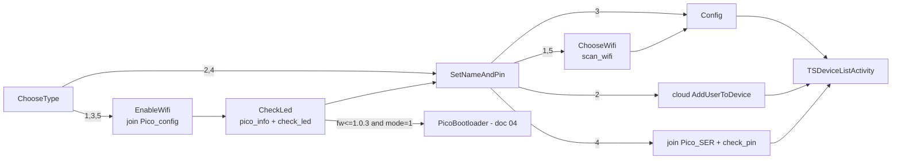
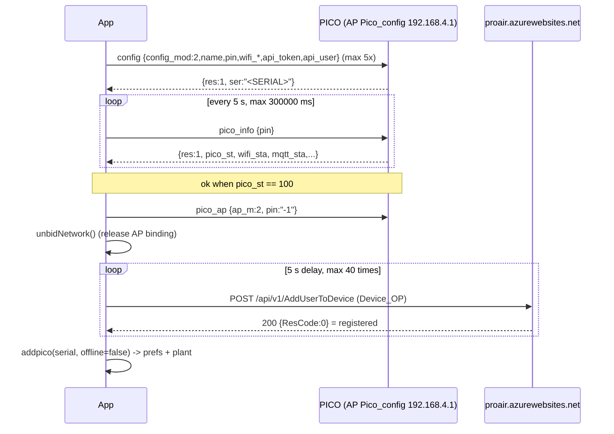

# Provisioning and configuration

Analyzed source: JADX of `it.tecnosystemi.TS`. All paths are relative to `../../../Export-Pico/sources/it/tecnosystemi/TS`. "(inferred)" = deduced, not read explicitly in the code.
UDP/ACK/idp/timeout transport: see [01-transport.md](01-transport.md) (not repeated). Post-provisioning runtime: [02-pico-runtime.md](02-pico-runtime.md). Bootloader/OTA: [04-firmware-ota.md](04-firmware-ota.md). Scope: PICO only; the other families (VMC, SeiX/P6X, legacy Control Unit) are out of scope.

## Index

1. [Activity map and setup modes](#1-activity-map-and-setup-modes)
2. [Device AP join and network binding](#2-device-ap-join-and-network-binding)
3. [PICO flow](#3-pico-flow)
   - 3.1 EnableWifi / CheckLed / `pico_info` / `check_led`
   - 3.2 SetNameAndPin and PIN
   - 3.3 ChooseWifi / `scan_wifi`
   - 3.4 Config mode 1 (online), 3 (offline)
   - 3.5 Modes 2 and 4 (adding an already configured PICO)
4. [Reference payloads](#4-reference-payloads)
5. [`pico_ap` and `ap_m` semantics](#5-pico_ap-and-ap_m-semantics)
6. [Token / cloud user, PICOServer, local vs cloud](#6-token--cloud-user-picoserver-local-vs-cloud)
7. [Persisted state (SharedPreferences)](#7-persisted-state-sharedpreferences)
8. [Error handling, anomalies, open questions](#8-error-handling-anomalies-open-questions)

---

## 1. Activity map and setup modes

Entry: `Activity/TS/SelectTypeDevActivity.java:50-85` opens `ChooseTypePICOActivity` (provisioning) or `IstrBootloaderActivity*` (firmware, see 04; the choice depends on a flag, (inferred)); the other families have analogous activities, out of scope.

`ChooseTypePICOActivity.btnProc` (`Activity/PICO/Config/ChooseTypePICOActivity.java:41-64`) writes the extra `Constants.INTENT_SETUPMODE` ("setupmode", `Utils/Constants.java:92`) with modes 1-4 (mode 5 is out of scope; texts: `resources/res/values/strings.xml:148-159`):

| mode | UI meaning | First screen | Contacts device? | Cloud? | `config_mod` sent | `Pico.offline` saved |
|---|---|---|---|---|---|---|
| 1 | Connect PICO online (via router Wi-Fi) | EnableWifi (AP `Pico_config`) | yes | yes (registration + polling) | 2 | false |
| 2 | Add already-online PICO (other user) | SetNameAndPin | no | yes (`AddUserToDevice`) | - | false |
| 3 | Connect PICO offline (AP only) | EnableWifi | yes | no | 1 | true |
| 4 | Add already-offline PICO (other user) | SetNameAndPin | yes (join AP `Pico_<SER>`, `check_pin`) | no | - | true |

Modes 2/4 skip EnableWifi/CheckLed (`ChooseTypePICOActivity.java:57-61`).

PICO navigation graph:



---

## 2. Device AP join and network binding

Everything goes through `Activity/BaseActivity.java`: `connectToWifi(onOk, onFail, redhome, skipGps)` (`:1552-1560`, runs in a thread) -> `connectToWifi_` (`:1576-1783`). The target credentials are the static fields `BaseActivity.toConnSid` / `toConnPwd` (`:118-119`), set by the caller right beforehand.

PICO SSID/password (`Utils/Constants.java:272-289`):

| Phase | PICO |
|---|---|
| Configuration AP (unconfigured device, modes 1/3) | `Pico_config` / `12345678` |
| Operational AP (configured device, mode 4) | `Pico_<SERIAL>` / `TS_<SERIAL>` |

`<SERIAL>` = typed serial, `toUpperCase()` (`SetNameAndPinPICOActivity.java:233,248-251`). The device always exposes `192.168.4.1` (`Commands/UDPSocket.java:33,64`).

`connectToWifi_` algorithm:
1. If `manualconn` (SDK<29, user attached manually) runs `onOk` immediately (`:1585-1596`).
2. If GPS is off and `skipGps=false` -> `enableLocation()` and abort (`:1597-1601`). Also requires `ACCESS_FINE_LOCATION` (`:1654-1660`). `skipGps=true` is passed by the phases that follow an already completed join (ChooseWifi, Config), `false` by EnableWifi/SetNameAndPin (first join).
3. If the current SSID (`getCurretWifiName()`) == `toConnSid`: does not reconnect; obtains the Wi-Fi `Network` with `getCurrentWifiNetwork()` and calls `bindProcessToNetwork(net)`, saves it in `MySocket.tobindnet`, `MySocketBootLoader.tobindnet`, `PicoSocketBootloader.tobindnet` (`:1600-1635`); then `onOk`.
4. SDK >= 29 (`:1678-1783`): if Wi-Fi is off opens `android.settings.panel.action.WIFI`. Scan (SDK>=31 uses `getScanResults()` to obtain the BSSID; otherwise `startScan()` with a max wait of ~15 s). Builds a `WifiNetworkSpecifier` (`setSsid`, `setBssid` if known, `setWpa2Passphrase`) and a `NetworkRequest` with `removeCapability(12)` (NET_CAPABILITY_INTERNET: network without Internet accepted) + `TRANSPORT_WIFI`. `ConnectivityManager.requestNetwork(req, cb, 120000)`.
   - `onAvailable(net)` -> after 10 ms `AvaiableNetwork(net)` (`:1891-1925`): `bindProcessToNetwork(net)`, `MySocket/MySocketBootLoader/PicoSocketBootloader.tobindnet = net`, `connected=true`, then `onOk`. All process traffic (including UDP) is therefore forced onto the device network as long as the binding holds.

`Activity/BaseActivity.java:1895-1899`:
```java
((ConnectivityManager) getSystemService("connectivity")).bindProcessToNetwork(network);
MySocket.tobindnet = network;
MySocketBootLoader.tobindnet = network;
PicoSocketBootloader.tobindnet = network;
this.connected = true;
```
   - `onUnavailable()` -> `onFail` if present, otherwise toast `msg_error` (`:1763-1771`).
   - `onLost()`: behavior depends on the activity type (SetNameAndPin/ChooseWifi: reconnect; `PicoActivity`: `UDPSocket.resetIDP()` + `stopListening()` + `startListening(true)` and reconnect, max 3 attempts, `:1799-1830`).
5. SDK < 29 (`:1832-1860`): `WifiConfiguration` (priority 999999) + `addNetwork/enableNetwork/reconnect`, 30 s timer; if not connected fires `onFail` or `errorcollWifi()` (toast `ha_apAssente` + opens `android.settings.WIFI_SETTINGS`, `:2024-2040`).

Return to the home Wi-Fi (there is no explicit "reconnect home"):
- `disconnectFromWIfi()` (`:1933-1951`): SDK>=29 `unregisterNetworkCallback` + `bindProcessToNetwork(null)`; SDK<29 `removeNetwork(STATIC_networkId)` + `disconnect()` + `reconnect()`.
- `unbidNetwork()` (`:1995-2005`): clears `tobindnet` and `bindProcessToNetwork(null)` + `unregisterNetworkCallback`.
- Once the `NetworkRequest` is released, it is Android that returns to the preferred network (inferred). `onDestroy` (SDK<29) removes the added `networkId` (`:2060-2070`).
- The `redhome` parameter is stored but the two branches of `errorcollWifi` are identical; all config callers pass `false`.

Join failure dialog (`EnableWifiVCActivityPICO.AnonymousClass3`, `:91-124`; analogous ones in SetNameAndPin): message `ba_apAssente` + `connectToPolaris` + `SSID: <toConnSid>` + password; the Ok button opens `WIFI_SETTINGS`; in `onResume` the activity may show toast `ba_apAssente` (`:134-142`).

---

## 3. PICO flow

### 3.1 EnableWifi / CheckLed

Trigger: "Procedi" button in `EnableWifiVCActivityPICO.btnProc` (`Activity/PICO/Config/EnableWifiVCActivityPICO.java:69-89`): `toConnSid="Pico_config"`, `toConnPwd="12345678"` (`:86-87`), `connectToWifi(ok->gotoCheckLed, fail->dialog, false, false)`. User prerequisite (text `c2_pico_lblInstruction`, `strings.xml:213`): PICO Pro/Pro+ in config with NOTE+MIN SPEED keys for 3 s -> blinking blue LED; PICO Basic: config active in the first 2 minutes after power-on.

`CheckLedPICOActivity.onCreate` (`CheckLedPICOActivity.java:42-56`) immediately calls `getInfo()` (`:58-129`):

```json
// app -> 192.168.4.1:40070   (pin absent: null field not serialized (inferred))
{"cmd":"pico_info","frm":"app","idp":1}
```
`sendCMD(cmd, 10000, 10000)`; if `null`, up to 3 further attempts with `Thread.sleep(1000)` + `startListening()` (`:70-78`). The datagram goes to `192.168.4.1:40070`; the response always arrives on UDP port 40069 (confirmed, see section 4).

`Activity/PICO/Config/CheckLedPICOActivity.java:67-78` (`pico_info` retry):
```java
CmdPICO cmdPICO = new CmdPICO();
cmdPICO.setCmd("pico_info");
UDPSocket.startListening();
CheckLedPICOActivity.this.respInfo = UDPSocket.sendCMD(cmdPICO, 10000L, 10000L);
UDPSocket.stopListening();
int i = 0;
while (CheckLedPICOActivity.this.respInfo == null && i < 3) {
    i++;
    Thread.sleep(1000L);
    UDPSocket.startListening();
    CheckLedPICOActivity.this.respInfo = UDPSocket.sendCMD(cmdPICO, 10000L, 10000L);
}
```
Response fields used (all `getInt/get` without default, exception silenced, `:84-117`):
- `ser` (serial), `fw_ver` (semver string),
- `config_mod`: 1 = master offline, 2 = master online, 3 = slave (out of scope), other = not configured (`:94-107`). Same enum used when sending `config`.
- If `fw_ver` is non-empty, `mode==1` and `Functions.compareVersions(fw_ver,"1.0.3") <= 0` -> `bootloader=true`, label `fw_too_old` (`:112-116`); "Procedi" will go to `PicoBootloaderActivity` (doc 04) instead of SetNameAndPin (`btnProc`, `:140-150`).

`Activity/PICO/Config/CheckLedPICOActivity.java:84-116` (`pico_info` parsing):
```java
JSONObject jSONObject = new JSONObject(CheckLedPICOActivity.this.respInfo);
// ...
sb.append(jSONObject.get("ser"));
// ...
int i2 = jSONObject.getInt("config_mod");
if (i2 == 1) {
    // StatoMasterOffline
} else if (i2 == 2) {
    // StatoMasterOnline
} else if (i2 != 3) {
    // StatoNoConfig
} else {
    // StatoSlave (out of scope)
}
// ...
sb.append(jSONObject.get("fw_ver"));
if (jSONObject.getString("fw_ver").length() > 0 && CheckLedPICOActivity.this.mode == 1 && Functions.compareVersions(jSONObject.getString("fw_ver"), "1.0.3") <= 0) {
    CheckLedPICOActivity.this.bootloader = true;
    // ...
}
```

`btnCheckLed` (`:152-193`):
```json
{"cmd":"check_led","frm":"app","idp":N,"led_color":2}
```
`Commands/CmdPICO.java:361-371` (`led_color` fixed to 2 by the constructor; no other setter in the code; color semantics (inferred): makes the LED blink to identify the device).

 `sendCMD(cmd, 5000, 1500)`; `res==1` -> `askLed()` Yes/No dialog (`:240-248`). Yes -> `btnProc()` (SetNameAndPin with `setupmode`); No -> (inferred from the argument order of `createYesNoPopUp`) `spegniCOnf()` + reconnect:
1. `pico_ap` with `ap_m=5` (see 5), `sendCMD(.,5000,5000)` (`:250-264`),
2. wait up to 5 s for `UDPSocket.isConnected()` to become false (`:212-220`),
3. `disconnectFromWIfi()`, `recoonect()` -> join `Pico_config` again and `getInfo()`; on `onUnavailable` -> `tornaIndietro()` returns to EnableWifi (or `IstrBootloaderActivityPICO` if `bootloader`) with toast `c2_1_pico_RetryMessage` (`:266-317`).
On `check_led` timeout with `!UDPSocket.isConnected()` -> toast + `finish()` (`:177-185`); otherwise toast `msg_commandKo`.

`CheckLedPICOActivity` is also reached from `PicoActivity.gotoCheckLed()` with extra `INTENT_BOOTLOADER=true` (`Activity/PICO/PicoActivity.java:1770-1800`, join `Pico_config` as above) and from `IstrBootloaderActivityPICO` (doc 04): here `bootloader=true` and "Procedi" leads to the bootloader.

### 3.2 SetNameAndPin and PIN

`SetNameAndPinPICOActivity` (`Activity/PICO/Config/SetNameAndPinPICOActivity.java`). Fields per mode (`setUpGui`, `:304-350`):
- mode 1/3: `txtNome` = device name, `txtPin` = new PIN chosen by the user.
- mode 2: `txtNome` = **serial**, `txtPin` = existing PIN; `txtNome2` hidden.
- mode 4: `txtNome` = serial, `txtNome2` = local name, `txtPin` = PIN.

Validation `checinput()` (`:171-195`): non-empty name; mode 4 also name2; PIN with `length()==4` **and** `Integer.parseInt` ok (so it also accepts e.g. "-123"/"+123"; does not enforce digits only). No default PIN on the app side: the user chooses the PIN (hint `c3_pico_lblInstruction`: "4-digit security code (e.g. 1234)", `strings.xml:222`).

Meaning of `"-1"`: appears as a PIN only in `CmdPICO.PicoAP` (`Commands/CmdPICO.java:378-383`, `pico_ap`). Interpretation (inferred): "PIN not applicable/wildcard" for commands executed on a still unconfigured device. The outcome of `pico_ap` is never verified in the PICO flows (`setPicoWiFiMode` returns an ignored bool, `ConfigPICOActivity.java:205,292,304`), so it is not proven that the device accepts `-1` after configuration. `pico_info` in CheckLed and `check_led` do not set `pin`.

`btnProc` (`:197-262`):
- mode 3 -> `ConfigPICOActivity` (extras setupmode, pin, name) (`:199-206`).
- mode 1 -> `ChooseWifiPICOActivity` with setupmode/pin/name (`:210-219`).
- mode 2 -> cloud (3.5). mode 4 -> join AP + `check_pin` (3.5). In `ISDEMO`, demo toast and return to `TSHomeActivity`.

### 3.3 ChooseWifi / `scan_wifi`

`ChooseWifiPICOActivity.aggiornaWifi` (`Activity/PICO/Config/ChooseWifiPICOActivity.java:77-146`). First `connectToWifi(runnable,false,true)` (uses `toConnSid` still = `Pico_config`, so only a re-bind if already connected), then in a thread:
```json
{"cmd":"scan_wifi","frm":"app","idp":N,"pin":"1234"}
```
`Protocols.CMD_GET_WIFI="scan_wifi"` (`Commands/Protocols.java:8`); **pin = PIN chosen by the user in the previous step** (not `-1`), `sendCMD(cmd,10000,1500)` (`:141-143`).

`Activity/PICO/Config/ChooseWifiPICOActivity.java:139-143`:
```java
CmdPICO cmdPICO = new CmdPICO();
cmdPICO.setPin(ChooseWifiPICOActivity.this.pin);
cmdPICO.setCmd(Protocols.CMD_GET_WIFI);
UDPSocket.startListening();
final String strSendCMD = UDPSocket.sendCMD(cmdPICO, 10000L, 1500L);
```

Expected response (`addwifi`, `:155-190`; `Model/WiFi.java`):
```json
{"idp":N,"res":1,"aps":[{"id":"MyWiFi","sec":1,"rssi":-55,"mac":"aa:bb:cc:dd:ee:ff"}, ...]}
```
`Constants.JSON_WIFI="aps"` (`Constants.java:188`). `id`=SSID, `sec` int (the UI asks for a password if `sec==1`, `Adapters/WifiAdapter.java:72-80`; 0 = open), `rssi` default 0, `mac` default `""`. `res` is **not** checked; an `aps` array is enough. PICO filter: `Functions.isPicoWiFi(ssid)` = prefix `Pico_` and != `Pico_config` (`Utils/Functions.java:142-144`); `Pico_*` entries are hidden; dedup by SSID. The "Aggiorna" button re-runs the scan.

`Activity/PICO/Config/ChooseWifiPICOActivity.java:158-181` (parsing and filter):
```java
JSONObject jSONObject = new JSONObject(str);
JSONArray jSONArray = jSONObject.getJSONArray(Constants.JSON_WIFI);
this.wifis = new ArrayList();
for (int i = 0; i < jSONArray.length(); i++) {
    WiFi wiFi = new WiFi(jSONArray.getJSONObject(i));
    boolean zIsPicoWiFi = Functions.isPicoWiFi(wiFi.getSid());
    boolean z = true;
    if (zIsPicoWiFi != (this.mode == 5)) {
        z = false;
    }
    if (z) {
        if (zIsPicoWiFi) {
            wiFi.setCrip(0);
        }
        // ... dedup by SSID (getSid().equals)
    }
    // ...
}
```

`protectedwifi` (`:195-246`): if `sec==1` password text popup (IME action 6=Done -> `wiFi.setPwd(text)`); then `ConfigPICOActivity` with extra `INTENT_WIFI` (Serializable `WiFi`), name, setupmode, pin. The password is not persisted.

### 3.4 Config

`ConfigPICOActivity.onCreate` (`Activity/PICO/Config/ConfigPICOActivity.java:79-228`). Reads setupmode/name/pin; `serial` is never assigned in this activity (only `serialToCheck`). Constants: `akwait=15000`, `CONFIG_TIMES=40` (`:61-62`).

**Mode 1 (online)** (`:104-176`): `connectToWifi(.., false, true)` then thread:



Command construction (mode 1) and retry, `Activity/PICO/Config/ConfigPICOActivity.java:115-159`:
```java
CmdPICO.ConfigMasterOnline configMasterOnline = new CmdPICO.ConfigMasterOnline();
configMasterOnline.setName(ConfigPICOActivity.this.name);
configMasterOnline.setPin(ConfigPICOActivity.this.pin);
if (ConfigPICOActivity.this.mode == 1) {
    configMasterOnline.setConfig_mod(2);
    configMasterOnline.setWifi_sec(wiFi.isCrip());
    configMasterOnline.setWifi_ssid(wiFi.getSid());
    configMasterOnline.setWifi_pwd(wiFi.getPwd());
    configMasterOnline.setWifi_mac(wiFi.getMac());
    // ... token: calcNewToken or Constants.FIX_TOKEN
    configMasterOnline.setApi_token(ConfigPICOActivity.this.token);
    configMasterOnline.setApi_user(Constants.user);
    i2 = 100;
    j = 300000;
} else {
    // ... (slave branch omitted)
}
String strSendCMD = null;
for (int i3 = 0; i3 < 5; i3++) {
    UDPSocket.startListening(true);
    strSendCMD = UDPSocket.sendCMD(configMasterOnline, 15000L, ConfigPICOActivity.this.akwait);
    UDPSocket.stopListening();
    if (strSendCMD != null) {
        break;
    }
    // Thread.sleep(500L)
}
```

`config` payload mode 1 (`ConfigMasterOnline`, `Commands/CmdPICO.java:401-500`; fields filled at `:116-130`):
```json
{"cmd":"config","frm":"app","idp":N,"pin":"1234","config_mod":2,"id_slave":0,"name":"Salotto","verso":1,
 "wifi_sec":1,"wifi_ssid":"MyWiFi","wifi_pwd":"secret","wifi_mac":"aa:bb:cc:dd:ee:ff",
 "api_token":"<token>","api_user":"<cloud user>"}
```
- `id_slave` default 0 and `verso` default 1 from the constructor (`CmdPICO.java:408-412`), untouched in mode 1.
- `wifi_sec/ssid/mac` come from the `WiFi` object chosen in ChooseWifi; `wifi_pwd` from the popup (null -> field omitted by Gson, (inferred) for open networks).
- `api_token`/`api_user`: see section 6.
- Attempts: up to 5 cycles of `startListening(true)` + `sendCMD(cmd, 15000, 15000)` with `sleep(500)` between cycles (`:147-160`); each `sendCMD` in turn has its 3 internal attempts (see 01). `null` or `res!=1` or missing `ser` -> `error()`. `ser` saved in `serialToCheck`.
- `CheckInfoPICO(100, 300000)` (`:230-345`): loops while `!okconf && elapsed<j && !blockCheckPico`; each iteration calls `connectToWifi(run, false, true)` (reconnects/binds if needed) and `pico_info` with `pin`, `sendCMD(.,10000,10000)`, then `sleep(5000)`. Parsing: `res==1`; `pico_st` (`Constants.PICO_JSON.PICO_ST`, `Constants.java:344`) `== 100` -> ok; otherwise stores `wifi_sta`, `mqtt_sta`. (inferred) `pico_st` = configuration state machine state; 100 = "online configured"; other values cannot be decoded by the client.

`Activity/PICO/Config/ConfigPICOActivity.java:242-283` (`pico_info` polling):
```java
while (true) {
    z = this.okconf;
    if (z || this.datediff >= j || this.blockCheckPico) {
        break;
    }
    // connectToWifi(new Runnable() { run() {
    UDPSocket.startListening(true);
    String strSendCMD = UDPSocket.sendCMD(cmdPICO, 10000L, 10000L);
    UDPSocket.stopListening();
    if (strSendCMD != null) {
        JSONObject jSONObject = new JSONObject(strSendCMD);
        if (jSONObject.getInt(Constants.JSON_RES) == 1) {
            if (jSONObject.has(Constants.PICO_JSON.PICO_ST)) {
                ConfigPICOActivity.this.lastpico_st = jSONObject.getInt(Constants.PICO_JSON.PICO_ST);
                if (ConfigPICOActivity.this.lastpico_st == i) {
                    ConfigPICOActivity.this.okconf = true;
                }
            }
            // ... wifi_sta / mqtt_sta saved in lastwifi_sta / lastmqtt_sta
        }
    }
    // }}, false, true);
    this.datediff = new Date().getTime() - date.getTime();
    Thread.sleep(5000L);
}
```
- Failure (`:326-345`): `wifi_sta` in 1..6 -> toast `c5_lblConfigKo_wifiProblem` (password/router/Internet); otherwise if one of wifi_sta/pico_st/mqtt_sta >0 -> dialog "errore codice `wifi-mqtt-pico_st`"; otherwise `not_errcom`. Fine button re-enabled.
- Mode 1 success: `pico_ap{ap_m:2}` (`setPicoWiFiMode(2)`, `:292`), `UDPSocket.stopListening()`, `unbidNetwork()`, `times=40`, `checkPicoOnline()` (`:383-410`).

Cloud polling (`checkPicoOnline`): every 5 s (`Handler.postDelayed(5000)`) creates `Device_OP` `{PIN, Serial:serialToCheck, PlantId:TSDeviceListActivity.idSelected, token:FirebaseToken, platform:"fcm2", isPico:true, PhoneDate:"yyyy-MM-dd'T'HH:mm:ss.SSS'Z'"}` (`Model/Device_OP.java`) and sends it with `ThreadWebService(code 29)` to `uriWebService_PICO + uri_AddUserToDevice` = `https://proair.azurewebsites.net/api/v1/AddUserToDevice` (`strings.xml:811,814`). `checkPicoConfig()` (`Threads/ThreadWebService.java:421-440`) -> `ConfigPICOActivity.parseCheckConfig` (`:412-422`): HTTP 200 and `ResCode==0` -> `addpico(serialToCheck,false)`; otherwise repeats; after 40 attempts -> `error()`. (Cloud boundary only: token/user headers in `WebClientDevWrapper`, not mapped.)

`Activity/PICO/Config/ConfigPICOActivity.java:412-422`:
```java
public void parseCheckConfig(Response response) {
    if (response != null) {
        try {
            if (response.getHttpResponceCode() == 200 && new JSONObject(response.getHttpResponcePayload()).getInt("ResCode") == 0) {
                addpico(this.serialToCheck, false);
                return;
            }
        } catch (Exception unused) {
        }
    }
    checkPicoOnline();
}
```

**Mode 3 (offline)** (`:177-215`): join, then
```json
{"cmd":"config","frm":"app","idp":N,"pin":"1234","config_mod":1,"id_slave":0,"name":"Salotto","verso":1}
```
(`ConfigMasterOffline`, no `wifi_*`/`api_*` fields). `UDPSocket.startListening()` + `sendCMD(cmd,15000,15000)`. If `res==1` and `ser` non-empty: `pico_ap{ap_m:1}`, `disconnectFromWIfi()`, `addpico(ser, offline=true)`; otherwise `error()`. The device stays in AP `Pico_<SER>` / `TS_<SER>` (local operational mode, see 02 and `auto-discovery.md` in the repo). Minor bug: if `sendCMD` returns `null`, `error()` is called and then `new JSONObject(null)` throws NPE -> `error()` again.

`addpico(serial, offline)` (`:459-474`): `Pico.deletePICOfromPref(serial)`, `Pico.savePicoInPref(name, serial, pin, "", activity, offline, true)`, `addDevToPlant(serial)` (`Device{LVDV_Type=DEVICE_TYPE_PICO(1), Serial, Name}` in `Plant.addDeviceToPlantPref(device, TSDeviceListActivity.idSelected)` + `Constants.listaImpianti`), UI "dispositivo aggiunto" and "Fine" -> `TSDeviceListActivity`.

### 3.5 Modes 2 and 4

**Mode 2 (cloud only)**: `SetNameAndPinPICOActivity.btnProc` (`:233-246`): `Device_OP{isPico:true, PIN, Serial:SERIAL uppercase, token:FirebaseToken, platform:"fcm2", PlantId}` -> `ThreadWebService(code 24)` -> `connUsrPico()` (`Threads/ThreadWebService.java:1612-1650`): HTTP 200 and `ResCode==0` -> `savserverPico()` (`:301-312`) = `Pico.savePicoInPref(name=txtNome2, serial, pin, "", activity, offline=false, true)` + `addDevToPlant`; `ResCode!=0` -> toast `au_errorAddUser` ("PIN and/or invalid serial"). The device is not contacted. Note: the saved name is `txtNome2`, which in mode 2 is hidden and empty -> name `""` (inferred: later overwritten by cloud sync; not verified).

**Mode 4 (existing offline)**: join `Pico_<SER>` / `TS_<SER>` (`:248-262`), then `checkpin()` (`:80-130`):
```json
{"cmd":"check_pin","frm":"app","idp":N,"pin":"1234"}
```
`Protocols.CMD_CHECK_PIN="check_pin"`, `sendCMD(cmd)` default (5000,5000), response `res==1` -> `Pico.savePicoInPref(txtNome2, serial, pin, "", activity, offline=true, true)` + `addDevToPlant` -> `TSDeviceListActivity`; `res!=1` -> toast `au_errorAddUser`; `null`/exception -> `msg_commandKo`. PIN verification is therefore device-side (`res==1`), never local.

---

## 4. Reference payloads

| cmd | Specific fields | Origin | File:line |
|---|---|---|---|
| `pico_info` | (`pin` optional) | CheckLed (without pin), Config polling (with pin) | `CheckLedPICOActivity.java:68`, `ConfigPICOActivity.java:234` |
| `check_led` | `led_color:2` | CheckLed | `CmdPICO.java:361-371` |
| `scan_wifi` | `pin` = user PIN | ChooseWifi | `ChooseWifiPICOActivity.java:140-143` |
| `config` (online) | `config_mod:2, name, id_slave:0, verso:1, wifi_sec, wifi_ssid, wifi_pwd, wifi_mac, api_token, api_user` | Config mode 1 | `CmdPICO.java:446-500` |
| `config` (offline) | `config_mod:1, name, id_slave:0, verso:1` | Config mode 3 | `ConfigPICOActivity.java:193-198` |
| `check_pin` | envelope only | mode 4 | `SetNameAndPinPICOActivity.java:85` |
| `pico_ap` | `ap_m`, `pin:"-1"` | see section 5 | `CmdPICO.java:378-393` |

UDP ports (`Commands/UDPSocket.java:40-41`): the app sends to `192.168.4.1:40070` from an ephemeral source port (`new DatagramSocket()`, `:262`), and listens with a socket bound to **40069** (`:88-92`). Confirmed: the PICO always replies to UDP 40069, regardless of the sender's source port.
```java
static int portaDest = 40070;
static int portaRead = 40069;
// ... (:88-92, listener)
// ... (slave branch omitted)
UDPSocket.socketListen = new DatagramSocket(UDPSocket.portaRead, iPAddress);
// ... (:264-268, send)
// ... (slave branch omitted)
datagramPacket = new DatagramPacket(bytes, bytes.length, byName, portaDest);
```

Serialization: `bytes = gson.toJson(cmdPICO).getBytes();` (`UDPSocket.java:255`); `null` fields are not serialized by standard Gson (inferred, `new Gson()` without `serializeNulls` in `UDPSocket.sendGetStato:~330`).

All responses have `res` (1 = OK) except `scan_wifi` (not checked). `res==99` = ACK, already handled by the transport (01).

Timeouts `(t_resp, t_ack)` = arguments 2 and 3 of `UDPSocket.sendCMD` (`Commands/UDPSocket.java:212-310`): `t_ack` ACK wait per attempt; `t_resp` response wait after the ACK; 3 internal attempts. Values in provisioning: `pico_info` (10000,10000), `check_led` (5000,1500), `scan_wifi` (10000,1500), `config` online (15000,15000), `config` offline (15000,15000), `pico_ap`/`check_pin` default (5000,5000).

---

## 5. `pico_ap` and `ap_m` semantics

`CmdPICO.PicoAP` (`CmdPICO.java:378-393`): `{"cmd":"pico_ap","frm":"app","idp":N,"pin":"-1","ap_m":<int>}`; the `pin` stays `-1` in all PICO flows.

`Commands/CmdPICO.java:378-383`:
```java
public static class PicoAP extends CmdPICO {
    int ap_m;

    public PicoAP() {
        ((CmdPICO) this).cmd = "pico_ap";
        super.setPin("-1");
    }
    // ...
}
```

`Activity/PICO/Config/ConfigPICOActivity.java:350-359` (send and read of `res`, never verified by callers):
```java
public boolean setPicoWiFiMode(int i) {
    try {
        CmdPICO.PicoAP picoAP = new CmdPICO.PicoAP();
        picoAP.setAp_m(i);
        String strSendCMD = UDPSocket.sendCMD(picoAP);
        UDPSocket.stopListening();
        return new JSONObject(strSendCMD).getInt(Constants.JSON_RES) == 1;
    } catch (Exception unused) {
        return false;
    }
}
```

`ap_m` values seen in the code (semantics **(inferred)** from context, the device does not reply with a description):

| ap_m | Where | When | Interpretation |
|---|---|---|---|
| 1 | Config mode 3 (`:205`) | after successful offline `config` | stays in operational AP `Pico_<SER>` (local mode) |
| 2 | Config mode 1 (`:292`) | after `pico_st==100` | shuts down/leaves the AP, switches to station only + cloud |
| 5 | CheckLed "No" (`CheckLedPICOActivity.java:258`); PICO bootloader after `ota_end` (`PicoBootloaderActivity.java:341`) | cancel config / restart | exits config mode / reboot of the config AP |

The `res==1` response is read in `setPicoWiFiMode` but never used by callers.

---

## 6. Token / cloud user, PICOServer, local vs cloud

**Origin of `api_token` and `api_user`** (mode 1 only):
- `api_user` = `Constants.user` (`Utils/Constants.java:327`), set by login: `ThreadWebService.java:702` (login ok `ResCode==0`) or from prefs `PREF_USERNAME="username"` in `LoginActivity.onResume` if "remember me" (`Activity/LoginActivity.java:186-196`).
- `api_token`: if `Constants.token` is non-empty -> `Functions.calcNewToken(prefs, res)` (`Utils/Functions.java:544-576`): decrypts `Constants.token` with `AESCrypt(android_id[0:8] + SALT)` (`SALT="ns91wr48"`, `Constants.java:252`), format `"<base>_<counter>"`, increments the counter, re-encrypts, saves `Constants.token`, `PREF_CONTTOKEN="cont_token"` (counter), `PREF_TOKEN_VALUE="TOKENVALUE"`. If decryption fails it returns `null` (token omitted, inferred). If `Constants.token` is empty -> hard-coded constant `Constants.FIX_TOKEN` (`Constants.java:57`).
`Utils/Functions.java:548-571`:
```java
aESCrypt = new AESCrypt(Constants.android_id.substring(0, 8) + Constants.SALT);
// ...
strDecrypt = aESCrypt.decrypt(Constants.token);
// ...
String[] strArrSplit = strDecrypt.split("_");
if (strArrSplit.length == 2) {
    long j = Long.parseLong(strArrSplit[1]) + 1;
    String strReplace = aESCrypt.encrypt(strArrSplit[0] + "_" + j).replace("\r", "").replace("\n", "");
    Constants.token = strReplace;
    savePreferences.save(Constants.PREF_CONTTOKEN, String.valueOf(j));
    savePreferences.save(Constants.PREF_TOKEN_VALUE, Constants.token);
    return strReplace;
}
```
- `Constants.token` comes from login as field `Token` (`ThreadWebService.java:822`, `savepref`) and is saved in `PREF_TOKEN`/`PREF_TOKEN_DATE`.
- Purpose (inferred): the PICO receives credentials with which it then talks to the backend/MQTT as the user; this is why it also registers `wifi_*`. The device is therefore not "claimed" by the cloud but by the app, in two steps (config on the device + `AddUserToDevice`).

**Local vs cloud at the end**: the choice is stored in `Pico.offline` (`Pico.savePicoInPref(...,offline,...)`: true for modes 3/4, false for 1/2). At runtime `PicoActivity.sendCmdUpdPico` (`Activity/PICO/PicoActivity.java:1550-1575`) sends UDP if `pico.getOffline()` otherwise cloud POST. For cloud commands the `CmdPICO` is serialized **inside** a JSON with `frm="mqtt"` and local `idp`:
- `Commands/PICOServer.java`: `{Cmd:"<json CmdPICO>", Name, Pin, Serial}` -> `.../api/v1/SendPicoCmd?picoSerial=<S>&PIN=<P>` via `ThreadWebService(code 27)` (`PicoActivity.java:1568-1575`).
- `Commands/PICOServerTimezone.java`: `{Cmd, Pin, Serial, Timezone}` (`PicoActivity.java:1542-1550`).
Both classes are **not** used in `Activity/PICO/Config/*` (provisioning); they appear only in the runtime (`PicoActivity`, `PicoCronoSetActivity`, `PICOCronoSummaryActivity`) -> details in [02-pico-runtime.md](02-pico-runtime.md).

Boundary: all local provisioning is UDP over the device AP; the cloud is involved only in mode 1 (`AddUserToDevice` polling) and mode 2.

---

## 7. Persisted state (SharedPreferences)

Prefs file `PREFS_TS` (`R.string.PrefsName`, `strings.xml:44`) via `Utils/SavePreferences`:

| Key | Content | Written by |
|---|---|---|
| `PICODevs` (`PREF_PICO_DEVS`) | JSON array of `Pico` `{Name, Serial, Pin, offline, LastAddTimezone (if arg true), ...}`, deduplicated by `Serial`, sorted by name | `Pico.savePicoInPref` (`Model/Pico.java:573-609`) |
| plant device list (via `Plant.addDeviceToPlantPref`) | `Device{LVDV_Type, Serial, Name}` under `TSDeviceListActivity.idSelected` | `addDevToPlant` (`ConfigPICOActivity.java:~430`, `SetNameAndPinPICOActivity.java:132`) |
| `cont_token`, `TOKENVALUE` | counter and encrypted token | `Functions.calcNewToken` |
| `username`, `userid`, `token`/`TOKEN_DATE` | credentials/session | login (`ThreadWebService.savepref`) |

The PIN is saved in clear text in the `Pico` record (`Pin`). The home Wi-Fi password is not saved by the app.

---


## 8. Error handling, anomalies, open questions

Errors:
- `error()` (all Config): toast `c5_lblConfigKo` ("retry from the start"), red label, "Fine" re-enabled. No rollback on the device: a `config` already accepted is not undone.
- `UDPSocket` returns `null` on failure (see 01): all flows treat `null` as an error, except `scan_wifi` where `new JSONObject(null)` is caught and the list stays empty.
- Config `onDestroy`: `UDPSocket.stopListening()` and `blockCheckPico=true` (stops the polling).
- DEMO (`Constants.ISDEMO=false`, `Constants.java:100`): demo branches everywhere, not relevant.

Anomalies read:
1. In mode 2 the saved name is `txtNome2` (empty).
2. `calcNewToken` increments a counter on every use (also the `AddUserToDevice` and `check*` polling): client-side "rotating" token (server-side role not determinable).
3. Hard-coded `FIX_TOKEN` as fallback.

Open questions:
- Real semantics of `ap_m` (1/2/5) and of `pico_st` (beyond 100/101): needs a network capture or firmware.
- `led_color` (fixed 2): other values accepted by the firmware?
- Is PIN `-1` accepted by the device on `pico_ap` after config? (`res` never checked).
- Does the device in `Pico_config` mode ignore the `pin` of the `scan_wifi`/`config` request or adopt it as the initial PIN (`config` sets the PIN: (inferred) yes)?
- Exact content of the `Pico` JSON and of the `Plant`/`Device` prefs (`Model/Pico.java`, `Model/Plant.java`) not mapped here.
- Flag deciding in `SelectTypeDevActivity` between provisioning and bootloader (lines 45-85) not read in full.
- Effect of `wifi_sec` other than 0/1 (WPA3?): the UI asks for a password only if `sec==1`.
