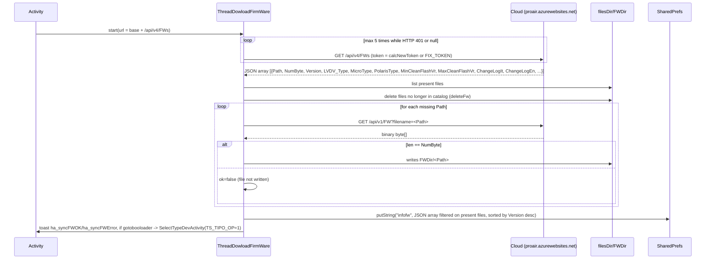
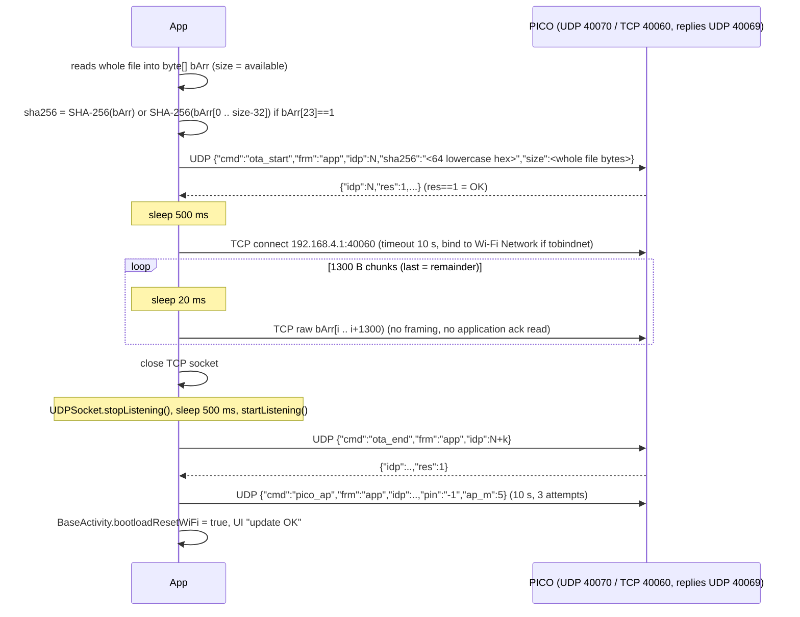
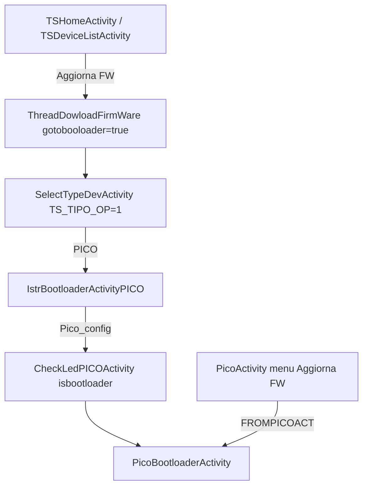

# PICO Firmware and OTA

Paths relative to `../../../Export-Pico/sources/it/tecnosystemi/TS` (omitted in `file:line` references). UDP transport and the `CmdPICO` envelope are described in [01-transport.md](01-transport.md); PICO runtime in [02-pico-runtime.md](02-pico-runtime.md); Wi-Fi/AP onboarding in [03-provisioning.md](03-provisioning.md). Scope: PICO only.

## Table of contents

1. [PICO flow overview](#1-pico-flow-overview)
2. [Firmware catalog (cloud) and local cache](#2-firmware-catalog-cloud-and-local-cache)
3. [PICO OTA: UDP + TCP 40060](#3-pico-ota-udp--tcp-40060)
4. [UI entry points and navigation](#4-ui-entry-points-and-navigation)
5. [Constants and SharedPreferences](#5-constants-and-sharedpreferences)
6. [Notes for open_pico_local_api and open questions](#6-notes-for-open_pico_local_api-and-open-questions)

---

## 1. PICO flow overview

| Item | Value |
|---|---|
| `LVDV_Type` in catalog | `1` (`Constants.DEVICE_TYPE_PICO`, Utils/Constants.java:49) |
| Activity | `Activity/PICO/PicoBootloaderActivity` (+ wizard `IstrBootloaderActivityPICO`) |
| Transport | UDP JSON (`pico_info`, `ota_start`, `ota_end`, `pico_ap`) + raw TCP 40060 (`Commands/PicoSocketBootloader`) |
| Image format | raw `.bin` |

The firmware NEVER travels from the device to the cloud: the app downloads the binary from the cloud (HTTP, boundary only, sec. 2) and pushes it to the device locally. Catalog/download = cloud (requires Internet); flash = always local (requires the PICO Wi-Fi).

---

## 2. Firmware catalog (cloud) and local cache

Cloud boundary: not mapped beyond what is needed. Handler: `Threads/ThreadDowloadFirmWare.java`.

### 2.1 Trigger

`new ThreadDowloadFirmWare(activity, uriWebService + uri_infoFrameWork).start()`:

| Caller | UI action | `gotobooloader` | Reference |
|---|---|---|---|
| `Activity/TS/TSHomeActivity` menu "Verifica FW" / "Aggiorna FW" | sync (+ opens `SelectTypeDevActivity` if "Aggiorna") | false / true | TSHomeActivity.java:237,251 |
| `Activity/TS/TSDeviceListActivity` (same) | same | false / true | TSDeviceListActivity.java:487,501 |
| `Activity/PICO/PicoActivity` menu "Verifica FW" (non-offline only), base `uriWebService_PICO` | sync + toast | false | PicoActivity.java:1918 |

`uriWebService_PICO` has the same value as `uriWebService` (`https://proair.azurewebsites.net`, `resources/res/values/strings.xml:810-811`).

Before opening `SelectTypeDevActivity` from "Aggiorna FW" the app sets `PicoBootloaderActivity.CLASSTOCALL` to the return activity (TSHomeActivity.java:248; TSDeviceListActivity.java:498). The same line also sets the `CLASSTOCALL` of the other families, out of scope.

### 2.2 Sequence



Authentication and retry: if `Constants.token` is not empty `Functions.calcNewToken` is used, otherwise `Constants.FIX_TOKEN` (Constants.java:57). Up to 5 attempts; the loop repeats while the response is `null` or HTTP 401. Token header/algorithm = cloud boundary, not mapped.

The catalog (`/api/v4/FWs`) is requested with the same scheme.

`Threads/ThreadDowloadFirmWare.java:74-84`
```java
for (int i3 = 5; i3 > 0 && z; i3--) {
    if (Constants.token != null && Constants.token != "") {
        strCalcNewToken = Functions.calcNewToken(pref, this.res);
    } else {
        strCalcNewToken = Constants.FIX_TOKEN;
    }
    newHttpClient = WebClientDevWrapper.getNewHttpClient(this.url, null, strCalcNewToken, Constants.user, 0, 4);
    if (newHttpClient != null && newHttpClient.getHttpResponceCode() != 401) {
        z = false;
    }
}
```

Single binary download: `base + uri_FrameWork + "?filename=" + Path` (ThreadDowloadFirmWare.java:385; `uri_FrameWork` = `/api/v1/FW`, `uri_infoFrameWork` = `/api/v4/FWs`, strings.xml:826,848). Same retry loop (:391).

Integrity: there is NO hash. Only `byte[].length == NumByte` from the catalog; if different the file is discarded and `ok=false`, but the loop over the other files continues.

`Threads/ThreadDowloadFirmWare.java:413-420`
```java
if (newHttpClient.getByteResponsePayload().length == list2.get(i).intValue()) {
    FileOutputStream fileOutputStream = new FileOutputStream(file.getPath() + "/" + list.get(i));
    fileOutputStream.write(newHttpClient.getByteResponsePayload());
    fileOutputStream.flush();
    fileOutputStream.close();
} else {
    this.ok = false;
}
```

Example catalog entry (exact names = values of the `JSON_*` constants, Constants.java:127-131,184,187; `"NULL"` = absent for `MinCleanFlashVr`/`MaxCleanFlashVr`/`ChangeLog*`):

```json
{"Path": "pico_1.2.0.bin", "NumByte": 123456, "Version": "1.2.0", "LVDV_Type": 1,
 "MicroType": 0, "PolarisType": 0, "MinCleanFlashVr": "NULL", "MaxCleanFlashVr": "NULL",
 "ChangeLogIt": "...", "ChangeLogEn": "..."}
```
(illustrative values; only the field names come from the code).

Other details:
- Local files: `<filesDir>/FWDir/<Path>` (`Constants.FW_DIRECTORY_NAME`, Constants.java:60).
- The catalog in pref (`Constants.PREF_INFOFWS = "infofw"`, Constants.java:214) contains ONLY the entries whose file is present in `FWDir` (ThreadDowloadFirmWare.java:154-214): an entry without a downloaded file disappears.
- Sorting (comparator :165-211): by `Version` "a.b.c" descending; on equal prefix, by `split.length` difference. On a parsing exception it returns 0.
- Errors: `null` response or `null` payload -> toast `ha_syncFWError` (only if not `gotobooloader`), then `gotobootloader()` anyway (:86-111). With a null payload the thread calls `gotobootloader()` twice (:106 and :110); the second is a no-op because the flag is already cleared (inferred).
- `gotobootloader()` (:359-372): clears `gotobooloader`, starts `SelectTypeDevActivity` with extra `TS_TIPO_OP=1`.

### 2.3 Versions

- `Functions.compareVersions(String,String)` (Functions.java:114-139): numeric comparison per segment, missing segments = 0. Used for the PICO threshold "1.0.3" (sec. 3.5) and in `CheckLedPICOActivity`.
- The flow has no automatic "installed vs latest available" comparison: the user picks the version in a Spinner.
- The "Aggiorna FW" entry in the `PicoActivity` menu appears only if `infofw` has at least one element (PicoActivity.java:1922-1935).

---

## 3. PICO OTA: UDP + TCP 40060

File: `Activity/PICO/PicoBootloaderActivity.java`, `Commands/PicoSocketBootloader.java`, `Commands/CmdPICO.java` (`OTA_Start` :525-548, `PicoAP` :378-393), `Commands/UDPSocket.java`.

### 3.1 Trigger and preconditions

The PICO must be reachable via UDP (see [01-transport.md](01-transport.md)). The PICO always replies to UDP port 40069, regardless of the sender's source port (confirmed fact). In the code: the listener is bound to `portaRead = 40069` and sending goes to `portaDest = 40070`.

`Commands/UDPSocket.java:264-268`
```java
// ... (slave branch omitted)
datagramPacket = new DatagramPacket(bytes, bytes.length, byName, portaDest);
```

`Commands/UDPSocket.java:88-92`
```java
// ... (slave branch omitted)
UDPSocket.socketListen = new DatagramSocket(UDPSocket.portaRead, iPAddress);
```

(`portaDest = 40070`, `portaRead = 40069`, UDPSocket.java:40-41.)

| Origin | How it is reached | Intent extra |
|---|---|---|
| `PicoActivity.setApConfig()` menu "Aggiorna FW" (PicoActivity.java:1743-1777, 1926) | If `pico.getOffline()` (already on local network/AP): direct. Otherwise connects to Wi-Fi `Pico_<serial>` / pwd `TS_<serial>` (`Constants.WIFI_NAME_OFFLINE_PICO`, `WIFI_PWD_OFFLINE_PICO`) and then opens | `FROMPICOACT=true` |
| `CheckLedPICOActivity.btnProc()` if `bootloader==true` (`Activity/PICO/Config/CheckLedPICOActivity.java:141-143`) | after LED check; wizard from `IstrBootloaderActivityPICO` | none (`fromAct=false`) |
| `PicoActivity.gotoBootIstr()` (cloud response `ResCode==0` for command id 28, PicoActivity.java:1806-1830) | opens `IstrBootloaderActivityPICO` (instructions); cloud path, boundary | - |

Wizard `IstrBootloaderActivityPICO.btnProcedi` (IstrBootloaderActivityPICO.java:71-100): in demo it skips; otherwise connects to SSID `Pico_config` (`WIFI_NAME_PICO_CONFIG`, Constants.java:279) pwd `12345678` (:77-78) and then `CheckLedPICOActivity` with `isbootloader=true` (:124-129). If the connection fails it shows a dialog with SSID/PWD and opens the Wi-Fi settings. The device must therefore be in configuration AP mode (cf. `pico_ap`/`ap_m` in [03-provisioning.md](03-provisioning.md)).

### 3.2 Phase 0: info read and firmware choice

`onCreate` (PicoBootloaderActivity.java:79-101): reads extras (`FROMPICOACT`, :86-88), `getFWs()`, `setUpSPinner()`, `getInfo()`.

`getInfo()` (:103-160), in a thread: starts the listener, then sends `pico_info` with `sendCMD(cmd, ackTimeout=15000, cmdTimeout=15000, ackOnly=false, attempts=1)`. If the response is `null`: up to 5 repetitions (listener restart, resend, `sleep 2000`) while `contine_getInfo` (cleared in `onDestroy`).

`Activity/PICO/PicoBootloaderActivity.java:113-131` (trimmed)
```java
CmdPICO cmdPICO = new CmdPICO();
cmdPICO.setCmd("pico_info");
// ... (startListening)
PicoBootloaderActivity.this.respInfo = UDPSocket.sendCMD(cmdPICO, 15000L, 15000L, false, 1);
int i = 0;
while (PicoBootloaderActivity.this.respInfo == null && i < 5 && PicoBootloaderActivity.this.contine_getInfo) {
    // ... (restart listener)
    PicoBootloaderActivity.this.respInfo = UDPSocket.sendCMD(cmdPICO, 15000L, 15000L, false, 1);
    if (PicoBootloaderActivity.this.respInfo == null) {
        Thread.sleep(2000L);
    }
    i = i2;
}
```

Parsed response (:144-145): `fw_ver` -> `old_fwver`, `ser` -> `old_ser`; silent exceptions.

`Activity/PICO/PicoBootloaderActivity.java:144-145`
```java
PicoBootloaderActivity.this.old_fwver = jSONObject.getString("fw_ver");
PicoBootloaderActivity.this.old_ser = jSONObject.getString("ser");
```

`pico_info` payload: `{"cmd":"pico_info","frm":"app","idp":<n>}`. `CmdPICO` has the fields `cmd`, `frm="app"`, `idp`, `pin` (CmdPICO.java:7-10); `pin` is not set here and Gson omits nulls (inferred from standard Gson behavior).

`getFWs()` (:438-449) reads `infofw` and keeps only PICO entries (`LVDV_Type == 1`):

`Activity/PICO/PicoBootloaderActivity.java:438-449`
```java
private void getFWs() {
    try {
        this.infofwsAll = new JSONArray(this.preferences.getString(Constants.PREF_INFOFWS, "[]"));
        this.infofwToShow = new JSONArray();
        for (int i = 0; i < this.infofwsAll.length(); i++) {
            if (this.infofwsAll.getJSONObject(i).getInt(Constants.JSON_LVDV_Type) == 1) {
                this.infofwToShow.put(this.infofwsAll.getJSONObject(i));
            }
        }
    } catch (Exception unused) {
    }
}
```

`setUpSPinner()` (:162-205) fills the Spinner with `Version`; the selection shows `ChangeLogIt/En` (it if locale is it, otherwise en; "NULL" = empty).

`versioneDUBUG` debug mode (static `false`, :46): if true it uses a file picker instead of the catalog. Not reachable in production.

### 3.3 Phases 1-4: OTA sequence

Trigger: tap on `btnAggiorna` -> `btnAggiorna(View)` (:249-264): `Path` and `Version` from the Spinner, `file = FWDir/<Path>`, thread `AnonymousClass6`.



**1. Read and hash** (PicoBootloaderActivity.java:281-296). `size = FileInputStream.available()` (whole file). If `bArr[23] == 1` the hash excludes the last 32 bytes, otherwise the whole file. `sha256` = lowercase hex (`%02x`) of 64 characters. `size` stays the full file length even with the flag. Semantics of byte 23 = flag "image with 32 trailing bytes appended (signature/hash)" (inferred; the header layout is not in the code).

`Activity/PICO/PicoBootloaderActivity.java:281-298` (trimmed)
```java
int iAvailable = fileInputStream.available();
byte[] bArr = new byte[iAvailable];
fileInputStream.read(bArr);
// ...
MessageDigest messageDigest = MessageDigest.getInstance("SHA-256");
int i = 0;
if (bArr[23] == 1) {
    messageDigest.update(Arrays.copyOfRange(bArr, 0, iAvailable - 32));
} else {
    messageDigest.update(bArr);
}
for (byte b : messageDigest.digest()) {
    sb.append(String.format("%02x", Byte.valueOf(b)));
}
CmdPICO.OTA_Start oTA_Start = new CmdPICO.OTA_Start();
oTA_Start.setSha(sb.toString());
oTA_Start.setSize(iAvailable);
```

**2. `ota_start`** (`CmdPICO.OTA_Start`, CmdPICO.java:525-548): fields `cmd:"ota_start"`, `sha256` (String), `size` (int). Sent with `UDPSocket.sendCMD(ota, 15000, 15000)`: the 3-argument overload forwards ackOnly=false and 3 attempts (UDPSocket.java:212-218). The listener is started first (`startListening()`). Example payload JSON:

```json
{"cmd":"ota_start","frm":"app","idp":101,"sha256":"<64 lowercase hex>","size":524288}
```

Success: `res == 1`. Any other case (null, `res != 1`) -> `enableBtnAggiorna()` and silent end, no toast (:304-308, final branch :400-404).

`Activity/PICO/PicoBootloaderActivity.java:304-309`
```java
String strSendCMD = UDPSocket.sendCMD(oTA_Start, 15000L, 15000L);
PicoBootloaderActivity.this.hideProgress();
if (strSendCMD != null) {
    JSONObject jSONObject = new JSONObject(strSendCMD);
    if (jSONObject.has("res") && jSONObject.getInt("res") == 1) {
        Thread.sleep(500L);
```

**3. TCP upload.** `PicoSocketBootloader.connectToSocket(ip)`: the target is `192.168.4.1:40060` (`ip == null` -> default `192.168.4.1`). Closes a previous socket, `Network.bindSocket` if `tobindnet != null`, `connect(timeout 10000)`. If it fails, the whole flow is skipped and `enableBtnAggiorna()` is called (no error shown).

`Commands/PicoSocketBootloader.java:25-27,39-49` (trimmed)
```java
public static boolean connectToSocket(String str) {
    if (str == null) {
        str = ip;
    // ...
    try {
        socket = new Socket();
        InetSocketAddress inetSocketAddress = new InetSocketAddress(InetAddress.getByName(str), porta);
        Network network = tobindnet;
        if (network != null) {
            network.bindSocket(socket);
        }
        socket.connect(inetSocketAddress, 10000);
        return socket.isConnected();
    } catch (Exception unused2) {
        return false;
    }
}
```

Send loop: **1300-byte** chunks, 20 ms pause before each write, no framing, **no application ack/CRC**: the return value of `sendfile` (false if socket not connected or on exception) is ignored, so a send that fails midway does not break the loop. At the end `closeSocket()`; the duration is logged in seconds (`PICOBOOT durata`).

`Activity/PICO/PicoBootloaderActivity.java:310-324`
```java
if (PicoSocketBootloader.connectToSocket(PicoBootloaderActivity.this.ipSlave)) {
    PicoBootloaderActivity.this.setBarProgress(0, iAvailable);
    Date date = new Date();
    while (i < iAvailable) {
        Log.d("PICOBOOT", "curr: " + i + " total: " + iAvailable);
        int i2 = i + 1300;
        if (i2 > iAvailable) {
            i2 = iAvailable;
        }
        Thread.sleep(20L);
        PicoSocketBootloader.sendfile(Arrays.copyOfRange(bArr, i, i2));
        PicoBootloaderActivity.this.setBarProgress(i2, iAvailable);
        i = i2;
    }
    PicoSocketBootloader.closeSocket();
```

`Commands/PicoSocketBootloader.java:53-65`
```java
public static boolean sendfile(byte[] bArr) {
    if (!socket.isConnected()) {
        return false;
    }
    try {
        OutputStream outputStream = socket.getOutputStream();
        outputStream.write(bArr);
        outputStream.flush();
        return true;
    } catch (Exception unused) {
        return false;
    }
}
```

The class has no `read` method: the app never reads from the TCP socket.

**4. End.** `stopListening()`, `sleep(500)`, `startListening()`, then `ota_end` with `sendCMD(cmd, 15000, 15000)`. Expected `res == 1`. If null/other: `enableBtnAggiorna()`, toast `ba_aggiornamento_ko`, `hideProgress()` (:394-398); the device has received the bytes anyway. If ok: `PicoAP{pin:"-1", ap_m:5}` sent with `sendCMD(ap, 10000, 10000, true)`. Note: the 4-argument overload ignores the `z` flag and passes `false` (UDPSocket.java:216-218), so it is NOT ack-only and uses 3 attempts. The `pico_ap` outcome is not checked.

`Activity/PICO/PicoBootloaderActivity.java:335-343` (trimmed)
```java
cmdPICO.setCmd("ota_end");
String strSendCMD2 = UDPSocket.sendCMD(cmdPICO, 15000L, 15000L);
if (strSendCMD2 != null) {
    JSONObject jSONObject2 = new JSONObject(strSendCMD2);
    if (jSONObject2.has("res") && jSONObject2.getInt("res") == 1) {
        CmdPICO.PicoAP picoAP = new CmdPICO.PicoAP();
        picoAP.setAp_m(5);
        BaseActivity.bootloadResetWiFi = true;
        UDPSocket.sendCMD(picoAP, 10000L, 10000L, true);
```

`Commands/UDPSocket.java:216-218`
```java
public static synchronized String sendCMD(CmdPICO cmdPICO, long j, long j2, boolean z) {
    return sendCMD(cmdPICO, j, j2, false, 3);
}
```

`pico_ap` example (the `PicoAP` constructor sets `pin = "-1"`, CmdPICO.java:378-384):

```json
{"cmd":"pico_ap","frm":"app","idp":105,"pin":"-1","ap_m":5}
```

`ap_m=5` = (inferred) AP/Wi-Fi mode post-update; enum semantics in [03-provisioning.md](03-provisioning.md).

`BaseActivity.bootloadResetWiFi = true` (BaseActivity.java:106) is a flag to handle the network drop after reboot (cleared in BaseActivity.java:1802 after more than 3 `onlost` on `PicoActivity`). Then `stopListening()`, toast `ba_aggiornamento_ok`, sleep 2 s.

### 3.4 Response parsing and codes

- All UDP responses are JSON `{idp,res,cmd,...}`; the app evaluates only `res`: `1` = OK; `99` = transport ACK (handled in `UDPSocket`, see 01-transport.md). Every `res != 1` is a generic failure.
- `ota_start` returns no information (TCP port, offset, resume): IP and TCP port are fixed. No resume on the app side: on error the user starts over.

### 3.5 Post-update: fw 1.0.3 threshold

After `ota_end` OK and `pico_ap`, only if `old_fwver != null` and the `1.0.3` threshold is crossed (one of the old and selected versions is <= 1.0.3 and the other > 1.0.3; condition at :351):

`Activity/PICO/PicoBootloaderActivity.java:351-353` (trimmed)
```java
if (!PicoBootloaderActivity.this.isSlave && PicoBootloaderActivity.this.old_fwver != null && ((Functions.compareVersions(PicoBootloaderActivity.this.old_fwver, "1.0.3") <= 0 || Functions.compareVersions(PicoBootloaderActivity.this.selectedFW, "1.0.3") <= 0) && (Functions.compareVersions(PicoBootloaderActivity.this.old_fwver, "1.0.3") > 0 || Functions.compareVersions(PicoBootloaderActivity.this.selectedFW, "1.0.3") > 0))) {
    Pico.deletePICOfromPref(PicoBootloaderActivity.this.old_ser, PicoBootloaderActivity.this.activity);
    Device.deleteDevPICOFromPef(PicoBootloaderActivity.this.old_ser, PicoBootloaderActivity.this.activity);
```

- The app deletes the PICO from the local lists (the PICO must be reconfigured; inferred from the fact that `CheckLedPICOActivity` flags `fw_too_old` for `fw_ver <= 1.0.3` in setup `mode==1`).
- Navigates to `TSDeviceListActivity` (if `fromAct`) or `CLASSTOCALL`, with `addFlags(AccessibilityEventCompat.TYPE_VIEW_TARGETED_BY_SCROLL)` (jadx constant reused as an Intent flag; real effect = clear-top/new-task, inferred), then `finish()`.
- Otherwise: the button becomes "Procedi" and returns to `finish()` (fromAct) or `CLASSTOCALL`.

`onDestroy` (:411-428): `contine_getInfo=false`, interrupts the info thread; if `fromAct` and PICO not offline `disconnectFromWIfi()`, if offline `UDPSocket.startListening(true)`; if not `fromAct` always `disconnectFromWIfi()`.

---

## 4. UI entry points and navigation



`SelectTypeDevActivity.btnPico` (Activity/TS/SelectTypeDevActivity.java:65-71): if `TS_TIPO_OP == 0` opens the setup wizard, otherwise `IstrBootloaderActivityPICO` (:69).

"Firmware too old" fallback in PICO setup: `CheckLedPICOActivity` reads `pico_info.fw_ver`; if `mode == 1` and `fw_ver <= 1.0.3` it sets `bootloader=true` and shows `fw_too_old`; `btnProc()` then opens `PicoBootloaderActivity` instead of `SetNameAndPinPICOActivity`.

`Activity/PICO/Config/CheckLedPICOActivity.java:112-115`
```java
if (jSONObject.getString("fw_ver").length() > 0 && CheckLedPICOActivity.this.mode == 1 && Functions.compareVersions(jSONObject.getString("fw_ver"), "1.0.3") <= 0) {
    CheckLedPICOActivity.this.bootloader = true;
    sb.append("\n");
    sb.append(CheckLedPICOActivity.this.getResources().getString(R.string.fw_too_old));
```

Used `pico_info` response: `ser`, `config_mod` (1 master offline, 2 master online, 3 slave (out of scope), other = not configured), `fw_ver`.

---

## 5. Constants and SharedPreferences

| Key / constant | Value | Where |
|---|---|---|
| `Constants.PREF_INFOFWS` | `"infofw"` (JSON array string, `PreferenceManager.getDefaultSharedPreferences`) | written by `ThreadDowloadFirmWare`, read by `PicoBootloaderActivity` and the `PicoActivity` menu |
| `Constants.FW_DIRECTORY_NAME` | `"FWDir"` (`<filesDir>/FWDir/<Path>`) | downloaded firmware files |
| `Constants.JSON_VERSION / JSON_LVDV_Type / JSON_MICROTYPE / JSON_POLARISTYPE / JSON_MINCLEANFLASHVR / JSON_MAXCLEANFLASHVR` | `Version`, `LVDV_Type`, `MicroType`, `PolarisType`, `MinCleanFlashVr`, `MaxCleanFlashVr` | Constants.java:127-131,184,187 |
| `Constants.WIFI_NAME_PICO_CONFIG` / `WIFI_PWD_PICO_CONFIG` | `Pico_config` / `12345678` | Constants.java:279,288 |
| `Constants.WIFI_NAME_OFFLINE_PICO` / `WIFI_PWD_OFFLINE_PICO` | `Pico_` (+ serial) / `TS_` (+ serial) | Constants.java:277,286 |
| `Constants.INTENT_BOOTLOADER` | `"isbootloader"` | Constants.java:82 |
| `Constants.TS_TIPO_OP` | `"TS_TIPO_OP"` (0 = setup, 1 = bootloader) | Constants.java:264 |
| `PicoSocketBootloader.ip` / `porta` | `192.168.4.1` / `40060` | PicoSocketBootloader.java:16-17 |
| Statics (not persisted) | `PicoBootloaderActivity.CLASSTOCALL`, `BaseActivity.bootloadResetWiFi`, `PicoSocketBootloader.tobindnet` | process memory only |

Persistent changes resulting from the update: only deletion of `Pico`/`Device` from pref on the 1.0.3 threshold (3.5). The `infofw` catalog is regenerated on every sync.

---

## 6. Notes for open_pico_local_api and open questions

For the Python implementation (constraints read from the code):
- PICO OTA = (1) UDP `ota_start{sha256,size}` -> `res==1`; (2) raw TCP 40060, no framing, 1300 B chunks with 20 ms pause; (3) UDP `ota_end` -> `res==1`; (4) `pico_ap{ap_m:5, pin:"-1"}`. No progress check from the device during TCP.
- `sha256` is over the full image (or without the last 32 bytes if byte 23 == 1); `size` is the full file size.
- Responses arrive on UDP port 40069 whatever the source port of the send.

Open questions:
1. Exact meaning of image byte 23 (`bArr[23]==1`) and structure of the last 32 bytes (signature, appended sha256?): not present in the code.
2. Enum semantics of `ap_m` (5 for PICO) and what the device does after `ota_end` (automatic reboot?): inferred, not read.
3. Does the device send data on TCP socket 40060 (progress/errors)? The app never reads from the socket.
4. `res` codes other than 1/99 for `ota_start`/`ota_end` (insufficient space, invalid sha): the app does not distinguish them.
5. `Constants.token`/`calcNewToken` and cloud HTTP headers: boundary, not mapped.
